# Architecture and conversation lifecycle

## Purpose and placement

This page explains the running parts and follows a conversation across them. It describes main at
`f83a5e807ff580bf1a3bb108f6872a07f673d04a`, rather than the older design drafts or unmerged branches.
The [program plan, sections 1–3](program/plan.md#1-what-we-are-building),
[section 6](program/plan.md#6-the-bridge-what-it-runs-and-where) and
[W4](program/plan.md#12-phase-order-after-m0) define placement: **the Echo detects “Computer” locally**,
captures microphones and plays replies through hassmic; its screen app displays the bridge's page.
Today echo-bridge and its pinned Codex app-server child run on the operator's PC, natively on Windows or on
Linux in WSL. OpenAI hosts Live and the delegated model; Port OS hosts home control and its authorization
service. The [2026-11-16 decisions](program/decisions.md#decided) select the app server and permit credentials
on the Echo. W4 moves the bridge, media peer, child process and private stores onto the Echo; the PC remains
the development/bench host. A cross-built artifact alone does not establish that device deployment.

## Components and connections

Solid links describe implemented protocols. The screen link is a logical relationship: the current server
accepts **loopback HTTP only**. Remote Echo access needs operator-provided forwarding; paired LAN TLS in
plan section 6 remains a target. Wyoming is plaintext, unauthenticated TCP on the local network today;
the fork's source restriction protects admission, not encryption. W4 makes that link local to the Echo.

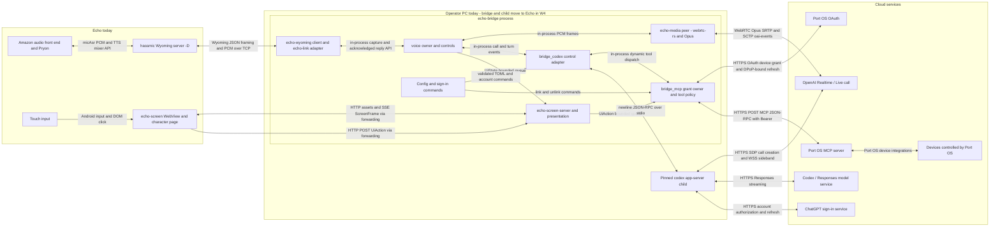

### hassmic

#### What it is — hassmic

hassmic is the Echo's local voice front end. It supplies wake detection, microphone capture and speaker
playback without moving those hardware responsibilities into our Rust bridge.

#### How it works — hassmic

The fork's `src/hassmic/main.c` runs the wake/listening/thinking/speaking state machine. Pryon loads the
firmware's `computer-en-US` model on the Echo. Once a client registers with `run-satellite`, a local wake
starts `run-pipeline` and 16 kHz, signed 16-bit mono `audio-chunk` capture. There is no microphone
`audio-start`; each chunk supplies its format. Reply input uses `audio-start`, chunks, then `audio-stop`;
`played` acknowledges completion. `-D` keeps capture streaming while replying and leaves speaking-time
wakes to the client. Ordinary reply completion ends the run; the custom `hassmic-continue` control can keep
capture in the same run when a client explicitly cuts playback.

In the pinned fork, `audio_mixer.c` opens `MIXER_REC_ASR` (`micAsr`, post-AEC/beamforming) and plays through
`MIXER_PLAY_TTS`, preserving Amazon's reference path. **`-D` enables duplex capture; it is not an AEC
implementation.** The [baselines](program/baselines.md#the-device) establish installed duplex operation and
local wake detection. They do not quantify residual echo or prove acoustic barge-in rejection. Host-file
audio tests substitute the device front end, so Amazon AEC effectiveness remains unverified here.

#### Language — hassmic

C, from the `portpowered/echo-dot-assist` fork; [hassmic.pin](../hassmic.pin) selects
`1ed455839983aa7ed50c52a11dd676db1853670c`. Amazon's mixer and Pryon libraries/models are firmware binaries.
The installed-device baseline records an older release; a pin change does not prove installation.

#### Responsibilities — hassmic

- Own local wake, microphone/speaker hardware, effective mute, keys and the light band.
- Serve Wyoming and report `hassmic-mute`; apply explicit playback/capture controls.
- It does not authenticate to OpenAI, run Codex turns or issue Port OS MCP calls.

#### Where it runs — hassmic

On the Echo, as the fork's service, today and in W4. The host counterpart used by tests is a different
audio backend, not an Echo emulator with working Pryon/AEC hardware.

#### Why we need it — hassmic

It reuses the firmware audio pipeline and wake engine. Keeping hardware in the upstream fork avoids
reimplementing Amazon's audio integration in echo-bridge.

### echo-bridge

#### What it is — echo-bridge

Our Rust executable coordinates a conversation, joins device audio to cloud media and owns tool effects.
Its libraries run inside the same process, rather than as one service per crate.

#### How it works — echo-bridge

[main.rs](../crates/echo-bridge/src/main.rs) routes operator commands or starts the Tokio runtime.
[bridge_runtime.rs](../crates/echo-bridge/src/bridge_runtime.rs) selects the configured Codex voice owner;
the retained simulator/Muse owner is separate. Config loading validates the nominated TOML before device
effects. [voice_runtime.rs](../crates/echo-bridge/src/bridge_voice/voice_runtime.rs) owns trace, screen and
health listeners around the entire authenticated device lifetime. [voice_host.rs](../crates/echo-bridge/src/bridge_voice/voice_host.rs)
authenticates the child before enabling Wyoming capture and probing readiness. MCP grant ownership is
opened next; catalog discovery happens on the first admitted call, not automatically as a boot-time link.

[voice_admission.rs](../crates/echo-bridge/src/bridge_voice/voice_admission.rs) waits for wakes, probes idle
connections and checks mute, kill and budget admission. A first wake creates a media peer and a call;
[voice_session.rs](../crates/echo-bridge/src/bridge_voice/voice_session.rs) retains that call between runs
until idle expiry. [bridge_voice.rs](../crates/echo-bridge/src/bridge_voice/bridge_voice.rs) concurrently
polls capture, control and PCM while pacing replies and waiting for `played`.
[bridge_codex](../crates/echo-bridge/src/bridge_codex/bridge_codex.rs) owns signaling and correlates tools;
[bridge_mcp](../crates/echo-bridge/src/bridge_mcp/bridge_mcp.rs) owns the Port OS grant. The tool policy
checks an exact allowlist, reserves durable effect keys and handles the existing approval/emotion paths.
View state is projected through one presentation owner; mute takes precedence over other activity.

#### Language — echo-bridge

Rust, ours, in [crates/echo-bridge](../crates/echo-bridge/src/lib.rs). Media code in `echo-media` is adapted
from pinned Codex `voice-host`, using webrtc/rtc 0.21.1, Opus and Rubato (see [ADR 0027](adr/0027-echo-media.md)).

#### Responsibilities — echo-bridge

- Own bounded audio queues, call/run lifetimes, media readiness, health, traces, screen and kill controls.
- Hold the Port OS grant and exclusive private Codex-home lease; execute admitted dynamic tools.
- Enforce configured tool-count/deadline/daily caps and correlate interruption with the delegated turn.
- It does not detect “Computer”, implement Amazon AEC or parse the native Live sideband delegation protocol.

#### Where it runs — echo-bridge

One PC process today, native Windows or Linux/WSL; pe-ci is the supported Linux test host. W4 targets the
Echo under its own user, with private credential storage and a child app server beside it. This move is
planned; it is not established by the current PC journeys.

#### Why we need it — echo-bridge

It keeps device playback, local policy and MCP effects under one owner. The app server already understands
OpenAI's changing protocols, while the bridge must retain control of home credentials and tool consent.

### Codex app server

#### What it is — Codex app server

OpenAI's pinned application server is the bridge's child process for account access, Live control and
delegated agent turns. It is distinct from both our `echo-codex` client library and the cloud model.

#### How it works — Codex app server

[echo-codex's supervisor](../crates/echo-codex/src/codex_supervisor/mod.rs) starts
`codex app-server --listen stdio://` with an exclusively leased external `CODEX_HOME` and empty working
directory. It exchanges newline-delimited JSON-RPC without a `jsonrpc` field: `initialize` enables the
experimental API, then `initialized` completes the handshake. Account commands use `account/read` and
`account/login/start`. A voice call starts an ephemeral `thread/start` with the bridge's `dynamicTools`,
then `thread/realtime/start` with a WebRTC SDP offer and explicit `version: v3`.

The child performs authenticated HTTPS call creation, returns `thread/realtime/sdp` and owns the cloud
sideband connection. Native `delegation.created` becomes a Codex turn. The child calls the model service,
sends `item/tool/call` requests to the bridge, receives their results and writes `delegation.context.append`
back to Live. The bridge sees JSON-RPC turn/transcript notifications, not those native delegation frames.
See [ADR 0026](adr/0026-codex-client.md) and the [source brief](spikes/codex-app-server.md); the release pin
overrides the brief's older main snapshot. The supervisor offers explicit restart; the configured voice
owner does not automatically restart failed sessions or replay work.

#### Language — Codex app server

Rust, pinned upstream `openai/codex`, release `rust-v0.160.0`, commit
`a956835d020762cb2b570053af06f643a11c0ecc`, selected by [codex.pin](../codex.pin). The PC uses a verified vendor
binary; the [ARM build](adr/0028-codex-armv7.md) carries authorized build patches for the W4 target.

#### Responsibilities — Codex app server

- Own ChatGPT sign-in storage/refresh, authenticated call creation, sideband and delegated model execution.
- Expose only bridge-supplied dynamic tools on ephemeral, read-only threads; built-in execution tools,
  environments and app-server MCP configuration are disabled by our thread/home settings.
- It does not capture the Echo mic, play its speaker or hold the Port OS grant. Its media peer is in the bridge.

#### Where it runs — Codex app server

A child beside echo-bridge on the PC today, connected by stdio, with its home outside the repository.
W4 starts the ARMv7 build as the bridge's child on the Echo and keeps that home private from the screen app.

#### Why we need it — Codex app server

It reuses the implementation that handles Live's V3 protocol and model delegation. Keeping it separate
lets us pin and supervise upstream without embedding its large dependency closure in our crates.

### Screen client and character UI

#### What it is — Screen client and character UI

`echo-screen` is an Android WebView hosting our screen page. The current page shows status, link prompts,
approval controls and emotion frames; the requested speaking character is being developed separately.

#### How it works — Screen client and character UI

The [Java Activity](../apps/echo-screen/src/org/portos/echoscreen/MainActivity.java)
retains the last valid page URL, uses immersive display and
retries initial page-load failures with capped backoff. [page.ts](../web/screen/src/page.ts) receives
`ScreenFrame` via EventSource/SSE and posts correlated `UiAction` JSON for touch or keyboard clicks.
Stale frames/actions are rejected. Current `speaking` renders a heading; it has no audio-driven mouth.
Emotion frames use the page's animation timer. Later SSE failures show “Screen connection interrupted”.

#### Language — Screen client and character UI

Our Java Android app and TypeScript/HTML/CSS page; Amazon provides the WebView runtime. See
[ADR 0023](adr/0023-echo-screen.md). No privileged JavaScript bridge exports credentials.

#### Responsibilities — Screen client and character UI

- Display bridge state and send touch intent, including approve/deny/relink/dismiss.
- It does not run wake detection, execute a tool or decide whether an action is authorized.

#### Where it runs — Screen client and character UI

The WebView is the Echo home app today and in W4; development browsers can load the same page on the PC.
Current loopback-only serving requires forwarding to reach the Echo. W4 makes serving local to the device.

#### Why we need it — Screen client and character UI

It presents the conversation and explicit consent without giving the renderer model or home credentials.
Keeping it separate from the bridge permits ordinary Android app lifecycle and browser testing.

### Screen server

#### What it is — Screen server

`echo-screen-server` serves the page and transports checked screen state/actions inside echo-bridge.

#### How it works — Screen server

[screen_core](../crates/echo-screen-server/src/screen_core.rs) keeps one current sequenced state;
[screen_http](../crates/echo-screen-server/src/screen_http.rs) handles assets, SSE and action POSTs.
Pairing-token admission, bounded connections/queues and publication acknowledgments protect the local
boundary. Reconnection sends the current snapshot. The bridge action owner applies consent and presentation
policy; server acknowledgment commits a snapshot, not proof the Echo rendered it.

#### Language — Screen server

Our Rust library, with Tokio/Hyper/Axum; [ADR 0016](adr/0016-screen-server.md) defines its loopback boundary.

#### Responsibilities — Screen server

- Serve assets and ordered state; admit authenticated action intents and revoke/close streams.
- It does not execute tools, implement the character or provide the planned paired LAN TLS transport.

#### Where it runs — Screen server

Tasks within the PC bridge process today; within the Echo bridge process in W4. It is not another daemon.

#### Why we need it — Screen server

It isolates HTTP connection and renderer transport lifetime from conversation and authorization policy.

### OpenAI Realtime / Live call

#### What it is — OpenAI Realtime / Live call

The cloud conversation service hears streamed audio and produces speech/transcripts. A retained call can
span multiple Echo wakes.

#### How it works — OpenAI Realtime / Live call

The app server creates the call with HTTPS SDP exchange and attaches its WSS sideband. The bridge's
[media peer](../crates/echo-media/src/media_peer.rs) sends/receives Opus over WebRTC SRTP after ICE/DTLS,
with an ordered `oai-events` SCTP channel. The pin defaults V3 to `gpt-live-1-codex` in
`codex-rs/core/src/realtime_conversation.rs`; plan section 3.3 instead names `gpt-live-1.1-codex`.
That is a source/plan discrepancy, not proof of the model a real provider resolves.
The app server forwards transcript notifications and handles native delegation. Local PCM conversion,
playout pacing and `played` receipt are outside the cloud call.

#### Language — OpenAI Realtime / Live call

Vendor cloud service; implementation language is not established by this repository. Our peer adapter is
Rust; the pinned app server implements the client protocol.

#### Responsibilities — OpenAI Realtime / Live call

- Own conversational speech generation and native delegation requests.
- It does not directly access Port OS credentials or prove when the Echo speaker finished playing.

#### Where it runs — OpenAI Realtime / Live call

OpenAI cloud today and in W4; only the bridge's media/control clients change host in W4.

#### Why we need it — OpenAI Realtime / Live call

It supplies realtime speech interaction. The separate delegated model handles longer tool work while Live
can provide filler or answer directly when the call context suffices.

### Codex / Responses model service

#### What it is — Codex / Responses model service

The cloud model used for the app server's delegated turns, distinct from the Live speech model.

#### How it works — Codex / Responses model service

The child sends Responses requests and consumes streamed model output. A dynamic-tool request is sent
back to the bridge and its correlated result continues that turn. Our
[codex_dispatch](../crates/echo-delegation/src/codex_dispatch.rs) validates matching thread/turn/tool IDs;
the model service itself is not implemented here. `codex.model`, falling back to `agent.model`, selects
the delegated model; omission uses the app-server default. The local-answer change supplies a single UTC
call-start date/time snapshot to both thread instructions and Live prompt, retained unchanged on reuse.

#### Language — Codex / Responses model service

Vendor cloud service, language unknown here; the consuming app server is pinned Rust upstream.

#### Responsibilities — Codex / Responses model service

- Produce delegated reasoning, tool requests and terminal response text.
- It does not grant consent, execute MCP itself or override bridge tool policy.

#### Where it runs — Codex / Responses model service

OpenAI cloud today and in W4; the app-server child remains its client.

#### Why we need it — Codex / Responses model service

It supports delegated tasks beyond Live's spoken interaction without moving home-control authority off
the bridge. Live can answer simple questions without starting such a turn.

### ChatGPT sign-in

#### What it is — ChatGPT sign-in

The account authorization service and the app server's local account client establish OpenAI access.
This is independent of linking Port OS.

#### How it works — ChatGPT sign-in

[signin_codex.rs](../crates/echo-signin/src/signin_codex.rs) requests `account/login/start` with
`chatgptDeviceCode` (or the explicit browser variant), presents the returned prompt and waits for matching
`account/login/completed`. Normal voice startup reads the nominated home's account; it does not silently
start interactive login. The app server stores/refreshes its auth file. API-key mode instead supplies the
explicitly nominated key through the same account RPC boundary. Retained `echo-chatgpt-auth` adapters are
legacy/Muse consumers, not a second sign-in owner in the configured Codex path.

#### Language — ChatGPT sign-in

Cloud vendor service with language unknown here; pinned Rust app-server client and our Rust command adapter.

#### Responsibilities — ChatGPT sign-in

- Establish/refresh OpenAI account access and report sign-in success or relink failure.
- It does not authorize Port OS MCP or give account credentials to the WebView.

#### Where it runs — ChatGPT sign-in

Cloud issuer plus private PC app-server home today; cloud issuer plus private Echo home in W4.
The operator approves through a browser; no browser is required for normal already-signed-in boot.

#### Why we need it — ChatGPT sign-in

It keeps upstream account lifecycle inside the app server while the bridge owns prompt presentation and
failure handling. Mixing it with Port OS OAuth would conflate two independent grants.

### Port OS MCP and OAuth

#### What it is — Port OS MCP and OAuth

Port OS exposes home tools through MCP and grants access through its authorization service.

#### How it works — Port OS MCP and OAuth

Our [echo-mcp-auth](../crates/echo-mcp-auth/src/lib.rs) discovers authorization metadata, explicitly links
with a device code, retains a private rotating grant and signs DPoP proofs for grant operations.
[echo-mcp-client](../crates/echo-mcp-client/src/lib.rs) initializes MCP, lists tools and issues stateless
POST-only `tools/call` using Bearer access. MCP requests carry no DPoP proof. The configured voice path uses
the first configured MCP server. Discovery does not grant permission: catalog mapping plus exact allowlist,
durable effect reservation and budget checks precede execution. Unauthorized calls latch relink rather than
retry effects. The generic approval implementation currently special-cases `test.requires_approval`; do not
infer universal confirmation of every Port OS control call.

#### Language — Port OS MCP and OAuth

Our clients/policy are Rust; Port OS is a separate service repository. Its implementation language and
individual device drivers are not established by this workspace.

#### Responsibilities — Port OS MCP and OAuth

- Port OS owns remote authorization enforcement, device catalog and control effects.
- The bridge owns its grant, local allowlist, consent policy and result correlation.
- The cloud model and app server do not receive the Port OS grant or open MCP connections.

#### Where it runs — Port OS MCP and OAuth

Cloud Port OS services and connected devices today and in W4; local clients/stores move with the bridge.

#### Why we need it — Port OS MCP and OAuth

It gives the assistant one authorized home-control API instead of per-device credentials and drivers in
the voice stack. The separate issuer permits unlinking the home without replacing OpenAI sign-in.

### Optional Muse profile

#### What it is — Optional Muse profile

An alternative delegated-task backend, selected explicitly instead of client/Codex tool execution.

#### How it works — Optional Muse profile

[bridge_muse](../crates/echo-bridge/src/bridge_muse/bridge_muse.rs) uses the retained bridge runtime.
The Unix [Muse service](../crates/echo-muse-bridge/src/service/mod.rs) admits authenticated HTTPS task
operations, owns a leased durable store and invokes `musegadget send-user-msg`. A private Unix callback
handler accepts the correlated `echo.report.result` command. Late/duplicate reports cannot grant consent.
See [plan section 7](program/plan.md#7-muse-a-wrapper-around-the-gadget-sdk) and
[ADR 0022](adr/0022-muse-service.md). It is not part of the default Codex sequence diagrams below.

#### Language — Optional Muse profile

Our Rust service and handler with an external Muse gadget CLI/SDK; the remote Muse implementation is external.

#### Responsibilities — Optional Muse profile

- Own task correlation, bounded polling/cancellation, durable reports and private callback admission.
- It does not receive the bridge's provider credentials or replace local consent with a task report.

#### Where it runs — Optional Muse profile

An opt-in Unix/Linux host beside the gadget service; the bridge remains its HTTPS client. W4 does not
require moving the Muse service to the Echo. Actual SDK/device integration remains a separate milestone.

#### Why we need it — Optional Muse profile

It provides the optional M7 backend without creating a second tool writer in the default client profile.

## Test-only lab and simulation

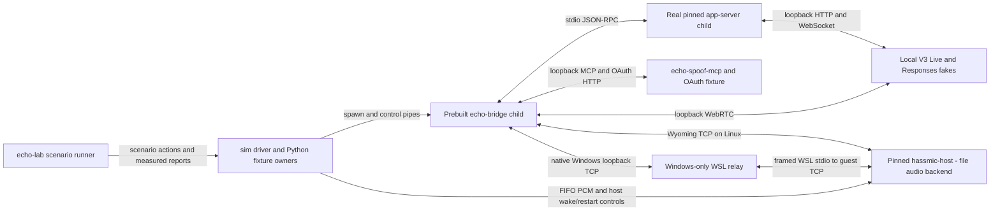

These are T3 local substitutes, not cloud or acoustic proof. `echo-lab` is our Rust CLI; sim also uses
Python owners. `hassmic-host` is the pinned fork's C file-audio build. On Linux it is reached directly;
native Windows tests use [wsl_relay.py](../scripts/wsl_relay.py) to reach the selected pe-ci guest, replacing
dead host connections when a restarted fixture is ready. The relay is test-only. Scripts consume prebuilt
artifacts; no Echo, Ring or real account is part of this documentation witness.

## Crate map

There are **21 directories in `crates/`** at the documented snapshot, one row each below. `xtask` is outside
that directory. These are linked libraries unless an executable is stated. Dependencies below are direct
production **workspace** edges from each `Cargo.toml`, not the third-party closure; `echo-` is omitted in
that column for space. PC-hosted product libraries move with their owner in W4. Historical APIs remaining
in a crate do not imply the configured voice owner calls them.

| Crate | Role and source/ADR | Execution location | Direct workspace dependencies |
| --- | --- | --- | --- |
| echo-agent-api | [Task/backend/tool traits](../crates/echo-agent-api/src/lib.rs), [0007](adr/0007-echo-agent-api.md) | In-process consumers; no runtime of its own | contracts |
| echo-agent-loop | [Retained Responses backend](../crates/echo-agent-loop/src/lib.rs), [0013](adr/0013-echo-agent-loop.md) | PC legacy/Muse/provider consumers; superseded for configured Codex voice | agent-api, contracts, config |
| echo-audio | [PCM conversion, Opus, queues/pacer](../crates/echo-audio/src/lib.rs), [0008](adr/0008-echo-audio.md) | Bridge host | contracts |
| echo-bridge | [Conversation executable and orchestration](../crates/echo-bridge/src/lib.rs), [0024](adr/0024-echo-bridge.md) | PC today; Echo W4 | codex, media, agent-api, link, agent-loop, delegation, mcp-client, mcp-auth, audio, config, contracts, live, screen-contract, screen-server, signin, wyoming |
| echo-chatgpt-auth | [Retained independent credential source](../crates/echo-chatgpt-auth/src/lib.rs), [0015](adr/0015-chatgpt-auth.md) | Legacy/Muse/sign-in adapters on bridge host | config, contracts |
| echo-codex | [App-server JSON-RPC client/supervisor](../crates/echo-codex/src/lib.rs), [0026](adr/0026-codex-client.md) | Bridge host; child itself is upstream, not this crate | contracts |
| echo-config | [Synchronous validated TOML](../crates/echo-config/src/lib.rs), [0005](adr/0005-echo-config.md) | Bridge and validation callers; offline | None |
| echo-contracts | [IDs, secret wrapper and wire vocabulary](../crates/echo-contracts/src/lib.rs), [0006](adr/0006-echo-contracts.md) | Shared in-process data; no transport | None |
| echo-delegation | [Codex dispatcher and retained legacy runner](../crates/echo-delegation/src/lib.rs), [0017](adr/0017-echo-delegation.md), [0026](adr/0026-codex-client.md) | Bridge host | agent-api, agent-loop, config, codex, contracts, mcp-client |
| echo-lab | [Scenario/probe/calibration CLI and fakes](../crates/echo-lab/src/main.rs), [0003](adr/0003-echo-lab-schema-validation.md), [0019](adr/0019-touch-calibration.md) | Workstation/CI; test-only in this diagram | contracts, codex, config, wyoming, screen-contract, spoof-mcp, live |
| echo-link | [Protocol-neutral capture/playback traits](../crates/echo-link/src/lib.rs), [0025](adr/0025-echo-link.md) | Bridge adapters; no process/runtime of its own | None |
| echo-live | [Retained encoded-Opus peer/provisional call API](../crates/echo-live/src/lib.rs), [0009](adr/0009-live-transport.md), [0011](adr/0011-live-call.md) | Legacy/Muse and local fake consumers; not configured Codex media | contracts |
| echo-mcp-auth | [Port OS device grant and rotating store](../crates/echo-mcp-auth/src/lib.rs), [0010](adr/0010-mcp-auth.md) | Bridge host | contracts |
| echo-mcp-client | [Stateless MCP ToolHost](../crates/echo-mcp-client/src/lib.rs), [0014](adr/0014-mcp-http.md) | Bridge host | agent-api, config, contracts |
| echo-media | [Frame-based WebRTC/Opus peer](../crates/echo-media/src/lib.rs), [0027](adr/0027-echo-media.md) | Bridge host | None |
| echo-muse-bridge | [Optional task core, Unix daemon/report binaries](../crates/echo-muse-bridge/src/lib.rs), [0020](adr/0020-muse-core.md), [0022](adr/0022-muse-service.md) | Separate Linux gadget host; optional | agent-api, contracts |
| echo-screen-contract | [UiState, ScreenFrame and UiAction](../crates/echo-screen-contract/src/lib.rs), [0004](adr/0004-screen-contract.md) | Bridge data boundary; schema consumed by page | None |
| echo-screen-server | [Loopback HTTP/SSE and actions](../crates/echo-screen-server/src/lib.rs), [0016](adr/0016-screen-server.md) | Within bridge process | contracts, screen-contract |
| echo-signin | [Writer-based commands and Codex account adapter](../crates/echo-signin/src/lib.rs), [0018](adr/0018-signin.md), [0026](adr/0026-codex-client.md) | Bridge/operator command process | codex, live, agent-loop, contracts, config, chatgpt-auth |
| echo-spoof-mcp | [Deterministic MCP library/executable](../crates/echo-spoof-mcp/src/lib.rs), [0014](adr/0014-mcp-http.md) | Local tests/CI | contracts |
| echo-wyoming | [Bounded duplex client and link adapter](../crates/echo-wyoming/src/lib.rs), [0012](adr/0012-echo-wyoming.md), [0025](adr/0025-echo-link.md) | Bridge host | link, contracts |

## Conversation sequences

Arrows labelled RPC, state or trace use code spellings. Other arrows describe operations rather than new
wire messages. PC participants are local to the bridge host; arrows to cloud participants cross the network.
Screen states are Rust names (`Listening`, `Speaking`); their JSON tags are lowercase.

### (a) Boot and readiness

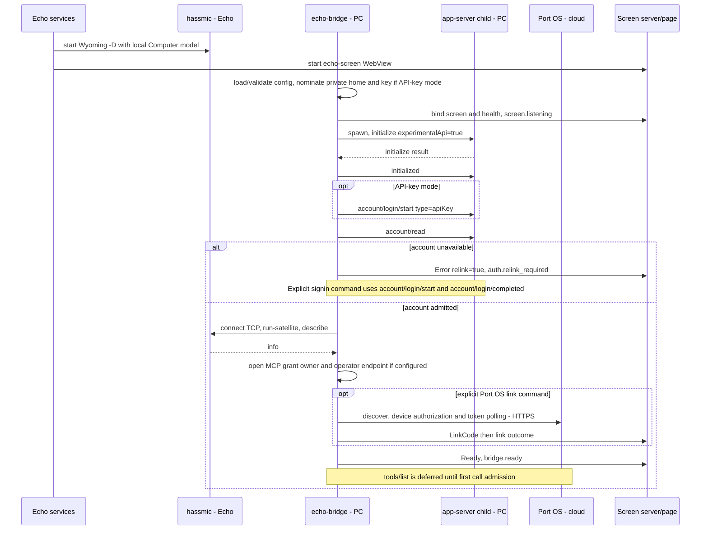

The screen binds before account admission. An auth failure keeps relink presentation available until
cancellation, without connecting Wyoming. Normal boot uses existing grants, not a fresh interactive login.
The app-server handshake is local; issuer/Port OS operations are cloud round trips when needed.

### (b) Wake word and activation

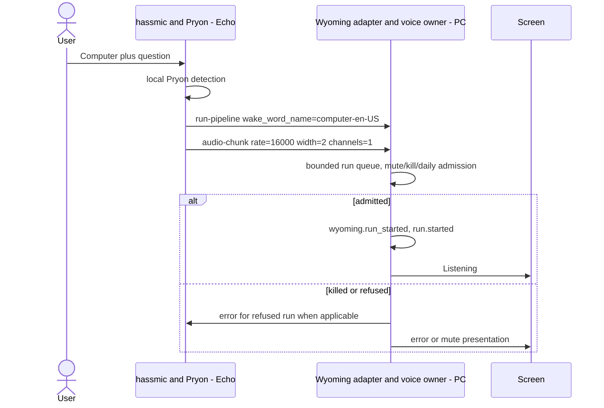

Capture includes hassmic's lead-in; no mic `audio-start` is inserted. `hassmic-mute` updates the bridge's
privacy gate. Local wake needs neither PC wake inference nor a cloud round trip. A bridge wake chime is
not drawn: `el-f-wake-earcon` is in progress; the installed baseline records no wake sound.

### (c) Call setup

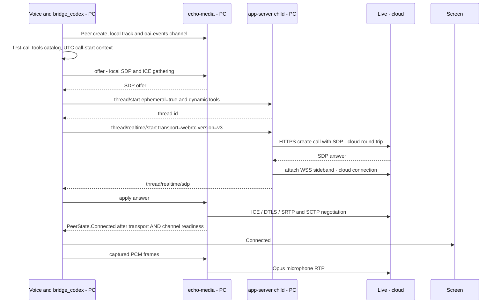

Call creation and actual media connectivity are different barriers. `Connected` is published only after
both signaling and media readiness; SDP success alone does not qualify. `thread/realtime/started` may
arrive during setup. Sideband attachment is app-server-owned and can overlap answer/media processing.
The new stage-trace presentation belongs to `el-f-call-setup-stages`; it is not assumed on this snapshot.

### (d) One question and answer

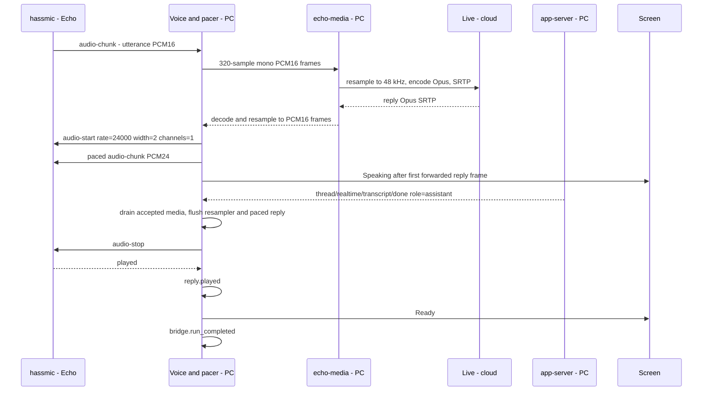

The playback operation may emit `audio-start` before reply PCM arrives. The pacer limits send lead using
`audio.reply_lead_ms`; transcript completion is not speaker completion. Success also requires microphone
EOF and the playback operation's `Played` result. Main shows a speaking heading and emotion frames, not
an audible-time mouth. `el-f-mouth-sync-audible-sim` PR 192 and antecedent PR 189 remain open.

### (e) Multi-turn

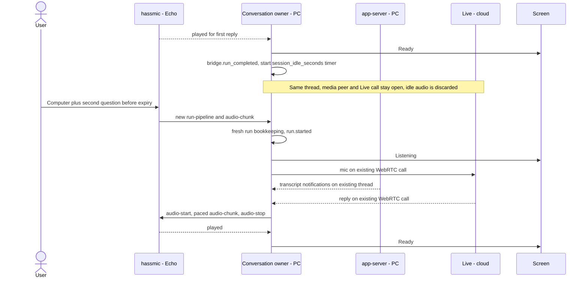

Ordinary reply completion ends the hassmic run, so the next question needs another wake. No second
`thread/start`, SDP negotiation or `Connected` publication occurs during reuse. The call-start UTC snapshot
from merged PR 191 remains unchanged; it is not a continually updating clock. Configured model selection
already exists; `el-f-voice-model-and-zone-config` is in progress for further model/zone behavior.

### (f) Barge-in: current limitation

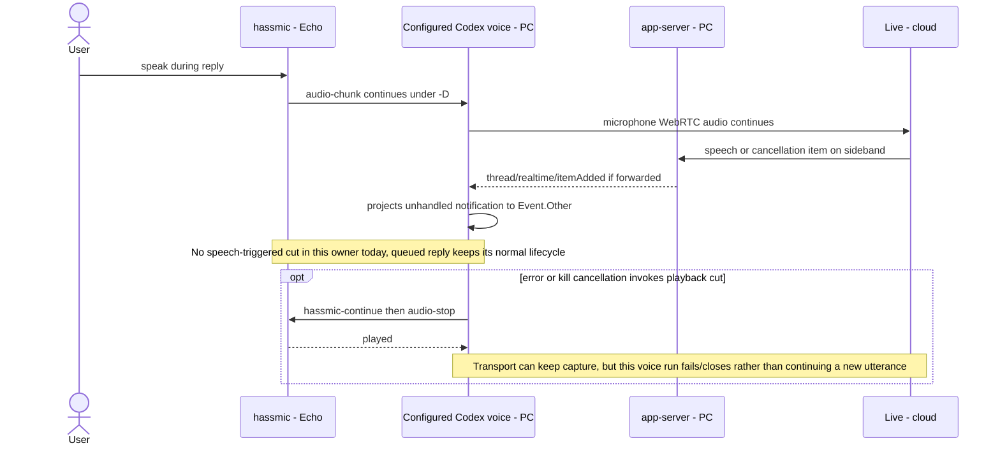

Live can stop producing audio, but the bridge does not currently translate its speech/cancellation item
into an immediate playback cut. A speaking-time wake under `-D` does not itself create another run.
The pinned fork and Wyoming cut API support continuing capture; that is insufficient to claim configured
end-to-end barge-in. `el-f-barge-in-keeps-run` owns that work. Legacy M3 sim behavior is not proof for this
owner. Historical [S2](spikes/s2-barge-in.md) measured an older pin's queue drain, not this newer control or
physical AEC performance.

### (g) Tools and delegated turns

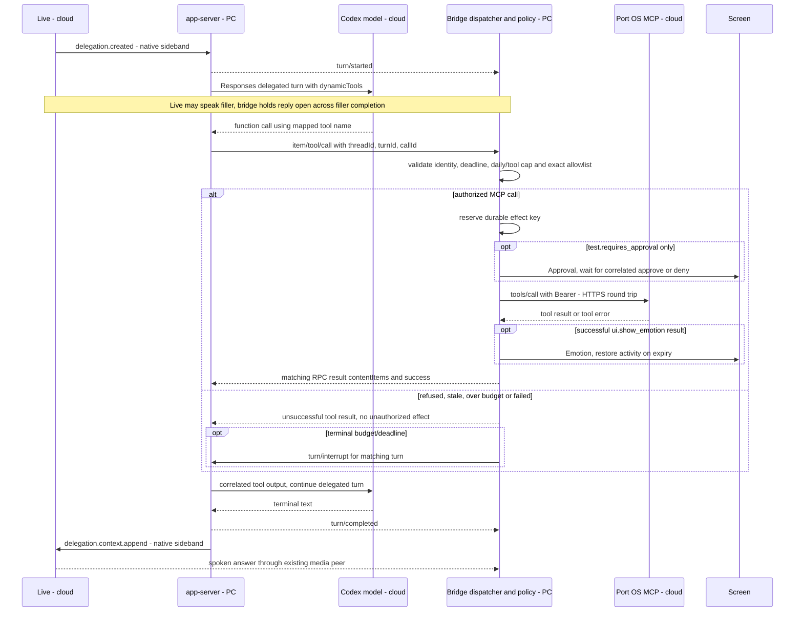

The bridge answers a dynamic-tool RPC locally, but the configured executable registers only the admitted
MCP catalog. There is no separate bridge-local “time” dynamic tool or direct Live function-tool execution
path on main. `ui.show_emotion` is an MCP result interpreted locally, not a second registered local model
tool. Direct local answers use prompt context. Port OS `control` can follow this path only when returned
by discovery and explicitly allowed; the fake's `test.echo` proves a substitute, not a real home effect.
The effect key is reserved **before** approval in actual policy code; a denial cannot replay that reservation.
Daily admission cannot prevent model routing that the pin has already started before `turn/started` is
observed. Filler is model audio, not a bridge-generated recording; the response deadline can abandon a late
delegated answer and finish the filler rather than claim a completed answer. An MCP error is returned to
the model; a spoken honest fallback depends on the model, not a locally synthesized guarantee.

### (h) Idle close and teardown

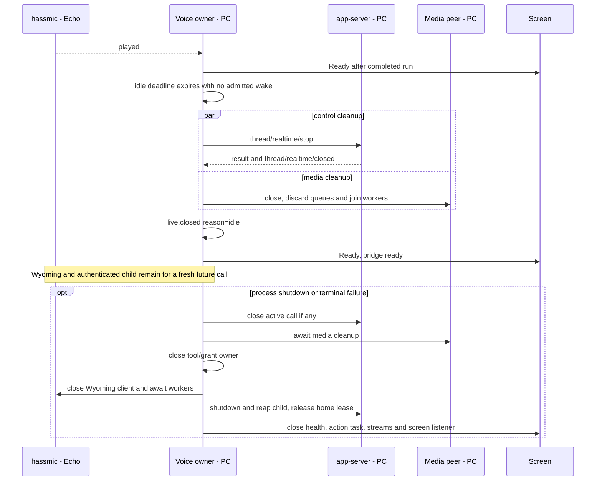

An idle call close is not process shutdown. Expiry wins at equality with a wake; muted wakes do not renew
the timer. The `live.closed` trace is a bridge projection after cleanup, not a cloud notification spelling.

### (i) Failure and recovery

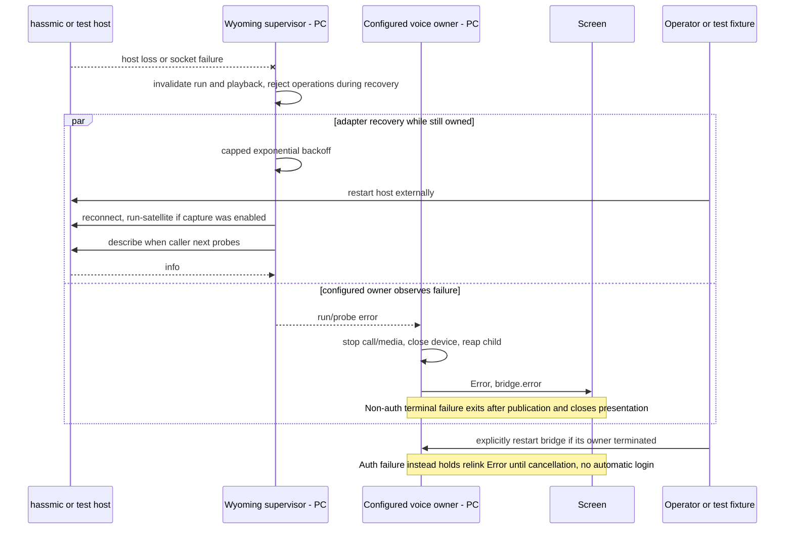

Transport reconnection does not guarantee recovery of an already failed configured conversation. A failed
idle probe or active run terminates this borrower; there is no automatic app-server restart or replay.
The lab restarts its pinned host/bridge as explicit scenario actions. Its Windows relay drops stale sockets
and switches guest generation on readiness; it is not a device recovery service. Open lane
`el-f-m1-host-restart-flake` PR 190 is investigating the host restart witness.
Provider `thread/realtime/error` becomes a terminal fixed error. Missing/invalid OpenAI auth displays relink;
MCP authorization failure has its own link overlay and grant owner. Mute may mask either until unmuted.
Main has **no local spoken recovery fallback** for these transport/auth failures. Non-auth errors can be
brief because the server closes after publication; the page then reports a lost connection. hassmic's own
error indicator is separate from the page and is not a promised spoken explanation.

## Where to look in the code

| Sequence | Main files |
| --- | --- |
| (a) Boot | [CLI](../crates/echo-bridge/src/main.rs), [voice lifetime](../crates/echo-bridge/src/bridge_voice/voice_runtime.rs), [device admission](../crates/echo-bridge/src/bridge_voice/voice_host.rs), [supervisor](../crates/echo-codex/src/codex_supervisor/mod.rs), [accounts](../crates/echo-signin/src/signin_codex.rs) |
| (b) Wake | [Wyoming routing](../crates/echo-wyoming/src/wyoming_route.rs), [admission](../crates/echo-bridge/src/bridge_voice/voice_admission.rs), [view](../crates/echo-bridge/src/bridge_voice/voice_view.rs), [captured-device baselines](program/baselines.md) |
| (c) Setup | [call RPC](../crates/echo-bridge/src/bridge_codex/bridge_codex.rs), [joint media owner](../crates/echo-bridge/src/bridge_codex/call_media.rs), [peer](../crates/echo-media/src/media_peer.rs), [signaling](../crates/echo-media/src/media_signal.rs) |
| (d) Reply | [voice loop](../crates/echo-bridge/src/bridge_voice/bridge_voice.rs), [source/filler state](../crates/echo-bridge/src/bridge_voice/voice_source.rs), [audio conversion/pacer](../crates/echo-bridge/src/bridge_codex/call_audio.rs), [Wyoming playback](../crates/echo-wyoming/src/wyoming_session.rs), [page](../web/screen/src/page.ts) |
| (e) Reuse | [session idle/run loop](../crates/echo-bridge/src/bridge_voice/voice_session.rs), [view](../crates/echo-bridge/src/bridge_voice/voice_view.rs), [call-start context](../crates/echo-bridge/src/bridge_voice/controls/voice_config.rs) |
| (f) Overlap | [notification projection](../crates/echo-bridge/src/bridge_codex/call_events.rs), [voice loop](../crates/echo-bridge/src/bridge_voice/bridge_voice.rs), [cut control](../crates/echo-wyoming/src/wyoming_session.rs), [legacy M3 wire](../crates/echo-lab/src/lab_run/sim/m3/wire.rs) |
| (g) Tools | [call tools](../crates/echo-bridge/src/bridge_codex/call_tools.rs), [catalog/lifetime](../crates/echo-bridge/src/bridge_voice/controls/voice_tools.rs), [policy](../crates/echo-bridge/src/bridge_voice/controls/tool_policy.rs), [dispatcher](../crates/echo-delegation/src/codex_dispatch.rs), [native test receipts](../crates/echo-lab/src/lab_run/sim/m4/codex/receipts.rs) |
| (h) Close | [session](../crates/echo-bridge/src/bridge_voice/voice_session.rs), [call stop](../crates/echo-bridge/src/bridge_codex/bridge_codex.rs), [media close](../crates/echo-bridge/src/bridge_codex/call_media.rs), [device cleanup](../crates/echo-bridge/src/bridge_voice/voice_host.rs) |
| (i) Recover | [reconnect](../crates/echo-wyoming/src/wyoming_session/wyoming_reconnect.rs), [idle probe owner](../crates/echo-bridge/src/bridge_voice/voice_admission.rs), [failure view](../crates/echo-bridge/src/bridge_voice/voice_view.rs), [lab host](../crates/echo-lab/src/lab_run/sim/host.py), [WSL relay](../scripts/wsl_relay.py) |
