# Architecture and conversation lifecycle

## Delegation trace payload boundary

Delegation diagnostics use the private bridge trace. The payload boundary for
`delegation.created`, retained `session.delegation.created`, `delegation.tool`
and `delegation.resolved` accepts observed task, request, response and answer
objects. `[trace] payloads` defaults to true; setting it false and restarting
removes these fields and retains lifecycle metadata. It is base configuration,
not a screen settings overlay; remove the table before rolling back to an older binary.

Credentials, authorization values, account and installation identifiers are
redacted recursively, including JSON nested in tool text. Bearer and JWT-shaped
credentials in text are replaced by `[redacted]`. Each object is measured after
redaction and capped at 65536 compact JSON bytes. A larger object is replaced by
`{"truncated":true,"original_bytes":N}` with the exact redacted pre-cap size;
there is no raw preview. A delegation row permits at most two such objects plus
the existing 4096-byte metadata envelope. Unrelated trace rows retain their
4096-byte rejection limit and private file ownership.

The native path can observe a handoff request and a final agent answer, but the
fixed app-server pin exposes no native send receipt. Its handback must remain
`unobserved` even after a completed agent item and turn. A real-pin local-provider
test may observe exact append identity and content only for its own run. Retained
`submitted` or `failed` describes the local append boundary, never remote acknowledgement.

The retained Muse owner now enriches its existing `session.delegation.created`
row with the observed task event and writes one `delegation.resolved` row. The
terminal outcome is `completed`, `failed`, `timed_out` or `cancelled`; fixed
failure classes distinguish submission, task, worker and local append failures.
`duration_ms` measures the owner's monotonic lifetime. Muse cannot observe the
remote agent's individual tool calls, so its `tool_counts` is empty. Unknown
thread and turn IDs are omitted. An observed prepared answer is included when
payloads are enabled; it remains the same text passed to the local append.
Normal abandonment joins cancellation and closes the trace lifetime; owner drop
attempts a cancelled resolution without replacing the original runtime error.
The native single reader records each observed `handoff_request` as
`delegation.created`, with its task and the run active at creation. Observed
turn completion, failure or interruption closes matching delegations once;
an observed deadline takes precedence over the interrupt it triggers. A run's
response expiry (`Deadline` or `NoResponse`) is also `timed_out` when existing
run cleanup closes a delegation before its own timer fires. This does not add
an interrupt or change either deadline. Requested realtime closure and owner
abandonment cancel outstanding lifetimes. An unsolicited active-call closure
instead fails with `realtime_closed`. Control, child EOF and media failures use
fixed failure classes. Final agent-item text may populate
`answer`, but never changes `handback=unobserved`. Duplicate handoffs and terminal
notifications cannot produce additional lifetimes or resolutions.
The native observer also writes `delegation.tool` for observed search, catalogued
dynamic tools, MCP, command and function completions. Catalogued notes/prompt
tools have kind `agent`; session controls have kind `home`. Function outputs
retain their reported namespace/name, with catalog aliases recovered when
applicable. Native execution/wait/input and clock wrappers do not add rows.
MCP server identity comes from the reported item or the configured single MCP
host for dynamic tool results. A correlated request arriving after handoff but
before `turn/started` supplies its observed turn identity and start time. Reported durations
are preferred, otherwise a matching observed start supplies monotonic duration;
missing starts do not imply zero duration. Search result counts are included only
when the item reports results. RPC results and item completion for the same turn
and item share one receipt and count. Wrappers do not imply nested tool calls.
Native counts describe emitted rows, not an assertion that no other tool ran.
The retained Client observes the existing runner through default no-op
`TraceSink::task_terminal` and `TraceSink::tool_completed` callbacks, implemented
only by its bridge sink. Existing trace events, tool results/errors and prepared
commentary are unchanged for other sinks. Its creation records the task; each
completed MCP invocation records original name, configured server, arguments,
result or error and monotonic duration. Failed transport and `is_error` results
are `failed`; a dispatch denial is `declined`. Counts describe observed completed
invocations, including failures. Thread/turn/item IDs unavailable to this legacy
runner are omitted. An actual completed task is `completed` regardless of its
answer text. Failed tasks are `failed`, with the runner's fixed `task timed out`
failure category recorded as `timed_out`. Abandonment closes the lifetime without
appending commentary; replaced workers receive a fresh observer generation.
Local append failure is `handback=failed`; success is only `submitted`.
Controlled configured-owner tests cover native managed exits, actual interrupt
acknowledgement, response expiry, duplicate/late events and isolated owners,
turns and generations. Real-peer configured journeys compare the diagnostic
rows against exact independently observed native append identity/content and
zero interrupted append. That test observer adds no production delivery receipt.
The lifetime guarantee applies to observed managed exits and successful trace
writes; abrupt process termination and filesystem failure cannot promise a row.

## Purpose and placement

This page explains the running parts and follows a conversation across them. It describes main at
`a019e053234d2dd316c2233ae7cf241aad9a49df`, rather than the older design drafts or unmerged branches.
The [program plan, sections 1–3](program/plan.md#1-what-we-are-building),
[section 6](program/plan.md#6-the-bridge-what-it-runs-and-where) and
[W4](program/plan.md#12-phase-order-after-m0) define placement: **the Echo detects “Computer” locally**,
captures microphones and plays replies through hassmic; its screen app displays the bridge's page.
Today echo-bridge and its pinned Codex app-server child run on the operator's Linux host. OpenAI hosts Live and the
delegated model; Port OS hosts home control and its authorization
service. The [2026-11-16 decisions](program/decisions.md#decided) select the app server and permit credentials
on the Echo. W4 moves the bridge, media peer, child process and private stores onto the Echo; the PC remains
the development/bench host. A cross-built artifact alone does not establish that device deployment.

## Components and connections

Solid links describe implemented protocols. The screen link is a logical relationship: the current server
accepts **loopback HTTP only**. Remote Echo access needs operator-provided forwarding; paired LAN TLS in
plan section 6 remains a target. Wyoming is plaintext, unauthenticated TCP on the local network today;
the fork's source restriction protects admission, not encryption. W4 makes that link local to the Echo.

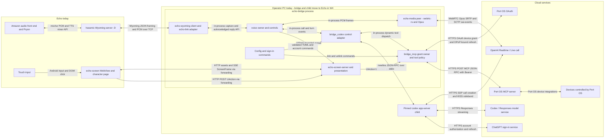

### hassmic

#### What it is — hassmic

hassmic is the Echo's local voice front end. It supplies wake detection, microphone capture and speaker
playback without moving those hardware responsibilities into our Rust bridge.

#### How it works — hassmic

The fork's `src/hassmic/main.c` runs the wake/listening/thinking/speaking state machine. Pryon loads the
firmware's `computer-en-US` model on the Echo. Once a client registers with `run-satellite`, a local wake
starts `run-pipeline` and 16 kHz, signed 16-bit mono `audio-chunk` capture. There is no microphone
`audio-start`; each chunk supplies its format. Reply input uses `audio-start`, chunks, then `audio-stop`;
`played` acknowledges completion. `-D` keeps capture streaming while replying and leaves speaking-time
wakes to the client. Ordinary reply completion ends the run; the custom `hassmic-continue` control can keep
capture in the same run when a client explicitly cuts playback.

In the pinned fork, `audio_mixer.c` opens `MIXER_REC_ASR` (`micAsr`, post-AEC/beamforming) and plays through
`MIXER_PLAY_TTS`, preserving Amazon's reference path. **`-D` enables duplex capture; it is not an AEC
implementation.** The [baselines](program/baselines.md#the-device) establish installed duplex operation and
local wake detection. They do not quantify residual echo or prove acoustic barge-in rejection. Host-file
audio tests substitute the device front end, so Amazon AEC effectiveness remains unverified here.

#### Language — hassmic

C, from the `portpowered/echo-dot-assist` fork; [hassmic.pin](../hassmic.pin) selects
`1e9a0c3d3d637fcb54759a26bdecea3299fc5ee5`. Amazon's mixer and Pryon libraries/models are firmware binaries.
The installed-device baseline records an older release; a pin change does not prove installation.

#### Responsibilities — hassmic

- Own local wake, microphone/speaker hardware, effective mute, keys and the light band.
- Serve Wyoming and report `hassmic-mute`; apply explicit playback/capture controls.
- It does not authenticate to OpenAI, run Codex turns or issue Port OS MCP calls.

#### Where it runs — hassmic

On the Echo, as the fork's service, today and in W4. The host counterpart used by tests is a different
audio backend, not an Echo emulator with working Pryon/AEC hardware.

#### Why we need it — hassmic

It reuses the firmware audio pipeline and wake engine. Keeping hardware in the upstream fork avoids
reimplementing Amazon's audio integration in echo-bridge.

### echo-bridge

#### What it is — echo-bridge

Our Rust executable coordinates a conversation, joins device audio to cloud media and owns tool effects.
Its libraries run inside the same process, rather than as one service per crate.

#### How it works — echo-bridge

[main.rs](../crates/echo-bridge/src/main.rs) routes operator commands or starts the Tokio runtime.
[bridge_runtime.rs](../crates/echo-bridge/src/bridge_runtime.rs) selects the configured Codex voice owner;
the retained simulator/Muse owner is separate. Config loading validates the nominated TOML before device
effects. [voice_runtime.rs](../crates/echo-bridge/src/bridge_voice/voice_runtime.rs) owns trace, screen and
health listeners around the whole process lifetime and supervises one voice generation after another
([voice_recovery.rs](../crates/echo-bridge/src/bridge_voice/recovery/voice_recovery.rs)): a generation is one
app-server child with its sign-in, tools and calls, and a failed one is replaced after a bounded backoff
(sequence (i)). [retained_link.rs](../crates/echo-bridge/src/bridge_voice/recovery/retained_link.rs) keeps the
device connection across generations. [voice_host.rs](../crates/echo-bridge/src/bridge_voice/voice_host.rs)
authenticates the child before enabling Wyoming capture and probing readiness. MCP grant ownership is
opened next; catalog discovery happens on the first admitted call, not automatically as a boot-time link.

[voice_admission.rs](../crates/echo-bridge/src/bridge_voice/voice_admission.rs) waits for wakes, probes idle
connections and checks mute, kill and budget admission. A first wake creates a media peer and a call;
[voice_session.rs](../crates/echo-bridge/src/bridge_voice/voice_session.rs) retains that call between runs
until idle expiry. [bridge_voice.rs](../crates/echo-bridge/src/bridge_voice/bridge_voice.rs) concurrently
polls capture, control and PCM while pacing replies and waiting for `played`.
[bridge_codex](../crates/echo-bridge/src/bridge_codex/bridge_codex.rs) owns signaling and correlates tools;
[bridge_mcp](../crates/echo-bridge/src/bridge_mcp/bridge_mcp.rs) owns the Port OS grant. The tool policy
checks an exact allowlist, reserves durable effect keys and handles the existing approval/emotion paths.
View state is projected through one presentation owner; mute takes precedence over other activity.

#### Language — echo-bridge

Rust, ours, in [crates/echo-bridge](../crates/echo-bridge/src/lib.rs). Media code in `echo-media` is adapted
from pinned Codex `voice-host`, using webrtc/rtc 0.21.1, Opus and Rubato (see [ADR 0027](adr/0027-echo-media.md)).

#### Responsibilities — echo-bridge

- Own bounded audio queues, call/run lifetimes, media readiness, health, traces, screen and kill controls.
- Hold the Port OS grant and exclusive private Codex-home lease; execute admitted dynamic tools.
- Enforce configured tool-count/deadline/daily caps and correlate interruption with the delegated turn.
- It does not detect “Computer”, implement Amazon AEC or parse the native Live sideband delegation protocol.

#### Where it runs — echo-bridge

One Linux PC process today; pe-ci is the supported local Linux test host. W4 targets the
Echo under its own user, with private credential storage and a child app server beside it. This move is
planned; it is not established by the current PC journeys.

#### Launch contract on the Echo — echo-bridge

On the Echo the operator uses `scripts/echo-install.sh` to install and start the bridge. The contract combines
the 2026-11-18 lifecycle and 2026-11-19 identity measurements ([baselines](program/baselines.md));
actual bridge/child identity after migration remains coordinator T5 proof.
[examples/bridge.echo.toml](../examples/bridge.echo.toml) supplies the base configuration; for the installer,
set `codex.binary` and `codex.ca_file` under `bin/` as its help requires.

1. **Run as existing Android nobody (uid 9999), with groups 3990 and `inet`**:
   `/data/local/hassmic/runas nobody 3990,inet`. The inherited Codex child uses the same identity.
   hassmic's firewall admits its egress group, gid 3990; omitting it blocks provider TCP. Root only prepares
   fixed paths and drops privilege before any writable launch script executes. No custom uid, SELinux or
   firewall changes. Nobody is shared and is not a separate child sandbox.
2. **Start the bridge in its own session** (`setsid`). A bridge left in an adb session's process group received
   SIGTERM about 17 s after launch.
3. **Hold the bridge's stdin open.** End of input on stdin is the bridge's clean-stop request
   ([bridge_runtime.rs](../crates/echo-bridge/src/bridge_runtime.rs)), so `</dev/null` stops it at once. Give it
   the read end of a FIFO whose write end the script keeps open; closing that write end is the clean stop. Once
   ready, the bridge does not exit on a failure: it recovers inside the process (sequence (i)) and no longer
   relies on a restart. It still exits non-zero on the kill path and on a configuration or credential it cannot
   use at startup, and a script may restart it after those or after a crash.
4. **Give it private/ and home/**, both owned by 9999:9999, mode 0700, data files 0600.
   The installer migrates stopped root-owned descendants without replacing retained data and rejects links
   and unsupported entries. It regenerates `private/launch.sh` (0700) on install/start; repeated migration
   needs no corrective changes. Base/bin stay root-owned 0755, binaries 0755 and CA 0644.
   Non-secret prompts and future notes/settings/screen packs belong in home/. `codex.home`, `audit.log_dir`, the
   trace, `live.credential_file` and `screen.pairing_token_file` sit inside private/; `codex.binary` and `codex.ca_file`
   may sit outside. The bridge creates its audit directory, kill marker, tool ledger and trace with modes 0700 and
   0600 whatever the umask (`adb shell` runs with umask 000), and creates the Codex home with mode 0700 and refuses
   one whose mode differs. It does not change the mode of anything that already exists, and it does not create the
   files the script redirects its output to, so the script still sets `umask 077`.
5. **Pass `--config` and `--trace`**, both inside the private directory. Health stays on `127.0.0.1:16901`.
6. **Observe the process user** with installer `status` (`process_user=nobody`). Running root/0 or
   unverifiable identity fails. Stop and reinstall before starting a root legacy installation.
7. **Name the standalone app server in the configuration**: `codex.launch = "standalone"` with `codex.binary`,
   because the armv7 build takes no `app-server` subcommand, and `codex.ca_file`, because the child starts with a
   cleared environment and finds no certificate bundle on the device. No wrapper script is needed for either.
8. **After a reboot the hassmic fork's satellite service starts the installed bridge** (owner decision 2026-11-19,
   [decisions](program/decisions.md)). The fork's `scripts/device/bridge.sh`, started by its `main.sh satellite`,
   uses this same launch: `private/launch.sh` as nobody with groups 3990 and `inet`, in its own session, with the
   installer's `private/run/` gate, FIFO and `stop`/`finished` markers. It starts only where the installer left
   `private/launch.sh` and `private/bridge.toml`, and refuses links and wrong owners as the installer does. It
   waits for the network before a start (a resolver known, then 10 s; fork PR 8), because a bridge started before
   DHCP is done cannot authenticate and stays in `relink_required` until it is started again. It
   starts the bridge again after an exit nobody asked for, waiting 3 s and doubling to 5 min while the bridge keeps
   exiting within a minute. A bridge stopped with installer `stop` stays stopped until installer `start`, the
   fork's `bridge.sh start` or a reboot; `uninstall` removes the launcher and with it the boot start. No init
   service, `.rc`, partition, SELinux or firewall change: the supervisor rides hassmic's existing service.

#### Why we need it — echo-bridge

It keeps device playback, local policy and MCP effects under one owner. The app server already understands
OpenAI's changing protocols, while the bridge must retain control of home credentials and tool consent.

### Codex app server

#### What it is — Codex app server

OpenAI's pinned application server is the bridge's child process for account access, Live control and
delegated agent turns. It is distinct from both our `echo-codex` client library and the cloud model.

#### How it works — Codex app server

[echo-codex's supervisor](../crates/echo-codex/src/codex_supervisor/mod.rs) starts
`codex app-server --listen stdio://` (or, with `codex.launch = "standalone"`, the named binary with
`--listen stdio://` alone) with an exclusively leased external `CODEX_HOME` and empty working
directory. It exchanges newline-delimited JSON-RPC without a `jsonrpc` field: `initialize` enables the
experimental API, then `initialized` completes the handshake. Account commands use `account/read` and
`account/login/start`. A voice call starts an ephemeral `thread/start` with the bridge's `dynamicTools`,
then `thread/realtime/start` with a WebRTC SDP offer and explicit `version: v3`.

The child performs authenticated HTTPS call creation, returns `thread/realtime/sdp` and owns the cloud
sideband connection. Native `delegation.created` becomes a Codex turn. The child calls the model service,
sends `item/tool/call` requests to the bridge, receives their results and writes `delegation.context.append`
back to Live. The bridge sees JSON-RPC turn/transcript notifications, not those native delegation frames.
See [ADR 0026](adr/0026-codex-client.md) and the [source brief](spikes/codex-app-server.md); the release pin
overrides the brief's older main snapshot. When the child exits or a call fails, the configured voice owner
starts a fresh child after a backoff (sequence (i)); it does not replay the failed turn.

#### Language — Codex app server

Rust, pinned upstream `openai/codex`, release `rust-v0.160.0`, commit
`a956835d020762cb2b570053af06f643a11c0ecc`, selected by [codex.pin](../codex.pin). The PC uses a verified vendor
binary; the [ARM build](adr/0028-codex-armv7.md) carries authorized build patches for the W4 target.

#### Responsibilities — Codex app server

- Own ChatGPT sign-in storage/refresh, authenticated call creation, sideband and delegated model execution.
- Expose only bridge-supplied dynamic tools on ephemeral, read-only threads; built-in execution tools,
  environments and app-server MCP configuration are disabled by our thread/home settings. Provider-backed read-only
  web search is the sole exception, selected by `[codex] web_search`.
- It does not capture the Echo mic, play its speaker or hold the Port OS grant. Its media peer is in the bridge.

#### Configuration — Codex app server

`[codex] web_search` accepts exactly `"live"`, `"cached"` or `"disabled"`. Omitting the table or key
selects `"live"`. Live search allows external web access; cached search sets provider
`external_web_access` to false in both search forms; disabled omits search. The pin's `indexed` value
is not exposed. Conventional models receive one hosted `web_search` declaration. Responses Lite models,
including `gpt-6.1-sol`, receive the pin's standalone `web.run` extension instead, using the authenticated
provider search API. Neither form adds local fetch, process, browser or file authority.
The complete bridge dynamic catalog and nested `exec` callables remain unchanged; native direct tools
add exactly `web.run` when enabled. Every other built-in effect stays disabled and `mcp_servers` stays `{}`.
Thread settings and local overrides set `features.code_mode.direct_only_tool_namespaces=["web"]` so search
remains direct. The local-fake provider opts into `supports_standalone_web_search` to reproduce
production support.

Invalid types or values stop startup with exit 2, empty stdout and exactly
`echo-bridge: codex.web_search: invalid type or value` on stderr followed by a newline, before child,
home, trace or listener effects. The supplied value is never echoed. Both thread settings and local-fake
child overrides receive the selected mode. Restart the bridge after changing it. To roll back search,
set `web_search = "disabled"` and restart. Remove the key before restoring an older bridge binary,
which always disables search. No credential, notes or ledger migration is needed; no query/result logging
is added. Real provider execution and spoken source attribution remain operator T5 evidence.

#### Where it runs — Codex app server

A child beside echo-bridge on the PC today, connected by stdio, with its home outside the repository.
W4 starts the ARMv7 build as the bridge's child on the Echo and keeps that home private from the screen app.

#### Why we need it — Codex app server

It reuses the implementation that handles Live's V3 protocol and model delegation. Keeping it separate
lets us pin and supervise upstream without embedding its large dependency closure in our crates.

### Screen client and character UI

#### What it is — Screen client and character UI

`echo-screen` is an Android WebView hosting our screen page. The current page shows status, link prompts,
approval controls and emotion frames; the requested speaking character is being developed separately.

#### How it works — Screen client and character UI

The [Java Activity](../apps/echo-screen/src/org/portos/echoscreen/MainActivity.java)
retains the last valid page URL, uses immersive display and
retries initial page-load failures with capped backoff. [page.ts](../web/screen/src/page.ts) receives
`ScreenFrame` via EventSource/SSE and posts correlated `UiAction` JSON for touch or keyboard clicks.
Stale frames/actions are rejected. Current `speaking` renders a heading; it has no audio-driven mouth.
Emotion frames use the page's animation timer. Later SSE failures show “Screen connection interrupted”.

#### Language — Screen client and character UI

Our Java Android app and TypeScript/HTML/CSS page; Amazon provides the WebView runtime. See
[ADR 0023](adr/0023-echo-screen.md). No privileged JavaScript bridge exports credentials.

#### Responsibilities — Screen client and character UI

- Display bridge state and send touch intent, including approve/deny/relink/dismiss.
- It does not run wake detection, execute a tool or decide whether an action is authorized.

#### Where it runs — Screen client and character UI

The WebView is the Echo home app today and in W4; development browsers can load the same page on the PC.
Current loopback-only serving requires forwarding to reach the Echo. W4 makes serving local to the device.

#### Why we need it — Screen client and character UI

It presents the conversation and explicit consent without giving the renderer model or home credentials.
Keeping it separate from the bridge permits ordinary Android app lifecycle and browser testing.

### Screen server

#### What it is — Screen server

`echo-screen-server` serves the page and transports checked screen state/actions inside echo-bridge.

#### How it works — Screen server

[screen_core](../crates/echo-screen-server/src/screen_core.rs) keeps one current sequenced state;
[screen_http](../crates/echo-screen-server/src/screen_http.rs) handles assets, SSE and action POSTs.
Pairing-token admission, bounded connections/queues and publication acknowledgments protect the local
boundary. Reconnection sends the current snapshot. The bridge action owner applies consent and presentation
policy; server acknowledgment commits a snapshot, not proof the Echo rendered it.

#### Language — Screen server

Our Rust library, with Tokio/Hyper/Axum; [ADR 0016](adr/0016-screen-server.md) defines its loopback boundary.

#### Responsibilities — Screen server

- Serve assets and ordered state; admit authenticated action intents and revoke/close streams.
- It does not execute tools, implement the character or provide the planned paired LAN TLS transport.

#### Where it runs — Screen server

Tasks within the PC bridge process today; within the Echo bridge process in W4. It is not another daemon.

#### Why we need it — Screen server

It isolates HTTP connection and renderer transport lifetime from conversation and authorization policy.

### OpenAI Realtime / Live call

#### What it is — OpenAI Realtime / Live call

The cloud conversation service hears streamed audio and produces speech/transcripts. A retained call can
span multiple Echo wakes.

#### How it works — OpenAI Realtime / Live call

The app server creates the call with HTTPS SDP exchange and attaches its WSS sideband. The bridge's
[media peer](../crates/echo-media/src/media_peer.rs) sends/receives Opus over WebRTC SRTP after ICE/DTLS,
with an ordered `oai-events` SCTP channel. The pin defaults V3 to `gpt-live-1-codex` in
`codex-rs/core/src/realtime_conversation.rs`; plan section 3.3 instead names `gpt-live-1.1-codex`.
That is a source/plan discrepancy, not proof of the model a real provider resolves.
The app server forwards transcript notifications and handles native delegation. Local PCM conversion,
playout pacing and `played` receipt are outside the cloud call.

#### Language — OpenAI Realtime / Live call

Vendor cloud service; implementation language is not established by this repository. Our peer adapter is
Rust; the pinned app server implements the client protocol.

#### Responsibilities — OpenAI Realtime / Live call

- Own conversational speech generation and native delegation requests.
- It does not directly access Port OS credentials or prove when the Echo speaker finished playing.

#### Where it runs — OpenAI Realtime / Live call

OpenAI cloud today and in W4; only the bridge's media/control clients change host in W4.

#### Why we need it — OpenAI Realtime / Live call

It supplies realtime speech interaction. The separate delegated model handles longer tool work while Live
can provide filler or answer directly when the call context suffices.

### Codex / Responses model service

#### What it is — Codex / Responses model service

The cloud model used for the app server's delegated turns, distinct from the Live speech model.

#### How it works — Codex / Responses model service

The child sends Responses requests and consumes streamed model output. A dynamic-tool request is sent
back to the bridge and its correlated result continues that turn. Our
[codex_dispatch](../crates/echo-delegation/src/codex_dispatch.rs) validates matching thread/turn/tool IDs;
the model service itself is not implemented here. `codex.model`, falling back to `agent.model`, selects
the delegated model; omission uses the app-server default. The local-answer change supplies a single UTC
call-start date/time snapshot to both thread instructions and Live prompt, retained unchanged on reuse.
The two texts are separate files in the optional agent home: `<home>/prompts/runner.md` is
thread/start's base instructions; `<home>/prompts/voice.md` is the Live prompt, whose unchanged default
makes conversation the rule and a hand-off the exception. A new call and its delegated thread reload both
files; retained calls keep their original snapshot and text. Edits require no bridge restart.

Configure `[home] dir` with an absolute path (no tilde or environment expansion). On the Echo use
`/data/local/echo-bridge/home`, separate from `/data/local/echo-bridge/private`, which still holds secrets.
The bridge creates missing home/prompts directories with mode 0700 and preserves existing modes.
The bridge user needs only search permission on the home's ancestors, as a non-root user has under `/data`;
it owns and reads only the `prompts/` and `notes/` directories.
Copy `examples/prompts/voice.md` and `runner.md` into the home's `prompts/` directory, then edit them.
Omitting `[home]` intentionally selects built-ins without file access. A missing configured prompt uses
its built-in default and emits one payload-free `prompt.defaulted` per kind per runtime lifetime.

Files must be nonblank UTF-8 and at most 32768 bytes. Empty, oversized, invalid UTF-8, unreadable or
nonregular files fail startup before credentials, child or device admission, with the logical filename
in the error. An invalid edit on reload emits `prompt.reload_refused` with a fixed kind/reason and keeps
that kind's previous accepted text; the other prompt can still reload. Deletion selects the default.
Prompt text and full paths never enter these trace records. The bridge never writes prompt files.
`<home>/settings.toml` is reserved for the screen-settings lane; prompt loading never reads or writes it.

Migration: remove `codex.instructions` and `codex.live_instructions` from TOML and save their values as
`prompts/runner.md` and `prompts/voice.md` respectively. Either old key is refused with the replacement
filename, regardless of its value. To roll back, restore the previous binary and its inline config
values together, removing `[home]`; keep the prompt files for a future upgrade.

#### Language — Codex / Responses model service

Vendor cloud service, language unknown here; the consuming app server is pinned Rust upstream.

#### Responsibilities — Codex / Responses model service

- Produce delegated reasoning, tool requests and terminal response text.
- It does not grant consent, execute MCP itself or override bridge tool policy.

#### Where it runs — Codex / Responses model service

OpenAI cloud today and in W4; the app-server child remains its client.

#### Why we need it — Codex / Responses model service

It supports delegated tasks beyond Live's spoken interaction without moving home-control authority off
the bridge. Live can answer simple questions without starting such a turn.

### ChatGPT sign-in

#### What it is — ChatGPT sign-in

The account authorization service and the app server's local account client establish OpenAI access.
This is independent of linking Port OS.

#### How it works — ChatGPT sign-in

[signin_codex.rs](../crates/echo-signin/src/signin_codex.rs) requests `account/login/start` with
`chatgptDeviceCode` (or the explicit browser variant), presents the returned prompt and waits for matching
`account/login/completed`. Normal voice startup reads the nominated home's account; it does not silently
start interactive login. The app server stores/refreshes its auth file. API-key mode instead supplies the
explicitly nominated key through the same account RPC boundary. Retained `echo-chatgpt-auth` adapters are
legacy/Muse consumers, not a second sign-in owner in the configured Codex path.

#### Language — ChatGPT sign-in

Cloud vendor service with language unknown here; pinned Rust app-server client and our Rust command adapter.

#### Responsibilities — ChatGPT sign-in

- Establish/refresh OpenAI account access and report sign-in success or relink failure.
- It does not authorize Port OS MCP or give account credentials to the WebView.

#### Where it runs — ChatGPT sign-in

Cloud issuer plus private PC app-server home today; cloud issuer plus private Echo home in W4.
The operator approves through a browser; no browser is required for normal already-signed-in boot.

#### Why we need it — ChatGPT sign-in

It keeps upstream account lifecycle inside the app server while the bridge owns prompt presentation and
failure handling. Mixing it with Port OS OAuth would conflate two independent grants.

### Port OS MCP and OAuth

#### What it is — Port OS MCP and OAuth

Port OS exposes home tools through MCP and grants access through its authorization service.

#### How it works — Port OS MCP and OAuth

Our [echo-mcp-auth](../crates/echo-mcp-auth/src/lib.rs) discovers authorization metadata, explicitly links
with a device code, retains a private rotating grant and signs DPoP proofs for grant operations.
[echo-mcp-client](../crates/echo-mcp-client/src/lib.rs) initializes MCP, lists tools and issues stateless
POST-only `tools/call` using Bearer access. MCP requests carry no DPoP proof. The configured voice path uses
the first configured MCP server. Discovery does not grant permission: catalog mapping plus exact allowlist,
durable effect reservation and budget checks precede execution. Unauthorized calls latch relink rather than
retry effects. The generic approval implementation currently special-cases `test.requires_approval`; do not
infer universal confirmation of every Port OS control call.

#### Language — Port OS MCP and OAuth

Our clients/policy are Rust; Port OS is a separate service repository. Its implementation language and
individual device drivers are not established by this workspace.

#### Responsibilities — Port OS MCP and OAuth

- Port OS owns remote authorization enforcement, device catalog and control effects.
- The bridge owns its grant, local allowlist, consent policy and result correlation.
- The cloud model and app server do not receive the Port OS grant or open MCP connections.

#### Where it runs — Port OS MCP and OAuth

Cloud Port OS services and connected devices today and in W4; local clients/stores move with the bridge.

#### Why we need it — Port OS MCP and OAuth

It gives the assistant one authorized home-control API instead of per-device credentials and drivers in
the voice stack. The separate issuer permits unlinking the home without replacing OpenAI sign-in.

### Optional Muse profile

#### What it is — Optional Muse profile

An alternative delegated-task backend, selected explicitly instead of client/Codex tool execution.

#### How it works — Optional Muse profile

[bridge_muse](../crates/echo-bridge/src/bridge_muse/bridge_muse.rs) uses the retained bridge runtime.
The Unix [Muse service](../crates/echo-muse-bridge/src/service/mod.rs) admits authenticated HTTPS task
operations, owns a leased durable store and invokes `musegadget send-user-msg`. A private Unix callback
handler accepts the correlated `echo.report.result` command. Late/duplicate reports cannot grant consent.
See [plan section 7](program/plan.md#7-muse-a-wrapper-around-the-gadget-sdk) and
[ADR 0022](adr/0022-muse-service.md). It is not part of the default Codex sequence diagrams below.

#### Language — Optional Muse profile

Our Rust service and handler with an external Muse gadget CLI/SDK; the remote Muse implementation is external.

#### Responsibilities — Optional Muse profile

- Own task correlation, bounded polling/cancellation, durable reports and private callback admission.
- It does not receive the bridge's provider credentials or replace local consent with a task report.

#### Where it runs — Optional Muse profile

An opt-in Unix/Linux host beside the gadget service; the bridge remains its HTTPS client. W4 does not
require moving the Muse service to the Echo. Actual SDK/device integration remains a separate milestone.

#### Why we need it — Optional Muse profile

It provides the optional M7 backend without creating a second tool writer in the default client profile.

## Test-only lab and simulation

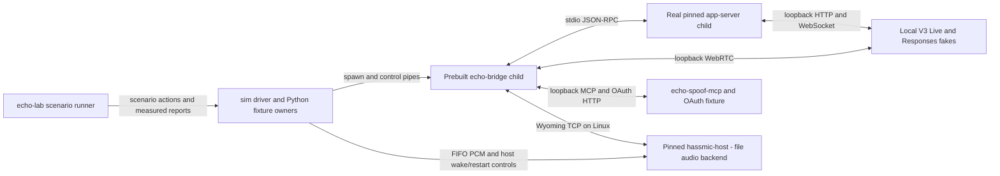

These are T3 local substitutes, not cloud or acoustic proof. `echo-lab` is our Rust CLI; sim also uses
Python owners. `hassmic-host` is the pinned fork's C file-audio build. It is reached directly as a Linux
child process. Scripts consume prebuilt
artifacts; no Echo, Ring or real account is part of this documentation witness.

## Key concepts

These concepts connect the component descriptions above to the journeys below. Each code link names the
implementation boundary, rather than implying that a local test proves a physical or cloud outcome.

### Wyoming

#### What it is — Wyoming

Wyoming is the Home Assistant voice satellite protocol. A TCP stream carries newline-terminated JSON
headers, optional separate JSON data and length-delimited binary payloads, such as microphone PCM.

#### How we use it — Wyoming

The bridge sends `run-satellite` to register for wakes and `describe` to request `info`. hassmic sends
`run-pipeline` after a confirmed wake, then microphone `audio-chunk` events. Reply playback travels the
other way as `audio-start`, `audio-chunk`, `audio-stop`; hassmic returns `played`. Our fork adds
`hassmic-flush` under `-D` to discard queued and in-player reply PCM without drain, then acknowledge
with one `played` while capture continues. `hassmic-end` explicitly ends capture and aborts an active
reply; duplicate controls are idle no-ops. Transcript, voice-stopped and natural audio-stop keep the
device listening. The bridge sends end after the normal reply's real played, preserving its existing
one-reply run lifetime. Error, pause, cancellation and close also end while transport is owned.
`hassmic-continue` remains a compatibility hint; `hassmic-mute` reports effective mute.
Optional `run-satellite.data.hassmic_failsafe_seconds` configures a connection-local safety watchdog
(integer 1..2147483647, default 30 seconds, reset on reconnect). Valid client progress refreshes it;
microphone traffic and ping/describe do not. Invalid values preserve the prior valid setting.
The bridge omits this field. Non-duplex and ESPHome behavior retain their existing lifecycle.
There is no microphone `audio-start` in this exchange; each microphone chunk carries its format.

#### Why — Wyoming

hassmic already speaks it. The protocol separates the Echo's hardware audio from the bridge's conversation
logic, letting the same bridge use the device or a pinned file-audio host in tests.

#### Where in the code — Wyoming

[Wire framing](../crates/echo-wyoming/src/wyoming_wire.rs),
[event routing](../crates/echo-wyoming/src/wyoming_route.rs) and
[playback controls](../crates/echo-wyoming/src/wyoming_session.rs) implement the adapter.
[echo-link](../crates/echo-link/src/lib.rs) exposes protocol-neutral capture, wake, mute, acknowledged
playback and cut operations. [ADR 0025](adr/0025-echo-link.md) explicitly makes it the seam for a future
local transport adapter; it is not a new wire protocol or an implemented replacement for Wyoming.

#### Limits and plans — Wyoming

Today Wyoming is plaintext and unauthenticated across the LAN. The fork's source-address restriction
limits who can connect; it does not encrypt microphone traffic. The [W4 plan](program/plan.md#12-phase-order-after-m0)
moves the bridge onto the Echo and sets `LISTEN_FROM` to numeric loopback only. That removes LAN exposure
but **keeps Wyoming**. No decision in [decisions.md](program/decisions.md) selects its replacement.

| Undecided options, not plans | Trade-off |
| --- | --- |
| Keep Wyoming on loopback | Cheapest reuse of the tested adapter; retains framing and a local TCP service |
| Private local socket or IPC, through another echo-link adapter | Can use local access controls and avoid TCP; needs a matching hassmic implementation and compatibility tests |
| Link the bridge audio path into the hassmic fork | Can remove the protocol boundary; couples languages, process lifetimes, releases and hardware ownership |

Open owner question: after W4, should Wyoming remain local or be replaced, and which trade-off is acceptable?
This documentation does not choose or implement an option.

### Wake word

#### What it is — Wake word

A local keyword detector decides when room speech should start an assistant interaction. Pryon runs on
the Echo with the firmware's “Computer” model; the PC performs no wake inference or model training.

#### How we use it — Wake word

After `run-satellite` registration, hassmic turns a confirmed wake into `run-pipeline` with
`wake_word_name=computer-en-US`, followed by capture including its lead-in. The bridge admits that run
through mute, kill and budget gates. Under `-D`, a speaking-time wake does not itself start a second run.

#### Why — Wake word

Local detection avoids sending continuous room audio to the PC or cloud while idle and uses the device's
existing microphone front end. It also gives each new ordinary question a deliberate activation point.

#### Where in the code — Wake word

Pinned hassmic's `src/hassmic/main.c` owns Pryon and the state machine;
[Wyoming routing](../crates/echo-wyoming/src/wyoming_route.rs) creates runs and
[voice admission](../crates/echo-bridge/src/bridge_voice/voice_admission.rs) accepts them.

#### Limits and plans — Wake word

False wakes can admit unintended speech; missed wakes never reach the bridge. The small recorded
[Computer-model trials](program/baselines.md#the-device) are not a household false-positive or miss-rate
guarantee. Host tests inject wakes and cannot measure Pryon accuracy. Wake earcon work remains in progress.

### AEC and duplex capture

#### What it is — AEC and duplex capture

Acoustic echo cancellation (AEC) removes speaker sound from captured room audio. Amazon's audio front
end supplies AEC and beamforming through `micAsr`. Duplex means capture and playback can happen together;
hassmic's `-D` enables that overlap and is **not** the echo canceller.

#### How we use it — AEC and duplex capture

hassmic reads `MIXER_REC_ASR` and plays through `MIXER_PLAY_TTS`, preserving the firmware reference path.
With `-D`, microphone chunks continue during a reply so user speech can reach Live while it speaks.

#### Why — AEC and duplex capture

Without effective AEC the assistant can hear its own reply as new speech. That can cause self-interruption
or false barge-in; concurrent capture alone cannot distinguish speaker echo from the person speaking.

#### Where in the code — AEC and duplex capture

Pinned hassmic's `src/hassmic/audio_mixer.c` selects the mixer paths and `src/hassmic/main.c` owns duplex
capture. [The component description](#hassmic) and [S2](spikes/s2-barge-in.md) distinguish host playback
control from device acoustics.

#### Limits and plans — AEC and duplex capture

Residual echo and real-room barge-in rejection are unmeasured. File-audio hassmic-host tests have no
Amazon acoustic front end. The coordinator must measure effectiveness at T5; this page claims no AEC score.

### Audio formats and resampling

#### What it is — Audio formats and resampling

PCM is a stream of sample values; Opus compresses those values for transport. Resampling changes the
sample rate while preserving pitch and elapsed audio time. Sample width and sample rate are different:
the reply's “PCM24” here means 24 kHz, still signed 16-bit samples.

#### How we use it — Audio formats and resampling

| Boundary | Format and conversion |
| --- | --- |
| hassmic microphone → capture adapter | 16 kHz signed 16-bit little-endian mono; chunks become 320-sample, 20 ms frames |
| echo-media → Live | Persistent Rubato resampling to 48 kHz; mono Opus encoding of 960 samples per 20 ms packet; RTP capability `opus/48000/2` |
| Live → echo-media | Opus decode at 48 kHz, then Rubato to 16 kHz mono frames |
| Reply adapter → hassmic | echo-audio resamples 16 kHz to 24 kHz signed 16-bit mono; 480 samples or 960 bytes per 20 ms chunk |

The reply pacer uses a monotonic audio clock and `audio.reply_lead_ms` to limit how far sent PCM leads
playout. Draining local queues or finishing a transcript does not prove that the speaker finished: the
bridge still awaits `played`. A dry device first gets a cushion of audio at once (the lead's worth on the
device, the rest held in the bridge), so arrival jitter from the call does not underrun the player. The
cushion is 100 ms on a smooth call and follows the call's measured arrival lateness up to 320 ms. A reply
that stalls in mid-speech fades out before the device runs dry and fades in when it resumes; delay above the
target is given back by leaving silent frames out of pauses. Each reply's `reply.quality` trace record
carries the arrival gaps, modelled device depth, underruns, discards, RTP loss, the target, restarts, fades
and frames left out.

#### Why — Audio formats and resampling

The hardware, caller API and network codec use different rates. Explicit conversion prevents pitch and
duration errors; pacing bounds queued speaker audio so a future interruption need not drain a whole reply.

#### Where in the code — Audio formats and resampling

[call_audio.rs](../crates/echo-bridge/src/bridge_codex/call_audio.rs) uses
[echo-audio](../crates/echo-audio/src/audio_pcm.rs) for PCM conversion;
[media_audio.rs](../crates/echo-media/src/media_audio.rs) owns Rubato/Opus and
[ClockPacer](../crates/echo-bridge/src/bridge_runtime/bridge_pacing/reply_playout.rs) schedules reply chunks
towards the target of the [jitter estimate](../crates/echo-bridge/src/bridge_runtime/bridge_pacing/reply_jitter.rs).

#### Limits and plans — Audio formats and resampling

Queues are bounded and count discarded frames. Filter delay, network jitter, queued device playback and
acoustics remain separate costs. A playout clock estimates sent audio time; it is not an Echo speaker sensor.

### Streaming connectivity

#### What it is — Streaming connectivity

A conversation uses several simultaneous streams. Media, control, tools and presentation have separate
connections and owners; “connected” cannot mean that an SDP response alone proves working audio.

#### How we use it — Streaming connectivity

| Link | Transport and contents | If it drops |
| --- | --- | --- |
| Echo ↔ bridge | TCP Wyoming: wake/run controls, PCM, mute and playback receipts | Adapter invalidates the run and reconnects with backoff while owned; the voice owner ends that run, keeps or redials the connection and serves the next wake |
| Bridge ↔ app server | Child stdio, newline JSON-RPC: account, thread, call and tool messages | Pending RPC/call fails; owner cleans up media, reaps the child and starts a fresh one after a backoff; no automatic replay |
| Bridge ↔ OpenAI media | WebRTC: Opus RTP protected by SRTP, plus ordered SCTP `oai-events` | Transport or data-channel loss fails the media peer and that call; the next generation's first wake makes a new call |
| App server ↔ Live | HTTPS SDP call creation and WSS sideband: transcripts, native delegation and call control | Creation can fail; control errors/closure are surfaced by the pin; the bridge ends the call on projected error/closed and recovers with a fresh child, without replaying the turn |
| App server ↔ Codex model | HTTPS Responses streaming: delegated reasoning, tool requests and results | Delegated turn cannot normally complete; pin reports turn outcome; bridge response/task deadlines bound waiting |
| App server ↔ ChatGPT issuer | HTTPS: device-code authorization and refresh | Sign-in/admission can fail or require relink; no silent interactive login |
| Bridge ↔ Port OS issuer | HTTPS OAuth: discovery, device authorization, token and refresh | Grant operation fails or latches relink; no unauthorized tool effect is retried |
| Bridge ↔ Port OS MCP | HTTPS POST JSON-RPC: initialize, `tools/list`, `tools/call`, Bearer grant | Discovery/call fails; tool error returns to the model, authorization failure requires linking |
| Bridge ↔ screen | Loopback HTTP assets, SSE `ScreenFrame`, POST `UiAction`; remote Echo needs forwarding | Page shows lost connection and reconnects; a lost action does not imply approval or stop the independent audio connection |

#### Why — Streaming connectivity

Separating these links keeps microphone media out of stdio, credentials out of the screen and MCP execution
on the bridge. It also explains why a visible page can survive an auth failure without a usable Live call.

#### Where in the code — Streaming connectivity

[voice_host.rs](../crates/echo-bridge/src/bridge_voice/voice_host.rs) owns device/child lifetime,
[call_media.rs](../crates/echo-bridge/src/bridge_codex/call_media.rs) joins control and media readiness,
and [screen server](../crates/echo-screen-server/src/lib.rs) owns presentation transport. Cloud client
boundaries are [echo-codex](../crates/echo-codex/src/lib.rs) and [echo-mcp-client](../crates/echo-mcp-client/src/lib.rs).

#### Limits and plans — Streaming connectivity

These are current failure boundaries, not automatic recovery promises. W4 changes local placement;
OpenAI and Port OS remain remote dependencies. Paired LAN TLS for the page remains a plan, not this server's behavior.

### WebRTC

#### What it is — WebRTC

WebRTC negotiates a live peer connection. SDP describes the offered media and answer; ICE candidates
describe possible network paths. ICE selects a working path, DTLS establishes keys, SRTP protects audio,
and SCTP carries the data channel over the protected connection.

#### How we use it — WebRTC

echo-media creates the Opus track and ordered `oai-events` channel, gathers an SDP offer and hands it to
the app server's `thread/realtime/start`. It applies the returned answer and waits for both transport and
channel readiness. Native delegation and transcripts use the app server's sideband; the bridge does not
use data-channel messages as a second delegation dispatcher.

#### Why — WebRTC

The pinned app server's ChatGPT sign-in path requires a WebRTC media peer; its all-JSON WebSocket audio
path is refused. WebRTC also supplies timed compressed media and transport security without carrying PCM
as JSON control messages. A sideband WebSocket still handles control independently.

#### Where in the code — WebRTC

[media_peer.rs](../crates/echo-media/src/media_peer.rs) configures webrtc-rs (`webrtc`/`rtc` 0.21.1),
[media_signal.rs](../crates/echo-media/src/media_signal.rs) admits addresses/SDP and observes readiness,
and [ADR 0027](adr/0027-echo-media.md) records the adaptation from Codex's voice-host.

#### Limits and plans — WebRTC

Production advertises usable non-loopback interfaces, with optional explicit allowlist/STUN settings;
loopback is opt-in for local tests and cannot reach a cloud peer. mDNS resolves remote `.local` host
candidates in the normal QueryOnly mode; an explicitly all-loopback allowlist disables it to avoid a
multicast dependency in local tests. A successful local pair proves neither NAT traversal nor provider access.

### Calls, runs, turns and multi-turn

#### What it is — Calls, runs, turns and multi-turn

| Term | Meaning in this implementation |
| --- | --- |
| Call | Retained Live session with one app-server thread/control owner and WebRTC media peer |
| Run | One device wake's microphone and reply-playback lifecycle, ending after capture EOF and acknowledged playback |
| Turn | Here, a delegated Codex unit of work identified by `turn/started` and `turn/completed`; can make several tool calls |
| Utterance | A speech segment tracked through transcript deltas/done; assistant segments can be filler or the answer within one run |

#### How we use it — Calls, runs, turns and multi-turn

The first admitted wake creates the call. A successful reply returns the page to `Ready` and starts
`session_idle_seconds`. A second wake before expiry starts fresh run bookkeeping on the same call, thread
and peer, without new SDP or another `Connected`. Idle audio is discarded. At expiry the bridge stops
realtime control and closes media; a later wake creates a new call.

#### Why — Calls, runs, turns and multi-turn

Retaining the call preserves conversation context and avoids setup for every question. Distinct lifetimes
prevent filler completion or a tool result from being mistaken for speaker completion.

#### Where in the code — Calls, runs, turns and multi-turn

[voice_session.rs](../crates/echo-bridge/src/bridge_voice/voice_session.rs) owns retained calls/idle close,
[bridge_voice.rs](../crates/echo-bridge/src/bridge_voice/bridge_voice.rs) drives a run, and
[voice_source.rs](../crates/echo-bridge/src/bridge_voice/voice_source.rs) tracks filler/answer utterances.

#### Limits and plans — Calls, runs, turns and multi-turn

Multi-turn today still requires “Computer” for each ordinary new question; it is not continuous hands-free
follow-up after playback. Expiry wins over a wake at equality and muted wakes do not renew it. The UTC
call-start prompt snapshot is retained unchanged, not resampled for each question.

### Barge-in

#### What it is — Barge-in

Barge-in means a person can interrupt a spoken reply, stop obsolete playback promptly and continue with
new speech. It requires coordinated capture, model cancellation, queue cutting and run lifetime.

#### How we use it — Barge-in

On current main, `-D` continues capture during reply audio, but configured Codex voice maps
`thread/realtime/itemAdded` speech/cancellation notifications to `Event::Other`. It does not use those
events to cut playback. Error/kill cleanup can cut through `hassmic-continue` and `audio-stop`, then await
`played`; that cleanup closes/fails the voice run instead of continuing a normal interrupted question.

The session controller's barge-in (2026-11-19) silences the reply at once and cuts it when the model
yields. The Live session transcribes whatever the microphone hears during a reply, and the model decides for
itself whether to stop: the pinned V3 session has no request that cancels a response. A user transcript
fragment or speech-start therefore arms a barge-in for 2 s. While it is pending the bridge holds the reply:
it writes nothing more to the device, which plays out the lead it already has (about 200 ms), and the
model's audio waits in the reply queue. The barge-in fires once the model has sent no audible reply audio
for 500 ms, or at once when the model ends its turn. Firing retires the reply, drops the held audio and
flushes the device. The cut reply then settles: `reply.played` (`outcome` `cut`) and `reply.quality` are
written, call audio is discarded until the model's next utterance, and the run listens for that answer
with no playback open. More speech from the user renews the listen window and opens nothing. A model that
is still talking after the 2 s was not interrupted: the held audio plays, late but whole, and the delay is
given back in the reply's silent frames. The times are constants in
[reply_barge.rs](../crates/echo-bridge/src/bridge_runtime/bridge_pacing/reply_barge.rs).

The session's transcript of the user is its earliest sign of speech at the pin, and it comes some hundred
milliseconds after the speech. The bridge therefore also listens to the microphone frames it forwards
([reply_ear.rs](../crates/echo-bridge/src/bridge_runtime/bridge_pacing/reply_ear.rs)): a level three times
above what the reply audio written in the last 700 ms can explain, for 80 ms, is speech. How much of the
reply the microphone hears is learned per call, from the reply's first half second and from every frame not
taken for speech. Speech at the microphone holds the reply for 800 ms; the transcript that follows extends
the hold as before. A hold the session does not bear out is released with nothing lost, and the ear raises
its estimate of the echo. The ear never cuts a reply by itself: a hold that only the microphone armed
lapses after its 800 ms whether the model paused, talked on or ended its turn. The echo is learned only
from reply audio above RMS 1500, with the room's noise taken off: against quiet reply audio the noise the
Echo amplifies read as an echo several times the reply. Its calibration on the Echo is unmeasured;
`reply.quality` `mic` reports what it heard.

A transcript of the user that comes before any audio of the reply has been written to the Echo arms
nothing: it is of the turn the reply answers. A call's first reply starts on a 300 ms jitter cushion, the
one every measured call came to need in its first reply, not on the 100 ms floor.

#### Why — Barge-in

It lets someone correct or stop a reply without waiting, provided the assistant's own speaker audio does
not trigger the same interruption. Duplex and the device cut API are prerequisites, not the complete behavior.

#### Where in the code — Barge-in

[call_events.rs](../crates/echo-bridge/src/bridge_codex/call_events.rs) projects notifications;
[voice loop](../crates/echo-bridge/src/bridge_voice/bridge_voice.rs) owns cancellation and
[Wyoming session](../crates/echo-wyoming/src/wyoming_session.rs) implements the acknowledged cut.

#### Limits and plans — Barge-in

`el-f-barge-in-keeps-run` is in progress. Its continued-capture outcome is not implemented by today's
configured owner. Legacy M3 sim evidence and host queue tests do not prove this owner or physical AEC.

### Delegation

#### What it is — Delegation

Live is the realtime speech model; a delegated Codex model performs longer reasoning and tool work.
The pinned V3 default is `gpt-live-1-codex`, while the plan names `gpt-live-1.1-codex`; this discrepancy
does not establish which model a real provider resolves. The delegated model is separately selected.

#### How we use it — Delegation

Live sends native `delegation.created` on the sideband. The app server runs a Codex turn with bridge
`dynamicTools`, requests effects from the bridge and returns text via native `delegation.context.append`.
The bridge sees `turn/started`, tool RPCs and `turn/completed`. Live can speak filler while work runs;
the bridge holds the reply open across that filler. Budget/deadline enforcement uses `turn/interrupt`
for the matching turn; nothing else does. While a delegated turn is in flight, user speech, barge-in and a
wake neither cancel it nor cut the speaker, and the run is held open past idle until the turn completes or
its deadline ends it. Barge-in applies again once the turn has completed. While the turn runs in silence
hassmic is sent a display-only `hassmic-thinking` for its face; speaking wins while audio plays. The
bridge's screen page does not show it yet. A response timeout can abandon a
late answer and finish the filler.

#### Why — Delegation

The fast voice interaction can acknowledge work while the reasoning model handles tools. Direct answers
using prompt context need not incur another model turn or tool round trips.

#### Where in the code — Delegation

[call_tools.rs](../crates/echo-bridge/src/bridge_codex/call_tools.rs) owns dispatch and interrupts,
[codex_dispatch.rs](../crates/echo-delegation/src/codex_dispatch.rs) correlates requests, and
[voice_source.rs](../crates/echo-bridge/src/bridge_voice/voice_source.rs) distinguishes filler from answer.

#### Limits and plans — Delegation

Main already selects `codex.model`, falling back to `agent.model`, or the app-server default if omitted.
The dedicated `delegate_model` configuration work in [PR 193](https://github.com/portpowered/portos-echo/pull/193)
is in progress. Delegation adds model and tool waiting; the repository baselines do not record the
suggested 3.3–24 s range as a delegated-turn measurement, so no numeric latency claim is made here.
The pin can route model work before bridge admission observes `turn/started`; daily caps cannot undo that work.

### MCP invocation

#### What it is — MCP invocation

Model Context Protocol (MCP) exposes named tools and structured results. A dynamic tool is the app-server
thread's model-facing definition of one admitted MCP tool; it does not grant execution permission by itself.

#### How we use it — MCP invocation

Before the first call's `thread/start`, the bridge initializes MCP, discovers `tools/list`, caches the
specifications and maps allowed entries into `dynamicTools`. A model call becomes `item/tool/call` with
thread, turn and call correlation. The bridge checks identity, deadline, daily/tool caps and exact
allowlist, reserves the durable effect key, and requests approval where policy requires it. The current
approval special case is `test.requires_approval`, not every Port OS action.

The bridge sends HTTPS MCP `tools/call` with the Port OS Bearer access token. DPoP protects device-grant
and refresh operations, not this MCP request. The correlated result returns as JSON-RPC `contentItems`
and `success`, continues the Codex turn, then reaches Live as context for speech. Denial produces an
unsuccessful result with no authorized effect; a reserved key is not replayed after denial. Tool errors
return to the model; authorization failure latches relink rather than retrying the effect.

#### Why — MCP invocation

It gives the model a controlled home-tool catalog while the bridge keeps the credential, policy and
single-writer authority. A model request never substitutes for local permission or proof of an effect.

#### Where in the code — MCP invocation

[voice_tools.rs](../crates/echo-bridge/src/bridge_voice/controls/voice_tools.rs) owns cached discovery,
[tool_policy.rs](../crates/echo-bridge/src/bridge_voice/controls/tool_policy.rs) checks effects/approval,
[call_tools.rs](../crates/echo-bridge/src/bridge_codex/call_tools.rs) dispatches, and
[echo-mcp-client](../crates/echo-mcp-client/src/lib.rs) performs HTTP MCP.

#### Limits and plans — MCP invocation

Discovery uses the first configured MCP server and occurs once, not at each question or boot readiness.
The configured path has no separate local time dynamic tool; `ui.show_emotion` is an MCP result interpreted
locally. A successful fake tool proves no real home effect, and a spoken fallback after a tool error depends
on the model. Port OS authorization-service changes remain separate backend work.

### Authentication

#### What it is — Authentication

Two independent grants establish OpenAI access and Port OS home access. Signing in to one does not link the other.

#### How we use it — Authentication

Explicit ChatGPT device-code sign-in uses `account/login/start` with `chatgptDeviceCode`, then waits for
`account/login/completed`. The child stores/refreshes its account in private `CODEX_HOME`; an exclusive
home lease prevents simultaneous ownership. Port OS device authorization creates a separately stored
grant with a DPoP key and rotating refresh token. Normal startup reads existing account state.

#### Why — Authentication

Separate owners allow independent unlink/relink and keep home credentials out of the model service,
app-server configuration and screen page.

#### Where in the code — Authentication

[signin_codex.rs](../crates/echo-signin/src/signin_codex.rs),
[Codex supervisor](../crates/echo-codex/src/codex_supervisor/mod.rs) and
[echo-mcp-auth](../crates/echo-mcp-auth/src/lib.rs) own these boundaries.

#### Limits and plans — Authentication

Auth failure requires relink, not automatic interactive sign-in. W4 moves private stores to the Echo's
bridge user; screen-app exclusion still needs device proof. No real credential is used to validate this page.

### Screen and mouth state

#### What it is — Screen and mouth state

The screen presents conversation activity and controls. A speaking state is a lifecycle signal; precise
mouth animation would need timing aligned with audible playback.

#### How we use it — Screen and mouth state

The bridge publishes `UiState` through SSE `ScreenFrame`s; the page renders `Ready`, `Listening`,
`Connected`, `Speaking`, errors, mute, link and approval presentations. Touch sends HTTP `UiAction`s.
Mute can mask other presentations; emotion expiry restores activity. `Speaking` follows forwarded reply PCM.

#### Why — Screen and mouth state

It makes listening, linking and consent visible without exposing credentials, and gives touch actions a
correlated route back to bridge policy.

#### Where in the code — Screen and mouth state

[voice_view.rs](../crates/echo-bridge/src/bridge_voice/voice_view.rs),
[screen contract](../crates/echo-screen-contract/src/lib.rs),
[server](../crates/echo-screen-server/src/lib.rs) and [page.ts](../web/screen/src/page.ts).

#### Limits and plans — Screen and mouth state

Main has speaking/emotion presentation, not audible-time mouth sync.
[PR 192](https://github.com/portpowered/portos-echo/pull/192) is in progress. A screen disconnect does not
prove that audio stopped; loopback serving currently needs forwarding for the remote Echo WebView.

### Mute and kill switch

#### What it is — Mute and kill switch

Mute suppresses microphone forwarding. The bridge kill switch cancels conversation execution; it is
distinct from the Echo's hardware privacy latch.

#### How we use it — Mute and kill switch

`hassmic-mute` reports effective device mute. The adapter terminates capture at the mute boundary and
counts discarded chunks; the voice owner also gates forwarding and presents `Muted`. Kill blocks new
admission and cancels active work, settling playback and stopping realtime/media during cleanup.

#### Why — Mute and kill switch

The physical device remains microphone authority, while the bridge can independently halt remote work.
A page animation or model instruction is insufficient to enforce either boundary.

#### Where in the code — Mute and kill switch

[Wyoming routing](../crates/echo-wyoming/src/wyoming_route.rs),
[voice admission](../crates/echo-bridge/src/bridge_voice/voice_admission.rs),
[voice source](../crates/echo-bridge/src/bridge_voice/voice_source.rs) and
[controls](../crates/echo-bridge/src/bridge_voice/controls/voice_config.rs).

#### Limits and plans — Mute and kill switch

Neither action revokes already completed remote effects. Host tests establish ordered suppression, not
the physical latch's electrical behavior; the recorded M1 device run left the mute steps unproved.

### Latency budget

#### What it is — Latency budget

Latency includes wake admission, cold call setup, first answer audio, delegated work and final speaker
drain. Each interval has different start/end events; a timeout is a bound on waiting, not a measurement.

#### How we use it — Latency budget

Retained calls avoid repeat SDP/ICE setup. Bounded queues and reply lead limit buffering. Direct prompt
answers avoid delegation; filler can acknowledge longer work but is not the final answer. Response,
task, negotiation and playback deadlines stop indefinite waiting.

#### Why — Latency budget

A quick acknowledgement, a connected transport and a completed answer are different experiences.
Keeping their clocks separate prevents reporting filler or SDP completion as answer latency.

#### Where in the code — Latency budget

[voice session](../crates/echo-bridge/src/bridge_voice/voice_session.rs),
[voice source](../crates/echo-bridge/src/bridge_voice/voice_source.rs),
[reply clock](../crates/echo-bridge/src/bridge_runtime/bridge_pacing.rs) and
[baselines](program/baselines.md) define the relevant lifetimes and recorded observations.

#### Limits and plans — Latency budget

The repository baselines do not record current configured-path wake-to-connected or question-to-answer
measurements. They are being measured by the coordinator; this page supplies no invented numbers.
`el-f-call-setup-stages` is in progress for clearer stage traces. Acoustic timing requires the T5 bench.

### Security and trust boundaries

#### What it is — Security and trust boundaries

A trust boundary separates components with different authority: room/device audio, local bridge policy,
child account state, cloud models, home tools and the presentation client.

#### How we use it — Security and trust boundaries

The bridge alone executes MCP with its private grant and enforces allowlist, caps and effect correlation.
The child gets only bridge dynamic tools; shell/unified execution, environments and its own MCP servers
are disabled. The screen receives states/prompts, not provider credentials. OpenAI receives admitted
audio, conversation context and tool results; local execution does not make those contents local-only.

#### Why — Security and trust boundaries

Keeping consent and credentials under local authority limits what a cloud tool request or compromised
page can do. Distinct grants and process leases preserve ownership during failures and restarts.

#### Where in the code — Security and trust boundaries

[tool policy](../crates/echo-bridge/src/bridge_voice/controls/tool_policy.rs),
[Codex call configuration](../crates/echo-bridge/src/bridge_codex/bridge_codex.rs),
[supervisor](../crates/echo-codex/src/codex_supervisor/mod.rs) and
[plan trust boundary](program/plan.md#2-architecture).

#### Limits and plans — Security and trust boundaries

Wyoming has no encryption/authentication today; W4 confines it to loopback rather than replacing it.
Port OS MCP uses Bearer access without resource-server DPoP proofs. The screen server is loopback HTTP;
paired LAN TLS remains planned. W4 private-store permissions and real device isolation require coordinator
proof, and the child can begin model work before the bridge observes its turn.

## Crate map

There are **21 directories in `crates/`** at the documented snapshot, one row each below. `xtask` is outside
that directory. These are linked libraries unless an executable is stated. Dependencies below are direct
production **workspace** edges from each `Cargo.toml`, not the third-party closure; `echo-` is omitted in
that column for space. PC-hosted product libraries move with their owner in W4. Historical APIs remaining
in a crate do not imply the configured voice owner calls them.

| Crate | Role and source/ADR | Execution location | Direct workspace dependencies |
| --- | --- | --- | --- |
| echo-agent-api | [Task/backend/tool traits](../crates/echo-agent-api/src/lib.rs), [0007](adr/0007-echo-agent-api.md) | In-process consumers; no runtime of its own | contracts |
| echo-agent-loop | [Retained Responses backend](../crates/echo-agent-loop/src/lib.rs), [0013](adr/0013-echo-agent-loop.md) | PC legacy/Muse/provider consumers; superseded for configured Codex voice | agent-api, contracts, config |
| echo-audio | [PCM conversion, Opus, queues/pacer](../crates/echo-audio/src/lib.rs), [0008](adr/0008-echo-audio.md) | Bridge host | contracts |
| echo-bridge | [Conversation executable and orchestration](../crates/echo-bridge/src/lib.rs), [0024](adr/0024-echo-bridge.md) | PC today; Echo W4 | codex, media, agent-api, link, agent-loop, delegation, mcp-client, mcp-auth, audio, config, contracts, live, screen-contract, screen-server, signin, wyoming |
| echo-chatgpt-auth | [Retained independent credential source](../crates/echo-chatgpt-auth/src/lib.rs), [0015](adr/0015-chatgpt-auth.md) | Legacy/Muse/sign-in adapters on bridge host | config, contracts |
| echo-codex | [App-server JSON-RPC client/supervisor](../crates/echo-codex/src/lib.rs), [0026](adr/0026-codex-client.md) | Bridge host; child itself is upstream, not this crate | contracts |
| echo-config | [Synchronous validated TOML](../crates/echo-config/src/lib.rs), [0005](adr/0005-echo-config.md) | Bridge and validation callers; offline | None |
| echo-contracts | [IDs, secret wrapper and wire vocabulary](../crates/echo-contracts/src/lib.rs), [0006](adr/0006-echo-contracts.md) | Shared in-process data; no transport | None |
| echo-delegation | [Codex dispatcher and retained legacy runner](../crates/echo-delegation/src/lib.rs), [0017](adr/0017-echo-delegation.md), [0026](adr/0026-codex-client.md) | Bridge host | agent-api, agent-loop, config, codex, contracts, mcp-client |
| echo-lab | [Scenario/probe/calibration CLI and fakes](../crates/echo-lab/src/main.rs), [0003](adr/0003-echo-lab-schema-validation.md), [0019](adr/0019-touch-calibration.md) | Workstation/CI; test-only in this diagram | contracts, codex, config, wyoming, screen-contract, spoof-mcp, live |
| echo-link | [Protocol-neutral capture/playback traits](../crates/echo-link/src/lib.rs), [0025](adr/0025-echo-link.md) | Bridge adapters; no process/runtime of its own | None |
| echo-live | [Retained encoded-Opus peer/provisional call API](../crates/echo-live/src/lib.rs), [0009](adr/0009-live-transport.md), [0011](adr/0011-live-call.md) | Legacy/Muse and local fake consumers; not configured Codex media | contracts |
| echo-mcp-auth | [Port OS device grant and rotating store](../crates/echo-mcp-auth/src/lib.rs), [0010](adr/0010-mcp-auth.md) | Bridge host | contracts |
| echo-mcp-client | [Stateless MCP ToolHost](../crates/echo-mcp-client/src/lib.rs), [0014](adr/0014-mcp-http.md) | Bridge host | agent-api, config, contracts |
| echo-media | [Frame-based WebRTC/Opus peer](../crates/echo-media/src/lib.rs), [0027](adr/0027-echo-media.md) | Bridge host | None |
| echo-muse-bridge | [Optional task core, Unix daemon/report binaries](../crates/echo-muse-bridge/src/lib.rs), [0020](adr/0020-muse-core.md), [0022](adr/0022-muse-service.md) | Separate Linux gadget host; optional | agent-api, contracts |
| echo-screen-contract | [UiState, ScreenFrame and UiAction](../crates/echo-screen-contract/src/lib.rs), [0004](adr/0004-screen-contract.md) | Bridge data boundary; schema consumed by page | None |
| echo-screen-server | [Loopback HTTP/SSE and actions](../crates/echo-screen-server/src/lib.rs), [0016](adr/0016-screen-server.md) | Within bridge process | contracts, screen-contract |
| echo-signin | [Writer-based commands and Codex account adapter](../crates/echo-signin/src/lib.rs), [0018](adr/0018-signin.md), [0026](adr/0026-codex-client.md) | Bridge/operator command process | codex, live, agent-loop, contracts, config, chatgpt-auth |
| echo-spoof-mcp | [Deterministic MCP library/executable](../crates/echo-spoof-mcp/src/lib.rs), [0014](adr/0014-mcp-http.md) | Local tests/CI | contracts |
| echo-wyoming | [Bounded duplex client and link adapter](../crates/echo-wyoming/src/lib.rs), [0012](adr/0012-echo-wyoming.md), [0025](adr/0025-echo-link.md) | Bridge host | link, contracts |

## Conversation sequences

Arrows labelled RPC, state or trace use code spellings. Other arrows describe operations rather than new
wire messages. PC participants are local to the bridge host; arrows to cloud participants cross the network.
Screen states are Rust names (`Listening`, `Speaking`); their JSON tags are lowercase.

### (a) Boot and readiness

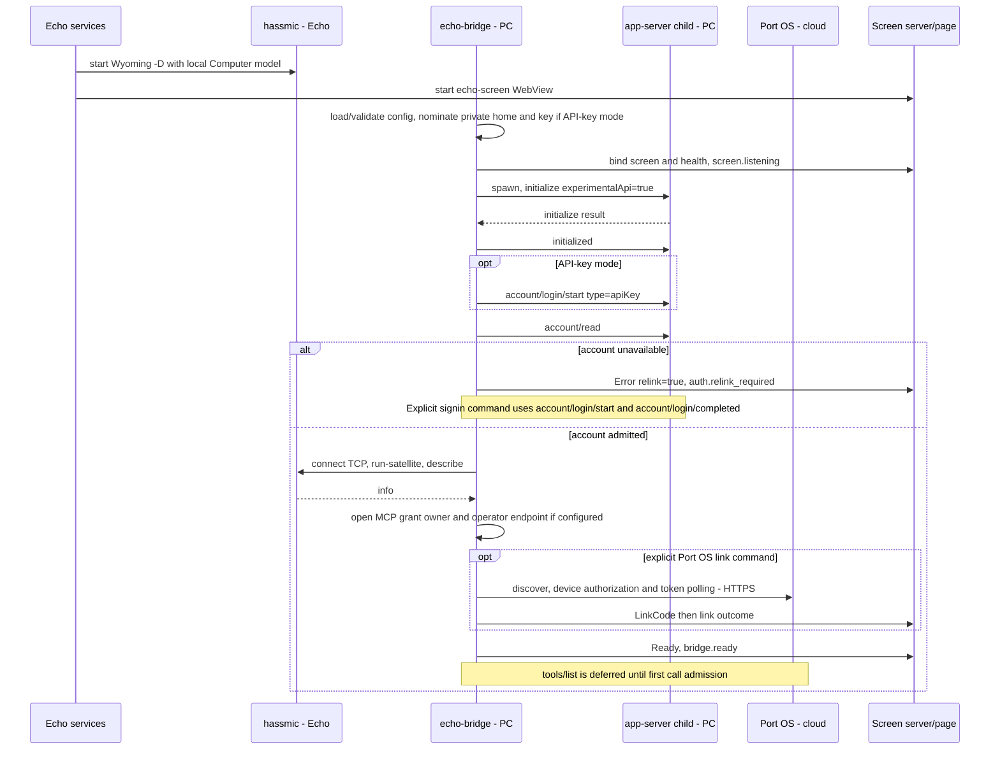

The screen binds before account admission. An auth failure keeps relink presentation available until
cancellation, without connecting Wyoming. Normal boot uses existing grants, not a fresh interactive login.
The app-server handshake is local; issuer/Port OS operations are cloud round trips when needed.

### (b) Wake word and activation

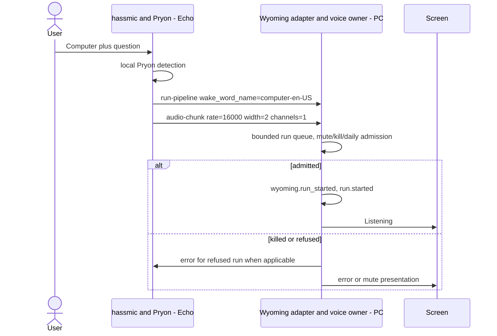

Capture includes hassmic's lead-in; no mic `audio-start` is inserted. `hassmic-mute` updates the bridge's
privacy gate. Local wake needs neither PC wake inference nor a cloud round trip. A bridge wake chime is
not drawn: `el-f-wake-earcon` is in progress; the installed baseline records no wake sound.

### (c) Call setup

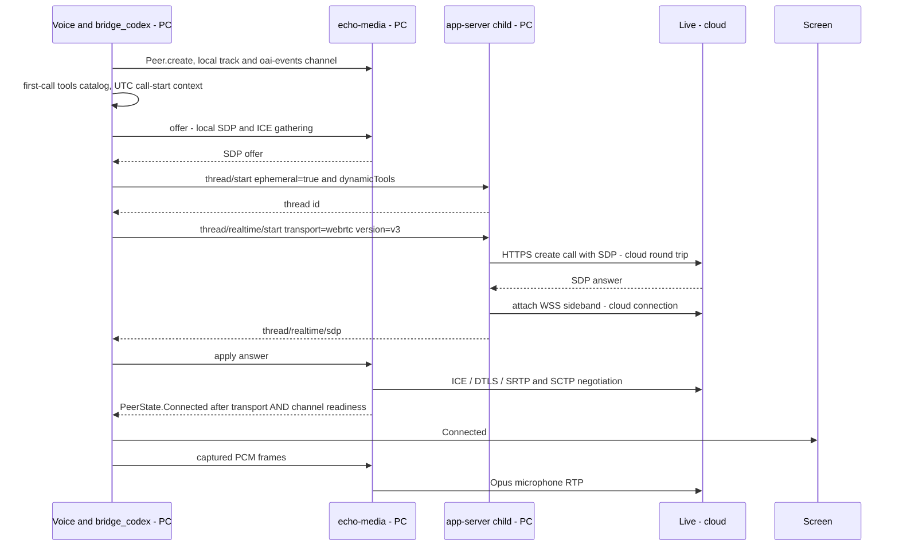

Call creation and actual media connectivity are different barriers. `Connected` is published only after
both signaling and media readiness; SDP success alone does not qualify. `thread/realtime/started` may
arrive during setup. Sideband attachment is app-server-owned and can overlap answer/media processing.
The new stage-trace presentation belongs to `el-f-call-setup-stages`; it is not assumed on this snapshot.

### (d) One question and answer

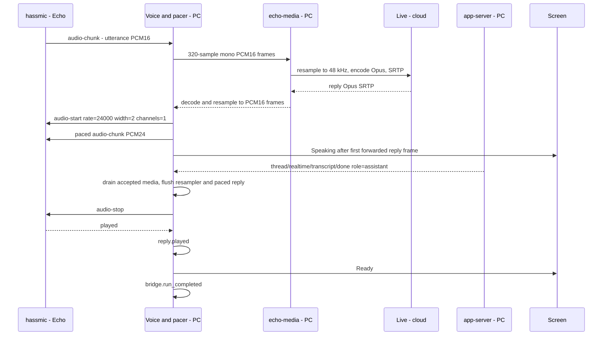

The playback operation may emit `audio-start` before reply PCM arrives. The pacer limits send lead using
`audio.reply_lead_ms`; transcript completion is not speaker completion. Success also requires microphone
EOF and the playback operation's `Played` result. Main shows a speaking heading and emotion frames, not
an audible-time mouth. `el-f-mouth-sync-audible-sim` PR 192 and antecedent PR 189 remain open.

### (e) Multi-turn

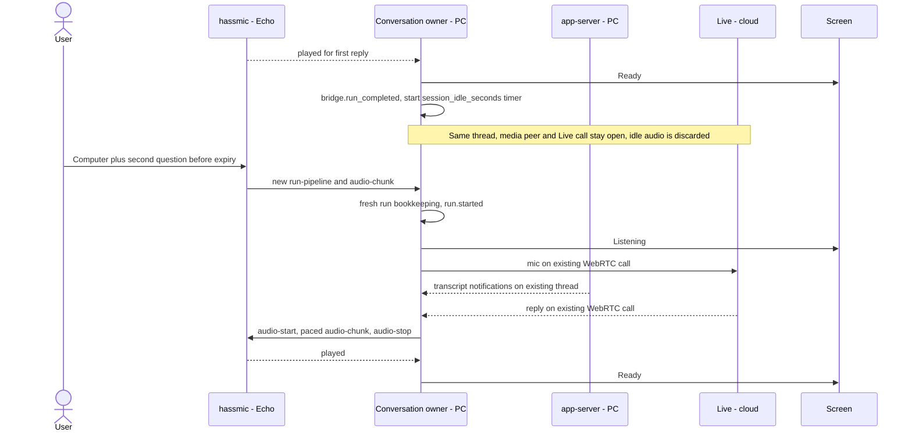

Ordinary reply completion ends the hassmic run, so the next question needs another wake. No second
`thread/start`, SDP negotiation or `Connected` publication occurs during reuse. The call-start UTC snapshot
from merged PR 191 remains unchanged; it is not a continually updating clock. Configured model selection
already exists; `el-f-voice-model-and-zone-config` is in progress for further model/zone behavior.

### (f) Barge-in: current limitation

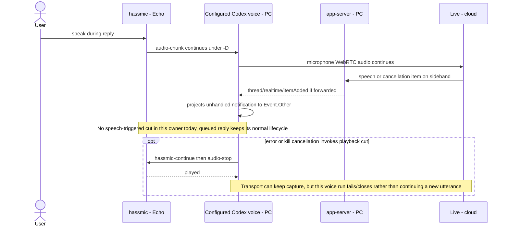

Live can stop producing audio, but the bridge does not currently translate its speech/cancellation item
into an immediate playback cut. A speaking-time wake under `-D` does not itself create another run.
The pinned fork and Wyoming cut API support continuing capture; that is insufficient to claim configured
end-to-end barge-in. `el-f-barge-in-keeps-run` owns that work. Legacy M3 sim behavior is not proof for this
owner. Historical [S2](spikes/s2-barge-in.md) measured an older pin's queue drain, not this newer control or
physical AEC performance.

### (g) Tools and delegated turns

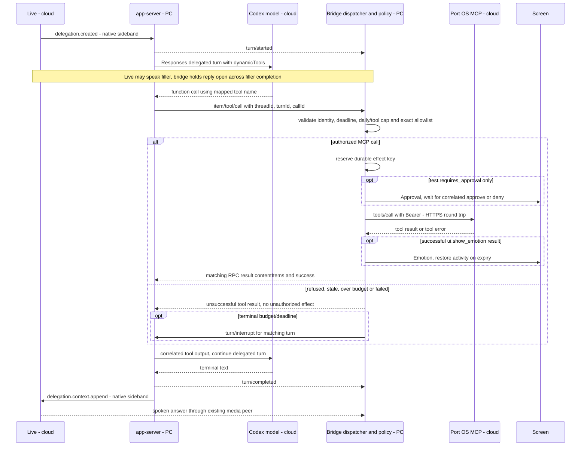

The bridge answers a dynamic-tool RPC locally, but the configured executable registers only the admitted
MCP catalog. There is no separate bridge-local “time” dynamic tool or direct Live function-tool execution
path on main. `ui.show_emotion` is an MCP result interpreted locally, not a second registered local model
tool. Direct local answers use prompt context. Port OS `control` can follow this path only when returned
by discovery and explicitly allowed; the fake's `test.echo` proves a substitute, not a real home effect.
The effect key is reserved **before** approval in actual policy code; a denial cannot replay that reservation.
Daily admission cannot prevent model routing that the pin has already started before `turn/started` is
observed. Filler is model audio, not a bridge-generated recording; the response deadline can abandon a late
delegated answer and finish the filler rather than claim a completed answer. An MCP error is returned to
the model; a spoken honest fallback depends on the model, not a locally synthesized guarantee.

### (h) Idle close and teardown

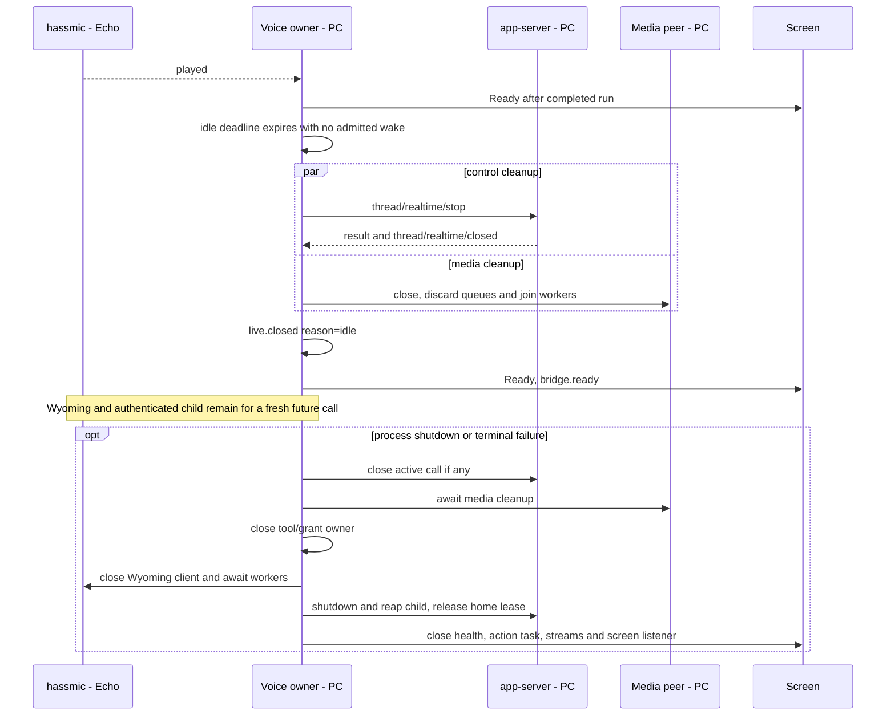

An idle call close is not process shutdown. Expiry wins at equality with a wake; muted wakes do not renew
the timer. The `live.closed` trace is a bridge projection after cleanup, not a cloud notification spelling.

### (i) Failure and recovery

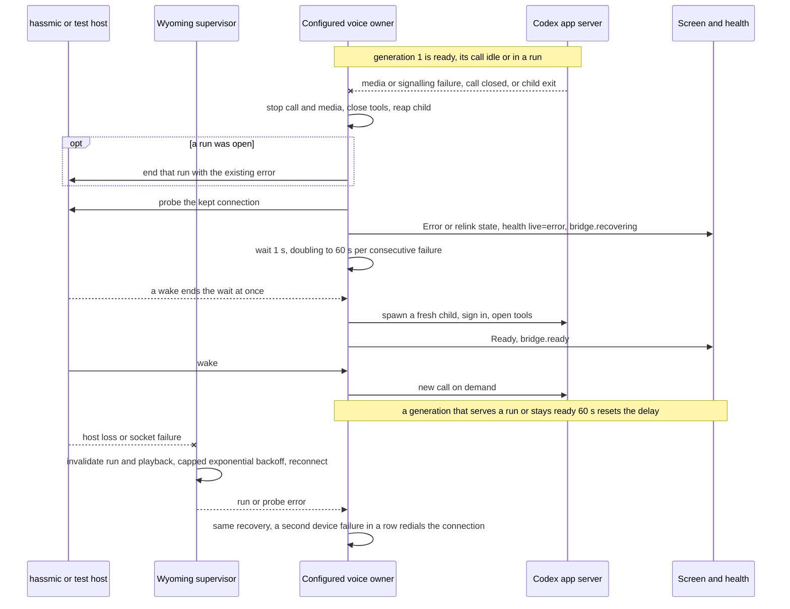

After the first `bridge.ready`, no failure ends the configured voice owner
([voice_recovery.rs](../crates/echo-bridge/src/bridge_voice/recovery/voice_recovery.rs)). The process exits in
three cases only:

- **A clean stop:** end of input on stdin. Exit 0, also when it arrives during a retry delay.
- **The kill path:** the kill switch ending an active run, or the control side closing without a clean stop.
  Exit 1, as before.
- **An unusable start, before the first ready:** an invalid configuration, Codex home, binary, CA file or
  import; or a sign-in or Port OS grant that needs the operator (`authorization`, relink, access denied,
  expired). A missing sign-in still holds the relink screen until the stop.

Everything else is one failed generation: Live media or signalling failing or closing, in a run or while the
call idles between wakes; the app server exiting; an MCP or Port OS error; a screen publication failing; the
Wyoming link dropping; a mute or a missing playback receipt cutting a run short; a wake refused by the daily
budget. The owner ends the generation, ends an open device
run with the existing error for that turn (`unavailable`, or `relink_required`), records `bridge.recovering`
with `reason`, `attempt` and `delay_ms`, shows Error (or the relink overlay) on the screen and `live: "error"`
on health, waits, and starts the next generation. `bridge.error` is now only the record of a terminal exit.

The delay is 1, 2, 4, 8, 16, 32 and then 60 s for consecutive failed generations, and returns to 1 s once a
generation has served a run or stayed ready for 60 s. A failure that never clears, such as a revoked
credential, therefore retries once a minute, with the screen and health showing it, and never exits or spins.
The same schedule covers a transient failure before the first ready, for example the device not answering yet.

A wake never waits on a pending retry. The device connection is kept across generations, so a wake during the
delay ends the delay and is served by the generation it starts; that generation makes its call on demand. If
Live cannot be reached then, the turn ends with the existing error and the cycle repeats. The connection is
redialled only when it fails its probe or when two device failures follow each other. One limit: the Wyoming
client drops its connection itself when a reply playback is abandoned, so a failure while reply audio is
playing reconnects inside the adapter rather than keeping the same socket. No failed turn is replayed.

The retained simulator owner ([bridge_runtime.rs](../crates/echo-bridge/src/bridge_runtime.rs)), used by the
lab's synthetic Live scenarios, keeps its one-shot protocol: it reports `bridge.error` and exits, because
those scenarios assert on that exit. It does not run on the Echo. Provider `thread/realtime/error` ends the
call and its generation. Missing or invalid OpenAI sign-in displays relink; MCP authorization failure has its
own link overlay and grant owner. Mute may mask either until unmuted. Main has **no local spoken recovery
fallback** for these failures. hassmic's own error indicator is separate from the page and is not a promised
spoken explanation.

## Where to look in the code

| Sequence | Main files |
| --- | --- |
| (a) Boot | [CLI](../crates/echo-bridge/src/main.rs), [voice lifetime](../crates/echo-bridge/src/bridge_voice/voice_runtime.rs), [device admission](../crates/echo-bridge/src/bridge_voice/voice_host.rs), [supervisor](../crates/echo-codex/src/codex_supervisor/mod.rs), [accounts](../crates/echo-signin/src/signin_codex.rs) |
| (b) Wake | [Wyoming routing](../crates/echo-wyoming/src/wyoming_route.rs), [admission](../crates/echo-bridge/src/bridge_voice/voice_admission.rs), [view](../crates/echo-bridge/src/bridge_voice/voice_view.rs), [captured-device baselines](program/baselines.md) |
| (c) Setup | [call RPC](../crates/echo-bridge/src/bridge_codex/bridge_codex.rs), [joint media owner](../crates/echo-bridge/src/bridge_codex/call_media.rs), [peer](../crates/echo-media/src/media_peer.rs), [signaling](../crates/echo-media/src/media_signal.rs) |
| (d) Reply | [voice loop](../crates/echo-bridge/src/bridge_voice/bridge_voice.rs), [source/filler state](../crates/echo-bridge/src/bridge_voice/voice_source.rs), [audio conversion/pacer](../crates/echo-bridge/src/bridge_codex/call_audio.rs), [Wyoming playback](../crates/echo-wyoming/src/wyoming_session.rs), [page](../web/screen/src/page.ts) |
| (e) Reuse | [session idle/run loop](../crates/echo-bridge/src/bridge_voice/voice_session.rs), [view](../crates/echo-bridge/src/bridge_voice/voice_view.rs), [call-start context](../crates/echo-bridge/src/bridge_voice/controls/voice_config.rs) |
| (f) Overlap | [notification projection](../crates/echo-bridge/src/bridge_codex/call_events.rs), [voice loop](../crates/echo-bridge/src/bridge_voice/bridge_voice.rs), [cut control](../crates/echo-wyoming/src/wyoming_session.rs), [legacy M3 wire](../crates/echo-lab/src/lab_run/sim/m3/wire.rs) |
| (g) Tools | [call tools](../crates/echo-bridge/src/bridge_codex/call_tools.rs), [catalog/lifetime](../crates/echo-bridge/src/bridge_voice/controls/voice_tools.rs), [policy](../crates/echo-bridge/src/bridge_voice/controls/tool_policy.rs), [dispatcher](../crates/echo-delegation/src/codex_dispatch.rs), [native test receipts](../crates/echo-lab/src/lab_run/sim/m4/codex/receipts.rs) |
| (h) Close | [session](../crates/echo-bridge/src/bridge_voice/voice_session.rs), [call stop](../crates/echo-bridge/src/bridge_codex/bridge_codex.rs), [media close](../crates/echo-bridge/src/bridge_codex/call_media.rs), [device cleanup](../crates/echo-bridge/src/bridge_voice/voice_host.rs) |
| (i) Recover | [reconnect](../crates/echo-wyoming/src/wyoming_session/wyoming_reconnect.rs), [idle probe owner](../crates/echo-bridge/src/bridge_voice/voice_admission.rs), [failure view](../crates/echo-bridge/src/bridge_voice/voice_view.rs), [lab host](../crates/echo-lab/src/lab_run/sim/host.py) |
