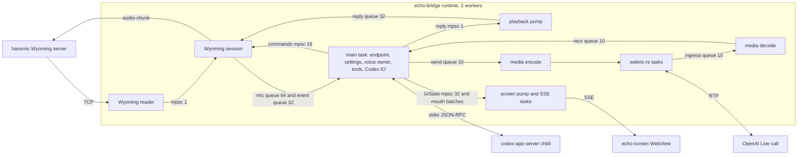

# One binary on the Echo: plan

Owner goal (2026-11-22): after rooting, one adb installer injects one `echo-bridge` binary that works end to end,
screen included. There is no separate hassmic and no separate Codex app server. We take Codex's auth, realtime,
agent loop and tools as libraries from `openai/codex`. The user-facing result is
[the target quick start](2026-11-22-single-binary-quickstart.md).

Owner decisions folded in (2026-11-22, relayed by the coordinator):

- **"Without the chromium runtime" means Codex's code mode.** The owner: Codex has a "code mode variant that runs
  with a full node/chromium runtime and we can't run that easily on our arm based" computer. Precisely, that is V8,
  the JavaScript engine of Chromium and Node (section 3.2). It does not mean the Android WebView or the Codex
  desktop app. The screen keeps its WebView.
- **Full Codex tool surface.** Code mode is the only part of Codex we leave out. Web search and fetch, file editing,
  skills, tool discovery, MCP clients and the rest stay (section 4).

References: fork paths are in `portpowered/echo-dot-assist`, read from a local worktree of its `main` near the
`hassmic.pin` commit, so treat line numbers as approximate. Codex paths are `codex-rs/` at `rust-v0.171.0`, the
newest release read locally. Crate counts are closures over that release's `Cargo.lock`, so they are upper bounds.

## 1. Today

### 1.1 Processes on the Echo

| # | Process (user, domain) | Started by | Owns |
| --- | --- | --- | --- |
| 1 | `boot.sh firewall` → `main.sh firewall` (root, `su`) | init, `hassmic_fw` service in fork `devices/athena/hassmic.rc` | Egress lock: only gid 3990 leaves (`lockdown.sh watch`); root side of signed OTA pushes (`ota_watch`, fork `src/hassmic/ota.c`) |
| 2 | `boot.sh satellite` → `main.sh satellite` (root, `su`) | init on `sys.boot_completed`, `hassmic` service | Picks factory copy or OTA copy with a three-tries rollback (fork `scripts/system/boot.sh`); Alexa off (`alexa-off.sh`); Wi-Fi workarounds (`netwatch`); clock and time zone; restarts hassmic every 3 s on exit (fork `scripts/system/main.sh`) |
| 3 | `hassmic -P wyoming -D` (uid `system`, groups `system,audio,inet,input,bluetooth`, domain `u:r:hassmic:s0`) | process 2 through `runas` (fork `main.sh`, athena `device.conf`) | Capture with VOICE_COMMUNICATION (source 7) and the ASP volume index 80 sent through the firmware's `service` tool (fork `src/hassmic/capsrc.c`, `audio_android.c`); playback; Pryon wake word from the firmware's `libpryon.so` (`wake_pryon.c`); mute latch and keys (`buttons.c`); speaker volume (`spkgain.c`); Wyoming server on 16700 (`proto_wyoming.c`); OTA receive; settings page |
| 4 | hassmic's screen UI, `app_process` with `screen.dex` and `libhmui.so` (uid `system`) | process 3 (fork `src/hassmic/screen.c`) | The light band, top grip, native face fallback and words layer as SurfaceFlinger layers (fork `src/ui/android.c`) |
| 5 | `org.hassmic.home`, a codeless HOME activity | Android | Lets boot complete once Alexa's launcher is gone (fork `tools/mkhome.py`) |
| 6 | `bridge.sh run` (root) | process 2 | Starts and restarts the bridge, honouring the installer's stop markers (fork `scripts/device/bridge.sh`) |
| 7 | `echo-bridge` (uid `nobody`, groups 3990, `inet`, `input`, own session) | process 6, or `echo-setup start` | Wyoming client, media peer, screen server, Port OS grant and tools, traces (launch contract in [architecture](../architecture.md#launch-contract-on-the-echo--echo-bridge)) |
| 8 | `codex-app-server` (same user) | process 7, stdio child ([supervisor](../../crates/echo-codex/src/codex_supervisor/mod.rs)) | ChatGPT sign-in and `auth.json`, Live call creation, sideband, delegated turns ([plan 3.3](../program/plan.md#33-the-codex-app-server)) |
| 9 | `org.portos.echoscreen` WebView | hassmic's `screen_home` setting ([echo-screen README](../../apps/echo-screen/README.md)) | Shows the bridge's page; about 220 MB of RAM ([decisions](../program/decisions.md), 2026-11-15) |

### 1.2 On the PC

`echo-setup` ([ADR 0030](../adr/0030-echo-setup.md)) verifies the release and drives `adb`. It pushes the bundle to
`/data/local/echo-bridge` and runs the bundle's shell lifecycle
([echo-install.sh](../../scripts/echo-install.sh)). Then it relays the sign-in codes and waits for a wake.
The bundle is `bin/echo-bridge`, `bin/codex-app-server`, `bin/cacert.pem`, `apk/echo-screen.apk`, scripts,
examples and licenses. The app server is our armv7 build of the upstream release
([build-codex-armv7.sh](../../scripts/build-codex-armv7.sh), [ADR 0028](../adr/0028-codex-armv7.md)). Rooting and
hassmic come from the fork's `scripts/setup.sh` and `install-system.sh`
([README step 1](../../README.md#1-root-your-echo-and-install-hassmic)).

### 1.3 Who owns what

| Concern | Owner today | Where |
| --- | --- | --- |
| Capture, AEC, call mode, source 7, ASP index | hassmic | fork `capsrc.c`, `audio_android.c`; [decision 2026-11-20](../program/decisions.md) |
| Playback, reply pacing | hassmic plays; the bridge paces and waits for `played` | [bridge_voice.rs](../../crates/echo-bridge/src/bridge_voice/bridge_voice.rs) |
| Wake word "Computer" | hassmic (Pryon) | [plan 5](../program/plan.md#5-wake-word) |
| Mute, volume, light band | hassmic; speaker state over Wyoming | [decision 2026-11-22](../program/decisions.md) |
| Supervisor, OTA, boot persistence | fork `boot.sh`, `main.sh`, `bridge.sh` | 1.1 rows 1, 2, 6 |
| Screen | WebView app plus hassmic's band and home activity | 1.1 rows 4, 5, 9 |
| ChatGPT auth, Live, agent turns | `codex-app-server` child | [echo-codex](../../crates/echo-codex/src/lib.rs) |
| Media peer, tools, Port OS, caps, traces | `echo-bridge` | [architecture](../architecture.md) |

Codex's own tools are off today. The thread settings set `features.shell_tool`, `features.unified_exec` and
`features.view_image` to false with empty `environments` and `mcp_servers`
([echo-codex](../../crates/echo-codex/src/lib.rs)). The agent sees only the bridge's dynamic tools (Port OS, notes,
prompts, session controls, emotion) and provider web search.

### 1.4 How the bridge's runtime works today

The bridge has no frame loop. It is one Tokio runtime, one main task and a handful of IO pump tasks. Each of them
sleeps in a `select!` until one of its inputs is ready: a socket, a queue, or a deadline it holds as an `Instant`.
Paths below are under `crates/`. Line numbers are at this commit.

#### 1.4.1 Tokio in game-loop terms

Tokio is an async runtime. An `async fn` compiles to a state machine (a future). The executor polls a task's future
until it returns `Pending` at an `.await` that is not ready, and then runs another task. Scheduling is cooperative:
nothing preempts a task between two `.await`s, so a long computation holds its worker thread. The reactor (epoll on
Linux and Android) and the timer wheel wake a task when its socket is readable or its deadline passes. `select!`
polls several futures in one task and runs the branch of the first one ready; `biased;` polls them in written order.

The bridge builds its runtime by hand; there is no `#[tokio::main]` outside an example. `runtime()` in
`echo-bridge/src/main.rs` (lines 62–68) and `process_generation` in
`echo-bridge/src/bridge_voice/controls/voice_entry.rs` (line 58) both use
`Builder::new_multi_thread().worker_threads(2).enable_all()`. Each settings
generation gets a new runtime; a settings change destroys it and `exec`s the binary again (`execute_process`). The
blocking pool is Tokio's default. One OS thread, `bridge-control`, blocks on stdin (`settings_process.rs` line 46).

#### 1.4.2 The tasks and their loops

Most of the voice path is one future in the main task: the Port OS endpoint (`bridge_endpoint/mod.rs` `scope`,
`supervise`, lines 144–190) wraps the settings inbox, which wraps the voice runtime, admission and the run. The
futures nested in it run on one task at a time, never in parallel.

| Loop | Task | What its `select!` waits on |
| --- | --- | --- |
| Dormant wait, `voice_admission.rs` `wait` (409–461) | main | Cancel; settings restart; a 20 ms `interval` that re-reads the kill file; a 1 s device probe; Codex idle notifications; Wyoming events (wake, mute) |
| Run, `bridge_voice.rs` `drive` (314–370) and `step` (372–414) | main | Endpoint end; earcon done; reply deadline; barge-in due; mouth due; then `step`: uplink space, Wyoming events, microphone frames, `port.next()` (Codex events and call PCM), the paced next reply frame, forwarding it |
| Between replies, `voice_listen.rs` `listen` (305–352) | main | Cancel; endpoint end; settings restart; the listen deadline; device events, microphone and call events |
| Tools, `bridge_codex/call_tools.rs` `next` (177–206) | main | The one in-flight tool future; a session-tool request; the nested call events |
| Codex app server, `echo-codex/src/codex_io.rs` `progress` (140–190) | main | One 4096-byte stdout read, one stdin write, the next request deadline. It has no task: whoever awaits `next_event` drives it |
| Port OS gateway, `bridge_endpoint/transport.rs` `serve`, `receive`, `respond` (167, 284, 308) | main | Socket frames versus a 45 s keepalive; commands, session ends and up to 16 in-flight replies |
| Wyoming session, `echo-wyoming/src/wyoming_session.rs` `run` (143–168) | own | Playback cancel; commands; frames from the reader; the next reply frame to write |
| Wyoming reader (`wyoming_session.rs` 83–92) and playback pump (`wyoming_playback.rs` 45–66) | own | One frame off the socket; one reply frame from the voice owner |
| Media encode and decode, `echo-media/src/media_peer.rs` (105–124) and `media_state.rs` `receive` (142–172) | own | Next PCM frame to encode; a receive reset versus the next RTP packet. webrtc-rs runs its own tasks on the same runtime (`media_runtime.rs`) |
| Screen, `echo-screen-server/src/lib.rs` (257–259), `screen_core.rs` `pump` (207–243) | own | Stop; publication barriers; `UiState`; one task per HTTP or SSE client |

Smaller tasks: the health listener (`bridge_health.rs` 68), SNTP (`bridge_time/bridge_time.rs` 139), screen
actions (`bridge_runtime/bridge_screen.rs` 244), MCP operator serving (`bridge_mcp/bridge_mcp.rs` 201–202).



#### 1.4.3 How events cross between tasks

| Channel | Capacity | When full |
| --- | --- | --- |
| Wyoming reader → session, `mpsc` | 1 | Backpressure: the reader stops reading the socket |
| Commands → Wyoming session, `mpsc` plus a `oneshot` reply each (`wyoming_client.rs`) | 16 | Backpressure on the sender |
| Microphone `FrameQueue` (`wyoming_queue.rs`, `mic_capacity`) | 64 chunks | Drops the oldest and counts it |
| Device events (`wyoming_events.rs`, `event_capacity`) | 32 | Audio arrivals coalesce into one entry; 32 other events pending is `Error::Capacity` and fails the link |
| Reply, voice owner → pump (`reply_channel(NonZeroUsize::MIN)`, `bridge_voice.rs` 254) | 1 | Backpressure |
| Reply, pump → Wyoming (`reply_capacity`) | 32 frames | Drops the oldest; the pacer's 200 ms lead keeps it short |
| Bridge reply buffer `ReplyAudio` (`bridge_codex/call_audio.rs` 143) | 128 frames, 2.56 s | Drops the oldest, counted in `reply_dropped` |
| Media send, receive and RTP ingress (`echo-media/src/media_queue.rs`, `PeerConfig::default`) | 10 each | `push` drops the oldest; `try_push` refuses |
| Uplink backlog `Source::uplink` (`voice_source.rs`, `UPLINK_BACKLOG`) | 1500 frames, 30 s | Holds what `try_send` refused, in order; evicts the oldest past 1500 |
| Codex notifications and pending calls (`echo-codex/src/codex_rpc.rs` `Limits`) | 256 and 128; 10 s per call | `EventsFull` or `PendingFull` closes the app-server generation |
| Early call events during ICE (`call_media.rs` 206) | 32 | Fails the call |
| `UiState` → screen (`bridge_screen.rs` 87, `try_send` in `bridge_presentation.rs`) | 32 | `Error::Screen` |
| Screen → each SSE client (`screen_core.rs`) | 32, at most 32 clients | A client that falls behind is disconnected; mouth batches skip it |
| Gateway commands (`transport.rs` 383, `try_send`) and session ends (`broadcast`, `RECENT_ENDS`) | 32 and 32 | Commands are dropped; a lagging ends reader loses the oldest |
| `watch` channels: peer state, endpoint status, health, settings restart | latest value | Coalesce: readers see only the newest |

#### 1.4.4 Deadlines when no event comes

Nothing polls a clock. The voice owner keeps deadlines as `Instant`s in `Source` and `Controller`. Each pass of the
loop recomputes the earliest one and arms a fresh `sleep_until`; when another branch wins, `select!` drops that
timer, and the next pass arms the new deadline. `bridge_voice.rs` lines 342–368, trimmed:

```rust
let barge = source.barge_due();
let (deadline, on_timeout) = voice_wait::deadline(source, played);
tokio::select! {
    biased; // timeouts cannot be starved by a continuously ready peer
    () = bridge_endpoint::voice::ending() => return voice_listen::remote_cut(port, source),
    () = voice_listen::until(deadline) => voice_wait::expired(source, on_timeout)?,
    () = voice_listen::until(barge) => source.interrupt(port)?,
    () = voice_listen::until(source.mouth.due()) => { /* open or close the mouth */ }
    result = step(events, microphone, port, sink.as_ref(), source, &mut pending, observe) => result?,
}
// until(None) is std::future::pending(): no deadline, no timer.
```

| Deadline | Value | Where | On expiry |
| --- | --- | --- | --- |
| Listen window | `voice.session_listen_seconds`, 15 | `Controller::idle_deadline`, renewed by `renew_idle`, lengthened by `extend_session` | The listen closes and the run ends |
| No answer | 60 s, `NO_ANSWER_TIMEOUT` | `Source::answer_due`, from the user's last end of speech | `NoResponse`, or an unfailed end after an earlier reply |
| Hand-back grace | 20 s, `HANDBACK_GRACE` | `voice_wait.rs` `owed` | As no answer |
| Speech-start latch | `voice.speech_start_expiry_seconds`, 20 | `Source::latch_expiry`, merged by `earliest` | Clears the latch only; the pinned V3 session sends no speech-stopped |
| Run cap | `voice.session_max_seconds`, 600 | `Source::run_ceiling`; deferred by one latch expiry while the user speaks (`run_cap`) | `SessionCeiling`, mark `capped` |
| Played | 5 s after the last frame (`voice_config.rs` 335) | `drive`'s `played` | `Deadline` |
| Barge-in | 2 s window, 500 ms quiet (`reply_barge.rs` 7–10) | `Source::barge_due` | Cut the reply |
| Warm call between wakes | `live.session_idle_seconds`, 120 | `voice_session.rs` 379 and `wait` (421) | Close the Live call |

Tests run on Tokio's paused clock: about 700 `start_paused = true` or `time::pause()` sites in 180 files, and 251
`time::advance` calls. With the clock paused, Tokio jumps to the next timer whenever every task is idle, so a 600 s
run cap takes microseconds (for example `bridge_voice/recovery/run_cap_cases.rs` line 170). Sim runs go further:
`--sim-clock` starts a current-thread runtime with `start_paused(true)` and steps time on an `advance_playout`
command (`bridge_mcp/bridge_clock.rs` 47–52).

#### 1.4.5 PCM granularity and micro-batching

| Stage | Unit and code | Buffer and owner |
| --- | --- | --- |
| hassmic → bridge | `audio-chunk`, 16 kHz s16le mono. hassmic-host in the sims sends 1600-byte, 50 ms blocks (`echo-lab/src/lab_run/sim/m2/codex/mod.rs` 318). On the Echo, M1 counted about 1,530 chunks in about 32 s (baselines). Assumption: about 20 ms per chunk on the Echo; the fork's chunk size is not read here, and the bridge does not depend on it | Mic queue 64, in the Wyoming session |
| Capture re-chunk | `CaptureAudio::process` (`call_audio.rs` 75–91): any chunk up to 8192 bytes → i16 → `PcmResampler` to 16 kHz → 320-sample, 20 ms `PcmFrame = [i16; 320]` (`echo-media/src/lib.rs` 22); a partial tail waits in `pending` | Voice owner (`Source::microphone`) |
| Uplink | `Source::forward` → `try_send`; Rubato 16 → 48 kHz, 960 samples per 20 ms Opus `Voip` packet (`media_audio.rs` 58–78) | Send queue 10, uplink backlog 1500 |
| Downlink | Opus decode 960 samples at 48 kHz → Rubato to a 16 kHz `PcmFrame` (`media_audio.rs`). webrtc-rs's internal buffers were not read here; their depth is unknown | Ingress and receive queues 10, in echo-media |
| Reply jitter buffer | `ReplyAudio::push` resamples 16 → 24 kHz into 960-byte, 20 ms frames; `ClockPacer::next_frame` (`reply_playout.rs` 158–181) releases frame n at start + 20 ms × n − lead, lead `audio.reply_lead_ms` 200. A dry start waits for a cushion of 100 to 320 ms (`reply_jitter.rs`); a stall fades out and silent frames are left out to give delay back | Voice owner (`Source::reply`); the Echo holds at most the lead |
| Playback | Frame → reply `mpsc` 1 → pump → `audio-chunk` writes. hassmic sends `played` 120 ms after the player takes the last slot (`TAIL_MS`, baselines). A reply succeeds only on the device's `Played` event and the playback result | Wyoming reply queue 32 |
| Barge-in | User speech holds the reply: `playable()` turns false, nothing more is forwarded and the Echo drains its lead (T3: transcript to silent device 187 ms). 500 ms of model quiet inside the 2 s window fires `Source::interrupt`, which retires the audio and cuts playback on the device; once per user turn (`Floor`) | Voice owner |
| Mute | Nothing is zeroed; frames are dropped. The Wyoming queue's `mute` (`wyoming_queue.rs` 52–58) counts later chunks as dropped and ends the capture; `Source::capture` drops chunks while `muted`; a mute change drops the converter's history and tail and clears the uplink backlog (`mute_uplink`). The only zeros are hassmic's 800 ms lead-in | Wyoming session and voice owner |

#### 1.4.6 Keeping the hot path cheap

- **Per 20 ms chunk or frame:** the reader parses a JSON header into a fresh `Vec` (`wyoming_wire.rs` 7–45); the
  voice owner wakes once, converts to i16, resamples, copies a `PcmFrame` by value, meters it (`Ear::heard`) and
  `try_send`s it; the encode task resamples and Opus-encodes into a new 1275-byte `Vec`. Downlink mirrors this, plus
  one pacer timer, one mouth sample and a non-waiting lip batch (at most 5 samples, `reply_lips.rs`).
- **Per event:** transcripts, turn lifecycle, tools, session tools, mute, `played` and trace rows. Reply quality is
  one `reply.quality` summary per reply, not a row per frame.
- **Allocation:** no `Bytes` and no buffer pools. `PcmFrame` is a fixed array; resamplers keep scratch buffers
  (`Converter::scratch`); the small per-chunk `Vec`s above remain.
- **Locks:** the queues use a `std::sync::Mutex` for a few instructions and release it before any `.await`
  (`media_queue.rs` `pop`, `wyoming_queue.rs`). The screen core is a `tokio::sync::Mutex`; the lip path only
  `try_lock`s it (`screen_mouth.rs`).
- **Blocking on the runtime:** `Trace::record` (`bridge_trace.rs` 101–140) serialises and calls `write_all` and
  `flush` on a `std::fs::File` inline, per event. The kill switch `inspect` (`bridge_runtime/bridge_kill.rs` 13)
  stats a file every 20 ms, dormant and in runs (`voice_kill.rs` `wait`, 111). `spawn_blocking` appears only in the
  screen server's pack scans, archive preparation and settings reads (`echo-screen-server/src/packs/`).
- **Pure logic apart from IO:** `session_controller::Controller` (Listening, Replying, Cutting, Retired, Closing,
  Closed), the deadline functions in `voice_wait.rs`, `bridge_pacing` (`Barge`, `Jitter`, `Ear`, `Floor`,
  `ReplyMeter`) and `codex_rpc.rs` take `Instant`s and values, not sockets, and are unit-tested on the paused clock.
  They are sub-state machines in one `Source`, mutated by the `select!` branches, not one reducer.
- **Measured (baselines):** on the Echo after PR 224, one 10.2 s reply played 510 of 525 frames, 0 dropped, 1
  underrun after a 279 ms network gap; 1363 microphone chunks, 0 dropped. At a load average of 14 the audio HAL took
  72% and hassmic 62% of one core of eight. The bridge's own CPU and RSS on the Echo are not recorded.

#### 1.4.7 The owner's game-loop terms

| Owner's term | What the code does instead | Does the target (10.3) change it? |
| --- | --- | --- |
| Loop | No single loop: one main task of nested `select!` loops (endpoint, settings, admission, run, listen), plus IO pump tasks | Yes in name: one core loop that owns the buffers; dispatch stays event-first (answer 1) |
| Tick | None. Timers only: a deadline re-armed each pass, the pacer's 20 ms frame release while a reply plays, the 20 ms kill-file poll, a 1 s probe while dormant, a 45 s keepalive | Yes: a low-rate core tick (start at 10 Hz) for flushes and timers with no event |
| Buffer | Owned by whoever drains it: Wyoming queues in the session task, echo-media queues in the peer, capture, uplink and reply buffers in the voice owner's `Source` | Partly: the voice owner already holds capture and playback; transcript and presentation buffers join it (answer 2) |
| Subsystem | Crates behind bounded queues (Wyoming, media, screen) or futures polled inline (Codex IO, tools, endpoint, pacing) | Yes: the device role becomes a process (2.1) and Codex runs in-process (2.3) |
| Event | Typed enums: `LinkEvent`, `MediaEvent` and `Event`, `Notice`, `UiState`; one `select!` branch per source | No; the draft's state names reach the traces (10.1) |
| Frame | 20 ms both ways; microphone chunks as hassmic sends them | No |

#### 1.4.8 Where the state lives today

State is spread over struct fields held by futures, task-locals, `watch` channels and a few statics. No one value
holds it all.

| State | Owner (type, file) | How others see it | Lifetime | Allocation |
| --- | --- | --- | --- | --- |
| Run: phase, deadlines, speech latch, barge-in, floor, stats | `Source` and `Controller` (`bridge_voice/voice_source.rs`, `controls/session_controller.rs`) | Only through `Notice` callbacks to trace and screen | One run | Fields long-lived; `Stats` boxes per reply |
| Session grants (`extend_session`, `end_session`) | `session_tools::Grants` in `Source` | Through `Notice::SessionTool` | One run | Long-lived |
| Delegated turn, tool in flight, tool ledger | `Delegation` (`recovery/voice_wait.rs`), `ToolSession::work` (`bridge_codex/call_tools.rs`), `tool_ledger::Ledger` | Not shared; trace rows | One turn | One boxed future per tool call |
| Live call, media peer | `MediaCall` (`bridge_codex/call_media.rs`); peer `Arc<Shared>` (`echo-media/src/media_state.rs`) | Peer state by `watch`; queues by `Arc` | One call, kept warm across wakes | Queues long-lived; a `Vec` per Opus packet |
| Reply pacer and buffers, capture converter, uplink backlog | `ReplyAudio`, `ClockPacer`, `CaptureAudio`, `Source::uplink` | Not shared | One reply (pacer, queue); one run (converter, backlog) | Per frame `Vec`s; scratch reused |
| Codex client, pending calls, notifications | `RpcIo` and `codex_rpc.rs` state, `Call` (`bridge_codex/bridge_codex.rs`) | Not shared; polled inline | One app-server generation | Per message |
| Wyoming link, mic queue, speaker state | `Client` (`echo-wyoming/src/wyoming_client.rs`); `Speaker` `Arc<watch::Sender<SpeakerState>>` | Commands by `mpsc`; queue by `Arc`; speaker by `watch` | Process generation, across reconnects | Per chunk `Vec` |
| Mute | `ServeOptions::session.muted` (`bool` passed by `&mut`); screen's `Arc<Mutex<Mute>>` (`bridge_runtime/bridge_screen.rs`) | Copied into each run's `Options` | Process generation | Long-lived |
| Port OS grant, presentation | `Grant` (`bridge_mcp/bridge_mcp.rs`, atomics and `Mutex`es); `Presentation` (`Arc<Mutex<Projection>>`) | `Arc<Grant>` cloned into tools and health | Retained across runs | Long-lived |
| Endpoint session view and ends | `Voice` task-local `CURRENT` (`bridge_endpoint/voice.rs`) | `watch<View>`, `broadcast` of ends | Settings generation | Per command |
| Screen state, clients | `Core` in `Arc<tokio::sync::Mutex>` (`echo-screen-server/src/screen_core.rs`) | `UiState` by `mpsc`; SSE per client | Process generation | A JSON `String` per publication |
| Settings, account, permissions | `SettingsHost` (`bridge_settings/settings_host.rs`), `Account` (`watch`), `PortosPermissions` (`Arc<Mutex>`) | `watch` and `Arc` | Process generation; a change re-execs | Long-lived |
| Trace writer | `Trace` with `Arc<Mutex<File>>` (`bridge_trace.rs`) | Cloned into each owner | Process generation | A JSON `Vec` per row |

Ambient state: twelve `tokio::task_local!`s carry state into nested futures, for example `run_marks.rs` `KNOBS`,
`earcon.rs` `CURRENT`, `reply_lips.rs` `CURRENT`, `prompts.rs` `CURRENT`, `bridge_time.rs` `SIM_TIME` and
`settings_restart.rs` `CURRENT`. A few statics remain: `bridge_time.rs` `ANCHOR` (the SNTP offset) and id counters
such as `approval.rs` `IDS`.

**How tests observe state.** Unit tests assert on `Source`, `Controller`, `Barge` and `ClockPacer` fields under
the paused clock. The T3 suites read the trace back as JSON rows and count events (`echo-bridge/tests/bridge_t3.rs`
`trace`, `bridge_support/bridge_cut.rs`). Observer tests check the wire through the Python host
(`tests/bridge_observer/host.py`). The sims write `bridge.private.jsonl`, `session.trace.jsonl`, `ui.private.json`
and `report.json`. A failing test therefore has several places to look and none that holds the whole state. For
example, a missing `reply.played` row can mean a pacer stall (in `ClockPacer`, never traced per frame), a lost
device event (in the Wyoming queue) or a cut (in `Controller`). A wrong screen state shows up in `ui.private.json`
while the run state that caused it shows up only as `Notice`s in the trace.

**Clocks and determinism today.**

- *Synthetic monotonic time works.* Deadlines, the pacer and trace `elapsed_ms` all use `tokio::time::Instant`, so
  `start_paused` and `advance` drive them. `--sim-clock` adds stepped playout (1.4.4).
- *Wall time is partly injectable.* Model-facing time goes through `bridge_time::now()`, which honours `SIM_TIME`.
  `echo-chatgpt-auth/src/auth_clock.rs` has its own `Clock` trait. Other places read `SystemTime::now()` directly:
  DPoP `iat` (`echo-mcp-auth/src/wire.rs` `unix_now`), the supervisor's nonce (`codex_supervisor/mod.rs` 248),
  `bridge_runtime.rs` 73 and `bridge_mcp.rs` 180.
- *Randomness comes from the OS.* DPoP `jti` and client registration (`OsRng`), the RTP SSRC (`media_track.rs`,
  `rand::random`) and camera ids. There is no seed.
- *Scheduling is not fixed.* Production and most sims use 2 workers, so which task runs first can vary between
  runs. Only `--sim-clock` runs on one thread. webrtc-rs and the Codex app server keep their own timers and threads.

## 2. Target

### 2.1 One file, four roles

`echo-bridge` is the only file we install. Each role below is the same binary started with a subcommand.

| Role | User and domain | Replaces | Owns |
| --- | --- | --- | --- |
| `echo-bridge boot` | root, a domain of ours | rows 1, 2, 6 | Firewall, Alexa off, clock, Wi-Fi watch; starts and restarts the other roles; picks the current or previous binary with the three-tries rule ported from fork `boot.sh`; installs the embedded APK when its digest changes. Nothing else runs as root |
| `echo-bridge device` | uid `system`, groups `audio,input`, a hassmic-like domain | rows 3, 4 (audio part) | Capture with source 7 and the ASP index, playback, Pryon wake, mute latch, keys, volume. It serves the device protocol on a Unix socket |
| `echo-bridge` (core) | `nobody`, groups 3990, `inet`, `input` | rows 7, 8 | The session loop, media peer, in-process Codex app server, Port OS, screen server, traces, credentials |
| `echo-bridge exec` | a dedicated unprivileged uid, no gid 3990, a confined domain | nothing | Codex's exec-server for shell and file tools, in `home/workspace` (section 4.2) |

The WebView APK `org.portos.echoscreen` is embedded in the binary. It gains a HOME intent filter and
`directBootAware`, so it replaces `org.hassmic.home`. The light band moves into the page.

**Why the device role is a separate process.** The firmware's recorder admits uid `system`, which OpenSL ES
reports without a package (fork `audio_android.c`, header). The credentials must stay unreadable to that uid. A
crash in `libpryon.so` or the HAL must not end a Live call. The device protocol is a seam that tests already use:
it stays the Wyoming subset the bridge speaks today, so `echo-wyoming`, the simulator and `hassmic-host` keep
working. It moves to a Unix socket, so no network port exists.

### 2.2 Audio, wake and controls in Rust

The device role starts as hassmic's MIT C, vendored and built with `cc` into one `ffi` crate (`echo-device-sys`).
It holds `capsrc.c`, `audio_android.c`, `wake_pryon.c`, `buttons.c`, `spkgain.c` and their helpers, keeps
upstream's notice and exposes a small C API. A Rust crate, `echo-device`, puts the Wyoming subset on top. This
gives parity first, with source 7, the ASP index sent before the first open, after each reopen and every 60 s,
the `capture_source` rollback and `hassmic-speaker` reports. Rewriting the C in Rust is optional later work. We
drop hassmic's Home Assistant, ESPHome, Music Assistant, Sendspin, BLE, Drop In, mDNS and settings-page duties.

### 2.3 Codex as libraries

The core links `codex-app-server` and runs it in-process through `codex_app_server::in_process`, behind the
`codex-app-server-client` facade that Codex's TUI and `exec` use (`codex-rs/app-server-client/src/lib.rs`). The
JSON-RPC methods and notifications stay those of [plan 3.3](../program/plan.md#33-the-codex-app-server). Only
the stdio framing and the child process go away, so `echo-codex`'s request logic carries over. One adapter crate,
`echo-codex-embed`, is the only crate of ours that imports `codex-*`.

### 2.4 World state and subsystems

The owner asks for three things: all world state in one blob that is reused for the runtime's life; subsystems
that compose as plugins instead of one large custom runtime; and synthetic clocks for tests. Below is what that
means in Rust and Tokio on armv7, and what we would build.

**The shape.** `World` is a plain struct owned by the core loop. It has one field per subsystem state, plus `Clock`,
`Rng` and preallocated rings. Each subsystem is a plain struct with one small trait. A step is synchronous and does
no IO:

```rust
trait Subsystem {
    type State;                                   // its slice of World
    const INPUTS: &'static [EventKind];           // events it reads
    const OUTPUTS: &'static [CommandKind];        // commands it may emit
    fn on_event(state: &mut Self::State, event: &Event, now: Now, out: &mut Commands);
    fn on_tick(_state: &mut Self::State, _now: Now, _out: &mut Commands) {}
    fn next_deadline(state: &Self::State) -> Option<Instant>;
    fn check(state: &Self::State) -> Result<(), Broken>; // invariants, run after every step in tests
}
// The core loop. Services are async tasks that turn IO into Events and apply Commands without waiting.
loop {
    let event = inbox.next_until(world.next_deadline()).await; // the only await
    world.step(&event, &mut commands); // fixed order, below
    services.apply(&mut commands);       // try_send into bounded service queues; never waits
    world.check()?;                    // tests and `--checks` builds
}
```

Subsystems, in the fixed step order. The order is fixed so that one recording always gives the same result:

| Subsystem | Today's state it takes (1.4.8) | Service it talks to | Track |
| --- | --- | --- | --- |
| Device | mute, speaker state, run and capture state now in the `echo-wyoming` `Client` | Wyoming, later the device role's socket | A1 |
| Session and turn | `Controller`, `Grants`, run fields of `Source`, `voice_wait` deadlines, `Barge`, `Floor` | none | A2 |
| Reply pacer | `ReplyAudio`, `ClockPacer`, `Jitter`, `Ear`, `Mouth`, lip batches | none | A2 |
| Live call and media | `MediaCall` phase, receive generation, uplink backlog | webrtc-rs peer | A2 |
| Delegation and Codex | `Delegation`, the pending-call table of `codex_rpc.rs` | the in-process app server | B1 |
| Tools | `ToolSession::work`, `Ledger`, `ToolBudget` | tool executors, exec role | B1 |
| Port OS | `Grant` status, endpoint `View` | gateway WebSocket, MCP HTTP | B2 |
| Screen and presentation | `Presentation`'s `Projection`, `UiState` | screen server, SSE | C1 |
| Timers | new: the core tick (10.2) and the deadlines due from the cron service | the cron service | B2 |
| Trace | new: a row ring | a writer task that drains it | A1 |

**Against today.** Today the voice owner is one composed future (1.4.2). Its state already sits in structs, but
`select!` branches mutate them directly and await IO in the middle of a step: `generation` joins playback,
`media` awaits `finish_reply` and `complete_turn`, and a cut awaits the device. The twelve task-locals carry state
that no test can see. In the target, those awaits become a `Command` and, later, a completion `Event`. `&mut World`
never crosses an `.await`, so the borrow problems that drove the task-locals go away.

**Trade-offs.**

- *Generics, not `dyn`.* The set of subsystems is fixed and known at compile time. Concrete fields and static calls
  inline, allocate nothing and show the order in one function. `dyn` stays at the services, where tests already
  swap fakes through `EchoLink`, `MediaPeer` and `LinkConnector`.
- *No ECS or plugin loader.* About ten subsystems, each with different state, do not need entity storage or a
  scheduler. A framework is the "large custom runtime" the owner wants to avoid. One trait and one `step` function
  are enough to read.
- *Services feed one ordered inbox.* PCM travels by value (`PcmFrame` is `Copy`, 640 bytes) through fixed rings like
  today's `media_queue.rs` `Queue`. Control events travel on a bounded `mpsc`. Deadlines come from
  `World::next_deadline()`, so 1.4.4's pattern stays, but in one place.
- *Cost.* The largest and riskiest change is reshaping the voice owner's awaits into commands. It is done one
  subsystem at a time, under the existing T3 suites, so it is never a rip-out.

**Memory and allocation.** Measured: the Echo has about 1.9 GB (`MemTotal`), about 670 MB available with stock
Alexa, and the WebView takes about 220 MB. The bridge's RSS is not recorded yet (B0 records it). The long-lived
audio buffers are small by construction: 128 × 960 B of reply ring is 123 KB and 1500 × 640 B of uplink backlog is
960 KB. So a global arena would not visibly change RSS, and `bumpalo` per tick has no work to do if steps do not
allocate. What preallocation buys is bounded memory over long uptimes, no allocator on the 20 ms path, and
determinism. Allocator churn today is a handful of small allocations per frame each way. Its CPU cost on armv7 is
not measured; the measured arrival gaps were not CPU-bound (decision of 2026-11-19).

| Per-frame allocation today (1.4.6) | Where | In the target |
| --- | --- | --- |
| Event buffer and JSON header per chunk | `wyoming_wire.rs` `read` | Reused per-connection buffer; payload copied into a mic ring slot |
| `MicFrame.payload` `Vec<u8>` | `echo-link` `MicFrame` | Fixed slots in the 64-entry mic ring |
| Sample `Vec<i16>` and frame `Vec<PcmFrame>` per chunk | `call_audio.rs` `process` | Decode into scratch; frames pushed straight into the uplink ring |
| Opus packet `vec![0; 1275]` | `media_audio.rs` `encode` | Reused packet buffer. Assumption: webrtc-rs's `track.send` may still need an owned buffer, at the fence |
| `Box<PcmFrame>` per received frame | `call_media.rs` 267 | By value |
| 960-byte reply `Vec` per frame and the `Vec<u8>` reply channel | `call_audio.rs` `frame_reply`, `reply_channel` | `[u8; 960]` slots in the 128-frame reply ring |
| Audio-chunk header per write; lip batch `String` per client | `wyoming_wire.rs` `write`; `screen_core.rs` `mouth` | Header formatted into a reused buffer; lips copied into a ring that the screen shell formats |
| Trace row `Vec` and a blocking write | `bridge_trace.rs` `record` | Fixed rows into the trace ring; the writer task serialises off the hot path |

Mute and barge-in checks already allocate nothing (flags and `Instant`s), and stay that way. Sessions and tool calls
get generational indices in fixed slots instead of `String`-keyed state. The owner decided (2026-11-22): a small
in-house slot table (a `Vec` of entries, a free list and a generation per slot), no slab crate, owned by the
session controller service (the loop control plane below). Subsystems and other services hold only its handles.

**What cannot live in `World`.** webrtc-rs's ICE, DTLS, SRTP and its tasks; the Codex app server's threads, rollouts
and auth, even in-process (B1); OS handles (sockets, files, the device role's audio handles in its own process); and
credentials, which stay in their private stores and are redacted from every snapshot. `World` holds their ids and
observed states; the services hold the handles.

**Clocks, determinism and replay.**

- *One `Clock`* in `World`, monotonic (`tokio::time::Instant`) plus wall (today's `bridge_time::now()`). Every
  direct `SystemTime::now()` in 1.4.8, DPoP `iat` included, goes through it, and clippy's `disallowed-methods`
  bans new ones. Tests step it tick by tick, as `--sim-clock` does now.
- *One `Rng`:* seeded in tests, `OsRng` in production. DPoP `jti` and the RTP SSRC must stay unpredictable on the
  Echo.
- *A simulated playback clock* in the device subsystem models frames written, depth, and `played` at depth plus
  `TAIL_MS`. Pacer holds and lip sync then run on synthetic time; today the pacer turns its adaptive hold off under
  the sim clock (`reply_playout.rs`), so sims never exercise it.
- *Record and replay.* Each service stamps its events with the tick and appends them to a recording. A replay feeds
  the same events, clock and seed into a fresh `World`, and `World::snapshot()` is diffed per tick; a failing test
  prints the first diff. Recordings hold PCM and transcripts, so they stay local, like the private traces.
- *Fences.* Two workers make interleaving vary, so determinism runs use a current-thread runtime with the paused
  clock. webrtc-rs already takes its sleeps and `now` from Tokio (`media_runtime.rs`), but packet arrival and DTLS
  are not reproducible, so replay swaps the peer for a recorded `MediaPeer`. The Codex app server keeps its own clock
  and HTTP, so replay records at the `codex-app-server-client` channel. Sockets are recorded at their services.

**Recommendation.** Build `World` and the plain `Subsystem` trait with static dispatch, synchronous steps and async
services. Bring it in subsystem by subsystem with the A, B and C tracks. Preallocate the audio path and gate it with
a zero-allocation test. Inject one `Clock` and one `Rng`, and add record and replay at the service boundary. Do not
build a global arena, `bumpalo` scratch or an ECS. Make no memory claim until B0 has measured RSS.

**Terms (owner, 2026-11-22).** These words mean one thing each in this plan:

- **Core loop.** It consumes events and buffers, and it is composed of subsystems, stepped in a fixed order.
- **Subsystem.** A pure step unit inside the core loop (the trait above): its own `World` slice, events in and
  commands out, no IO. Subsystems exist only inside the loop.
- **Loop control plane, the session controller service.** It constructs the core loop: it builds `World`, registers
  the subsystems in their order, wires the services' inboxes and command queues, starts and stops the loop, and
  owns the session slot table. It is a service, not a subsystem.
- **Service.** Everything else with a life of its own: the device link (later the device role), the media peer, the
  Codex app server, the Port OS gateway, the screen server, the trace writer, and the cron service, which owns
  persistent timers and schedules and posts "due" events into the loop. Services are not subsystems. Each one has
  its own crate, does the IO, and talks to the loop only through `echo-core-api` events and commands. The cron
  service is the owner's example of a service. Inside the loop, the timers subsystem only reacts to its "due"
  events and to the core tick.

**Ownership and boundaries (owner, 2026-11-22).** Each subsystem is the strong owner of one interface, and nothing
crosses between subsystems except through those interfaces:

- **One owner per interface.** A subsystem owns its state, the events it accepts and the commands it emits. Only
  the owner mutates its state. Others read it through the owner's published view, a small `Copy` or snapshot type,
  never by reaching into its fields. Examples: the session controller owns the slot table and session handles, the
  device subsystem owns mute and speaker state, and the pacer owns the reply ring.
- **Buffer readers talk to owners, not to each other.** The services that read sockets and rings (Wyoming, media,
  Codex, Port OS, screen) turn what they read into events addressed to the owning subsystem. They apply only the
  commands that subsystem emits. No service calls another service or another subsystem.
- **Cross-subsystem traffic goes through the core loop.** When one subsystem needs another to act, it emits a
  typed command or event declared in the shared interface crate, and the loop delivers it in the fixed step order.
  There are no direct calls, no shared `Arc<Mutex>` and no back channels between subsystems. That keeps every
  interaction visible in one recording and one `World` diff.
- **Enforced by crates.** The interface types (`Event`, `Command`, handles, views and the `Subsystem` trait) live in
  one crate, `echo-core-api`, with no IO dependencies. Each subsystem is its own crate (`echo-sub-device`,
  `echo-sub-session`, `echo-sub-pacer` and so on) that depends on `echo-core-api` and its own libraries, never on
  another subsystem crate. Each service is its own crate too (`echo-svc-cron`, `echo-svc-portos` and so on),
  depending on `echo-core-api` and never on a subsystem crate or another service crate. Only the session
  controller's crate, which composes the loop, depends on all of them. An xtask check reads
  `cargo metadata` in CI and fails if any subsystem crate depends on another subsystem crate or on a service crate,
  or if a service crate depends on a subsystem crate. The check lands with the first subsystem in A1, so every later
  subsystem is born inside the rule.

| Changes | Stays |
| --- | --- |
| Run, pacer, call, delegation, tool, Port OS and screen state move into `World` fields | The Tokio runtime, 2 workers, bounded queues and the paused test clock |
| `select!` branches become events and steps; awaits inside steps become commands | The Wyoming subset, `EchoLink`, `MediaPeer` and the other IO traits as service seams |
| Task-locals and direct `SystemTime::now()` reads go | Deadlines as `Instant`s, now gathered in `next_deadline()` |
| Per-frame `Vec`s become ring slots; traces leave the hot path | `PcmFrame`, 20 ms framing, the resamplers and Opus |
| Tests assert on `World::check()` and one snapshot diff | Trace rows and sim artifacts, as the T5 and operator view |

## 3. Codex: what we take and what we leave

### 3.1 Taken

| Crate (codex-rs) | Why |
| --- | --- |
| `codex-app-server`, `codex-app-server-client`, `codex-app-server-protocol` | The app server in-process; its typed protocol replaces our copied types |
| `codex-core` | Agent loop, `realtime_conversation`, delegation (`codex_delegate.rs`), the tool router and handlers, `AGENTS.md` loading (`agents_md.rs`) |
| `codex-login` | Device-code sign-in, refresh, `auth.json` storage (`device_code_auth.rs`, `auth/`) |
| `codex-api`, `codex-client`, `codex-protocol` | Live call creation (`endpoint/realtime_call.rs`), sideband and the V3 frameless protocol (`endpoint/realtime_websocket/`) |
| `codex-tools`, `codex-mcp`, `codex-rmcp-client`, `ext/*` | Tool specs, tool search and discovery, MCP, skills, web search, memories, image generation and the other extensions |
| `codex-apply-patch`, `codex-exec-server`, `codex-file-search`, `codex-utils-pty`, `codex-utils-image` | File editing, process and file access through an environment, fuzzy file search, PTYs, image input |
| `codex-state`, `codex-rollout`, `codex-thread-store` | Thread state the app server needs. Threads stay ephemeral |

The media peer stays ours (`echo-media`, adapted from `codex-voice-host`, [ADR 0027](../adr/0027-echo-media.md)).
The armv7 source fixes in `third_party/codex/prepare_source.py` move to Cargo `[patch]` entries on the same
prepared copy, and each one goes upstream as a pull request.

### 3.2 Left out, and how code mode is gated

| Left out | Reason |
| --- | --- |
| `codex-code-mode-host`, `codex-code-mode-runtime` | V8 enters the workspace only here: `code-mode-runtime/Cargo.toml` depends on `v8` (with `v8_enable_sandbox`) and `deno_core_icudata`. In `Cargo.lock`, `v8`'s only dependents are `codex-code-mode-runtime` and `codex-v8-poc`, and the runtime's only dependent is the host binary |
| `codex-v8-poc` | V8 experiment |
| `codex-cli`, `codex-tui`, `codex-exec`, `codex-voice-host`, `codex-app-server-daemon` | Binaries for other surfaces |
| `codex-linux-sandbox`, `bwrap`, `windows-sandbox-rs` | Other platforms. Landlock and seccomp are behind `cfg(target_os = "linux")` (`linux-sandbox/Cargo.toml`), and Android is a different `target_os` |
| `ollama`, `lmstudio`, `cloud-tasks*`, `responses-api-proxy` | Only if they do not come in with `codex-core` anyway; measured in B0 |

Code mode is gated at three levels. There is no cargo feature: `codex-app-server` declares none.

- **A separate process.** `codex-core` and `codex-app-server` depend on `codex-code-mode`, the V8-free client
  (663-crate closure, no `v8`). It talks gRPC to `codex-code-mode-host`, which runs JavaScript. If the host is
  absent, nothing V8 is linked. The app server's `--code-mode-host <URL>` can point at a remote host instead
  (`app-server/src/code_mode_host.rs`).
- **Runtime features** (`features/src/lib.rs`): `code_mode` (under development, default off), `code_mode_only`
  (under development, default off) and `code_mode_host` (stable, default on). We set `code_mode_host = false`.
- **Fallback.** Without a host, a thread in direct tool mode "falls back to direct tools", and code mode or
  code-mode-only "will fail closed" (`core/src/tools/code_mode/mod.rs`). Every catalog model is code-mode-only
  ([plan 3.3](../program/plan.md#33-the-codex-app-server)). So the configuration puts every tool namespace in
  `features.code_mode.direct_only_tool_namespaces`, not only `functions` and `web` as today. A T3 test fails if
  any declared tool is reachable only through `exec`.

**What dropping code mode costs.** Code mode gives the model `exec`, a JavaScript program that calls several tools,
loops and filters their output in one step, and `wait`, which polls a long `exec`. Without it, multi-tool work
takes more model round trips, more tokens and more latency. Nothing becomes impossible. The model calls each tool
directly and may call several at once (`core/src/tools/parallel.rs`). Local data handling goes through
`exec_command` with the Echo's `sh` and toybox. `tool_search`, `current_time` and `sleep` have native handlers
(`core/src/tools/handlers/`). The variant `code_mode_tool_search` is not needed.

## 4. Tool parity

### 4.1 The table

"armv7" means the tool builds and runs without Node, V8 or Chromium. Each check is a scenario in
`tests/scenarios/m8-tool-parity.yaml`: T3 against the fake model service, and T5 on the Echo, observed through the
trace and, for speech, the Ring bench.

| Tool or capability | codex-rs source | armv7 | How the binary exposes it | Check on the Echo |
| --- | --- | --- | --- | --- |
| Shell, `exec_command`, `shell` | `core/src/tools/handlers/shell_spec.rs`, `unified_exec`, `codex-exec-server`, `codex-utils-pty` | Yes; ADR 0028's mode-width fix | One environment served by `echo-bridge exec` (4.2) | "Run `uname -m` and tell me" → trace `exec_command`, speech says `armv7l` |
| Shell sandbox | `codex-sandboxing` returns no platform sandbox on Android (`sandboxing/src/manager.rs`) | Substitute | Permission profile `External`, enforced by the exec role | "Read the bridge's config file" → the trace shows permission denied, nothing secret is spoken |
| `apply_patch` and file writes | `codex-apply-patch`, `handlers/apply_patch.rs`, `runtimes/apply_patch.rs` | Yes | Auto-approved only inside `home/workspace`: `core/src/safety.rs` rejects a write without a sandbox unless the profile is `External` | "Create `hello.txt` saying hi" → the file exists, owned by the exec uid |
| File read, list, search | No separate read tool at 0.171; reads go through `exec_command` and the exec-server file system API (`local_file_system*.rs`); `codex-file-search` | Yes | Same environment | "What does `hello.txt` say?" → "hi" |
| Web search | `ext/web-search` (`web_search`, or `web.run` for Responses Lite models) | Yes, provider side | Unchanged, `[codex] web_search` | "What's the weather in Paris?" → trace `web.run`, a spoken answer |
| Web fetch ("web view") | Provider-side page opening inside `web.run` (assumption, checked in B0) | Yes, provider side | If absent, `curl` through `exec_command` only when an egress rule allows it (9.6) | "Open example.com and read its heading" → trace shows an open action, heading spoken |
| Skills, discovery and loading | `codex-skills`, `ext/skills` (catalog, loader, `invocation.rs`) | Yes | Skill roots under `home/skills`; packs added like screen packs | A test skill with a marker phrase → trace shows the skill load, marker spoken |
| Tool search and discovery | `tools/src/tool_search.rs`, `tool_discovery.rs`, `handlers/tool_search.rs` | Yes (not the code-mode variant) | Default config | With 40+ MCP tools → trace shows `tool_search` before the call |
| MCP client and server config | `codex-mcp`, `codex-rmcp-client`, `ext/mcp`, `handlers/mcp.rs`, `mcp_resource.rs` | Yes for HTTP servers; a stdio server written for Node does not run | `mcp_servers` in the bridge-written `config.toml`; Port OS stays bridge-owned (9.5) | Spoof MCP over HTTP in `mcp_servers` → "call the test tool" → `tools/call` once |
| Plan and todo | `handlers/plan.rs` (`update_plan`) | Yes | Plan notifications go to the screen | A three-step request → trace `update_plan`, the screen lists the steps |
| Image input | `handlers/view_image.rs`, `codex-utils-image` | Yes | `features.view_image` on; the camera snapshot lands in the workspace | Shutter open, "what do you see?" → `view_image` of the snapshot, a description spoken; shutter closed → refused |
| Image generation | `ext/image-generation` | Yes, provider side | The result is shown on the screen | "Draw a cat" → an image on the screen |
| Memories | `ext/memories`, `memories/read`, `memories/write` | Yes | Stored under `home/` | Say a fact, end, new session, ask → fact recalled |
| `AGENTS.md` | `core/src/agents_md.rs`, `agents_md_manager.rs` | Yes | `home/AGENTS.md` beside `voice.md` and `runner.md` | A marker instruction in `home/AGENTS.md` → it is followed |
| Subagents | `handlers/multi_agents*.rs` | Yes | Default | "Ask a helper to …" → trace shows a child thread |
| Ask the user | `handlers/request_user_input*.rs` | Yes | Shown as a screen prompt and spoken | The prompt appears; a tap answers it |
| Hooks, goals, connectors, plugins | `codex-hooks`, `ext/goal`, `ext/connectors`, `codex-plugin` | Yes; hooks run through exec | Default | Listed by `echo-bridge codex tools --json` |
| Code mode `exec`, `wait` | `codex-code-mode-host` (V8) | **No** | Left out; direct calls (3.2) | `exec` never declared; T3 fails on an `exec`-only tool |

The bridge's own tools (Port OS, session controls, emotion, camera, notes, prompts) remain dynamic tools beside
these. The parity oracle is `echo-bridge codex tools --json`. It prints the tool declarations core would send
for a turn under the Echo configuration. B2 passes when that list, minus `exec` and `wait`, equals the same
command's output on x86_64 Linux from the same release.

### 4.2 Shell and file sandbox on Android

Android has no Landlock or bubblewrap for us, and Codex picks no platform sandbox there, so we supply the outer
sandbox and tell Codex it is `External`:

- **A separate uid.** `echo-bridge exec` runs as a uid of its own, so it cannot read `private/` (0700, `nobody`) or
  the device role's state. Which uid is open question 9.3.
- **No network by default.** It lacks gid 3990, so the boot role's egress lock drops its traffic. Search and fetch
  happen on the provider's side.
- **A confined SELinux domain** added with the policy patch: its workspace, `/system` read, nothing else. It is not
  hassmic's `allow hassmic * * *` (fork `scripts/system/sepolicy-hassmic.rules`).
- **Limits.** `setrlimit` on CPU, address space, processes and file size. Optionally a seccomp-bpf filter via
  `seccompiler`, which Android 9 kernels support; Landlock is not assumed.
- **Approval.** None for now (owner, 2026-11-22: "don't include confirmations for now"). `approvalPolicy` stays
  `never`, and the sandbox above is the only boundary. The screen's approval prompt stays in the code for later.

## 5. Screen

The WebView app stays, as the owner directed. It needs only what the loss of hassmic forces:

- **HOME and direct boot.** Android finishes booting only once a home activity goes idle (fork `tools/mkhome.py`).
- **The band and grip.** The page draws the light band. Nobody reserves overscan any more.
- **Disconnected fallback.** The app's own "Waiting for bridge" view replaces hassmic's native face.
- **Install.** The boot role installs the embedded APK with `pm install -r` when its digest changes and launches it.

Optional phase C2, only if B2's measurement shows memory pressure: a native renderer. hassmic already proves the
method. It runs `app_process` with a generated dex and draws SurfaceFlinger layers through `ANativeWindow`, with
Skia for text (fork `src/ui/android.c`). That would save the WebView's roughly 220 MB, but it costs the page's
browser tests, the screen packs' WebM clips and touch through the DOM. A tiny APK with a frame protocol saves less
than the native renderer and still needs a renderer. Drawing the raw framebuffer fights SurfaceFlinger. So C2, if
it ever runs, follows hassmic's method.

### 5.1 Owner UX additions (2026-11-22)

- **Browse and install packs on the Echo.** Pasting a URL and a SHA-256 stays as **Advanced**, but it is not the main
  path. Each release publishes a `screenpacks.json` index with the name, version, asset URL, SHA-256, a preview
  still and the licence of every pack. **Settings > Screen packs** fetches the index from the latest release and shows
  a gallery with a search box. One tap downloads, checks the digest from the index and switches to the pack. The
  owner decided (2026-11-22) that the index is trusted on HTTPS to GitHub alone ("trust github"): no release-key
  signature. Each pack is still checked against the SHA-256 the index gives for it.
- **Wi-Fi on the Echo.** hassmic's settings page owned "Switch network" (fork `scripts/device/wifi.sh` and
  `wifictl.dex`, which calls Android 9's `IWifiManager` as uid 1000). When hassmic goes away, **Settings > Wi-Fi**
  takes over: scan, join with a password, forget. The device role runs the same `IWifiManager` calls; whether it
  does so through an embedded dex as uid 1000 or through the APK with permissions granted at install is decided in
  A2. When the Echo has had no network for 30 s, the screen opens Wi-Fi setup by itself. That screen works offline,
  because the page is served on the Echo. `echo-setup wifi` over USB is the fallback.
- **Voice and prompts.** No change: **Settings > Conversation** picks the Live voice, and **Voice instructions**
  and **Runner instructions** edit `home/prompts/voice.md` and `runner.md` ([configuration](../configuration.md)).

## 6. Installer

`echo-setup install` (Windows and Linux) stays the one command, and `install.sh` and `install.ps1` stay its
bootstraps:

1. Verify the release digest, find one rooted device and check `uid=0`.
2. Push `echo-bridge` to `/data/local/echo/bin/next`, then run `echo-bridge install` on the device as root. That
   command remounts `/system` once to write a small init `.rc`, applies the SELinux rules and creates the layout
   (`bin/`, `private/`, `home/`). Then it promotes `next` and reboots.
3. After the boot, relay the ChatGPT device code. The app server's `account/login/start` with type
   `chatgptDeviceCode` shows a URL and code on the screen and in the terminal. Then relay the Port OS code.
4. Wait for "Computer" and print `tools: parity ok` from the doctor.

`update` pushes `next`, and the boot role's tries counter rolls back a binary that fails three times. `rollback`
and `uninstall` keep their meaning. Character packs are browsed and installed on the Echo (section 5.1).
`echo-setup pack push <dir>` replaces `scripts/echo-screen-pack.sh` for packs you build yourself.

## 7. Phases

Each phase ships on its own and ends with a T5 run by the coordinator. Workers stay on T0–T4.

| Phase | Delivers | Acceptance (observable) | Deletes |
| --- | --- | --- | --- |
| **A1** Device role | `echo-device-sys` and `echo-device`; the fork's `main.sh` still boots, but starts `echo-bridge device` instead of hassmic | T5: wake on "Computer"; reply echo stays low (`reply.quality` echo_max in the same range as on 2026-11-20); barge-in; zero microphone frames while muted; `set-volume` acked with the reported state; ten restarts of each role recover; no hassmic process | The hassmic binary at runtime; TCP 16700 (Unix socket instead) |
| **A2** Boot and supervision | `echo-bridge install` and `boot`; the APK as HOME; light band in the page; **Settings > Wi-Fi** and the offline Wi-Fi prompt (5.1) | On a new network with no saved one, the screen offers Wi-Fi setup within 30 s and a join from the screen brings the agent back; On an Echo rooted but without the fork's install: one `echo-setup install`, a reboot, a wake works; `iptables -S` shows the egress lock; Alexa packages disabled; a forced bad binary rolls back after three tries | Dependence on fork `install-system.sh`, `boot.sh`, `main.sh`, `bridge.sh`, `hassmic.rc`, `screen_home`, `org.hassmic.home` |
| **B0** Measure and decide | `echo-codex-embed` builds for armv7 in CI with `codex-app-server` linked in-process; `echo-bridge codex tools --json`; size and RSS recorded in baselines; owner answers in section 9 | CI artifact is one stripped `echo-bridge`, size recorded; the tool list on host equals upstream's minus `exec` and `wait`; the T5 RSS of the bridge while idle and during a call is recorded | Nothing |
| **B1** Codex in-process | The bridge stops spawning the app server | T5: wake, a reply and a delegated web-search answer; `ps` on the Echo shows no `codex-app-server`; M2 and M4 pass with `--driver sim` | `bin/codex-app-server`, `codex.launch`, `codex.binary`, the stdio supervisor in `echo-codex`, the standalone path of `build-codex-armv7.sh` |
| **B2** Tool parity | Codex's tools on, the exec role, the `External` profile, `m8-tool-parity` | Every row of 4.1 passes on T3, then on T5 through the Ring bench; the `tools --json` diff is empty; the sandbox negative checks pass | `features.shell_tool=false` and the other off-switches; the "list must not widen" T3 assertion of 2026-11-17, replaced by the parity assertion |
| **C1** One-command install | The APK embedded; device scripts folded into `echo-bridge install`; `screenpacks.json` and the pack gallery (5.1); the README becomes the target quick start | A pack found by search in the gallery installs and shows in one tap, with a wrong digest refused; Someone follows only the quick start on a freshly rooted Echo and reaches step 5, time recorded; `doctor` prints `tools: parity ok` | `apk/echo-screen.apk` and `scripts/echo-install*.sh` as release assets, README step 1.4 |
| **C2** Native renderer (optional) | Section 5 | Same screen goldens as the WebView; RAM saved recorded | The WebView APK |

**Order of work (owner, 2026-11-22).** Iterate, never a total rip-out. First take out the hassmic components and
collapse them into the bridge (A), then fold in the Codex instance (B), then the screen app (C). Within each track
the phases run in order (A1 then A2, B0 then B1 then B2, C1 then C2), and each one keeps the previous path working
until its replacement has passed on the Echo:

- **A1** runs hassmic's audio, wake and controls as `echo-bridge device`, still started by the fork's `main.sh` and
  still speaking the same Wyoming subset, so the core, the simulator and every T3 suite are unchanged.
- **A2** moves boot and supervision to our own `.rc` only after A1 has run on the Echo.
- **B0** links Codex behind an off-by-default feature, **B1** makes it the default and deletes the child, and
  **B2** turns on the full tool surface.
- **C1** embeds the screen APK and makes the README the quick start. **C2** stays optional.

Technically B0 to B2 do not depend on A, but they start after A2 so that one track changes the Echo at a time.

**World state and subsystems (2.4) are folded into the tracks; they are not a track of their own.** Each phase moves
the subsystems it touches into `World` and leaves the rest of the voice owner as it is. These acceptance lines join
the phases' own:

- **A1:** `World`, `Clock`, `Rng`, the device and trace subsystems. Every T3 scenario ends with a `World` invariant
  check, and a failing test prints one `World` diff. Clippy finds no direct `SystemTime::now()` outside the clock.
- **A2:** the session, pacer and call subsystems, and the preallocated audio path. A T3 bench with a counting global
  allocator asserts zero allocations per frame in the core's steps after warm-up, across capture, uplink, downlink,
  pacing, playback, mute and barge-in. Allocations in fenced services (webrtc-rs, Tokio) are reported, not asserted.
- **B1:** the delegation and tool subsystems. A recorded call replays on the current-thread paused clock, and two
  replays give an empty per-tick `World` diff.
- **B2:** the Port OS and timer subsystems; the core tick runs as `on_tick`.
- **C1:** the screen subsystem. Lip-sync and pacing goldens run on the simulated playback clock.

## 8. Risks and unknowns

| Risk | What we know | Mitigation |
| --- | --- | --- |
| Root and SELinux | SELinux enforcing; the unlock leaves `su` permissive, and the fork adds init→`su` rules with `magiskpolicy32` ([baselines](../program/baselines.md#the-device), athena `sepolicy.rules`) | `echo-bridge install` applies the same rules. `magiskpolicy` is GPL, so it stays a separate download, never linked (9.4) |
| HAL access without hassmic | The recorder needs uid `system`; source 7 is silent until the ASP index is sent; only one capture at a time | The device role keeps hassmic's uid, domain, ordering and resend timer (vendored C) |
| Boot persistence | Android 9 has no `init.d`; the hook needs one `/system` write; boot waits for a HOME activity | A ten-line `.rc` and a HOME-capable APK; A2 proves it on a freshly rooted Echo |
| Root code of ours | The program rule is "no code of ours runs as root" ([plan 3](../program/plan.md#3-the-bridge-runs-the-conversation-and-the-tools)) | `boot` is the only root role and stays small; owner decision 9.1 |
| Binary size and RAM on armv7 | App server closure about 1,078 crates; 60–120 MB stripped was estimated, not measured ([spike](../spikes/codex-app-server.md)); 1.9 GB RAM; WebView about 220 MB | B0 measures; strip, LTO, `opt-level="z"` for cold crates; one TLS stack later |
| Codex churn, no pins | The owner tracks the newest release ([decision 2026-11-21](../program/decisions.md)); Rust APIs inside codex-rs promise no stability | One adapter crate; a weekly `codex-upstream` job builds against the newest release, like `hassmic-upstream`; Cargo.lock records what shipped |
| Dependency rule | A new `Cargo.lock` package needs an ADR (el-f6); the closure adds about 1,000 | One ADR covering the Codex closure, with `cargo-deny` licence checks |
| Licences | Codex Apache-2.0 with NOTICE; hassmic MIT; Pryon, libasp and OpenSL ES are firmware loaded from `/system`, never shipped; the CA bundle MPL-2.0 | Notices embedded and printed by `echo-bridge licenses`; no firmware file in the binary |
| Code-mode-only models | A namespace missing from the direct list makes a tool unreachable | The T3 parity test fails on any `exec`-only tool |
| Wider agent power | Shell and file writes on a device with a camera and a home grant | Separate uid, no egress, confined domain, resource limits (4.2); no confirmations for now (owner) |

## 9. Open questions for the owner

1. **Root role.** May `echo-bridge boot` run as root to own the firewall, Alexa-off, the boot hook and supervision?
   This amends "no code of ours runs as root".
2. **Rooting.** Should the fork's athena setup gain a "root only" stop, or does our installer take over from a bare
   rooted Echo?
3. **Exec uid.** Which uid should the tools run as: one from Android's OEM-reserved range, or `shell`? `shell` has
   `pm install` power, which we would rather avoid.
4. **Policy tool.** May the installer download `magiskpolicy` as a separate GPL asset, or must the SELinux patch be
   written in Rust?
5. **Port OS through Codex's MCP client?** Codex's client does not do Port OS's DPoP device grant. Our
   recommendation keeps Port OS bridge-owned (policy, ledger, consent) and uses Codex's client for other servers.
6. **Network for tools.** Do shell tools get internet (for `curl`, `git`), or does search and fetch stay on the
   provider's side?
7. **Approvals.** Answered 2026-11-22: no confirmations for now (10.3, answer 4).
8. **Bridge notes tools.** Retire them once file tools work, or keep them as the safe default?
9. **On-device updates.** Should the Echo fetch signed releases itself, or does `echo-setup update` stay the only path?

## 10. Evaluation against the owner's architecture draft

The owner's private draft (not in this repository) describes the system as a game loop. A device layer pushes events
such as the wake word or a glance. One core loop owns a session's inbound and outbound buffers, state flags and
policy subsystems, and workers outside it do all blocking I/O. A session controller moves a session through
dormant, creating, active, held and ending; it ends after about 15 s of quiet or on a terminate tool. Barge-in
clears the speaker queue while the microphone keeps running. Backchannels are allowed overlap. The device does
echo cancellation. A secondary agent takes delegated work in parallel. A renderer picks one expression from
coexisting flags, lip-syncs to the playback clock and idles with blinks. Future items are gaze and gaze wake,
persistent timers, a background non-voice agent, generative UI, cloud agents, dynamic MCP registration and
confirmations, which are off today. Its notes ask for precision on tick versus event, buffer ownership, terminology
and trust.

### 10.1 Matrix

Ratings: **good**, **fair**, **weak**.

| Dimension | Current | Plan (owner's draft) | Recommendation |
| --- | --- | --- | --- |
| Processes and boundaries | 9 processes from 3 projects (1.1) — **weak** | One app: device layer, loop, cloud — **good** | One binary, four roles; the device role and exec role isolated — **good** |
| Install steps | Fork setup, hassmic config edit, reboot, then installer — **weak** | Not covered | Root, one installer command, sign in, talk — **good** |
| Audio capture and AEC | hassmic, source 7 call pipeline, ASP index — **good** | Device-side AEC and beamforming — **good** | Same pipeline inside the device role — **good** |
| Playback and barge-in | Bridge paces, hassmic plays; one cut per user turn; backchannels pass — **good** | Clear speaker queue, mic stays on; backchannel as a session state — **good** | Unchanged; adopt the draft's names in traces — **good** |
| Wake | Pryon "Computer" in hassmic — **good** | Wake pipeline in the device layer; gaze wake later — **good** | Pryon in the device role; gaze as a second event source later — **good** |
| Core loop model | Tokio tasks with bounded queues; one voice owner polls capture, control and PCM ([bridge_voice.rs](../../crates/echo-bridge/src/bridge_voice/bridge_voice.rs)) — **good**; described in 1.4 | One loop, event plus tick, buffers, subsystems — **good** once the owner's answers are in (10.3) | Event-first loop that owns every buffer, plus a low-rate tick that flushes buffers and fires timers with no event of their own; the renderer ticks at display rate — **good** |
| State ownership | Spread over the voice owner's futures, twelve task-locals and a few statics; tests read traces (1.4.8) — **fair** | One world blob owned by the loop — **good** | One `World` with a field per subsystem; credentials, webrtc-rs and the app server's internals stay outside (2.4) — **good** |
| Subsystem structure | One composed voice-owner future whose branches await IO mid-step (1.4.2) — **fair** | Subsystems composed as plugins — **good** | A plain `Subsystem` trait, static dispatch, fixed step order, async IO shells; no ECS or plugin loader (2.4) — **good** |
| Test clock and determinism | Paused Tokio clock and `--sim-clock`; direct `SystemTime::now()` reads, OS randomness, 2 workers (1.4.8) — **fair** | Synthetic clocks for tests — **good** | One injected `Clock` and seeded `Rng`, a simulated playback clock, record and replay with fenced shells (2.4) — **good** |
| Hot-path allocation | A handful of small `Vec`s per frame each way and inline trace writes (2.4) — **fair** | Zero allocations, preallocated buffers — **good** | Ring slots and reused buffers, gated by A2's counting-allocator bench; no global arena — **good** |
| Session lifecycle | Run with a 15 s listen window, `extend_session` ceiling, `end_session`; Live call kept warm across wakes ([plan 3](../program/plan.md#3-the-bridge-runs-the-conversation-and-the-tools)) — **good** | Dormant, creating, active, held, ending; the connection kept when appropriate, closed when needed (owner, 10.3) — **good** | Draft states as the vocabulary; a warm-call substate of dormant with explicit close rules (10.3, answer 3) — **good** |
| Realtime and agent loop | Live through the app-server child; delegation into Codex turns — **good** | Voice model plus parallel secondary inferencer — **good** | The same, in-process (2.3) — **good** |
| Tool surface | Bridge tools plus search — **weak** against the owner's intent | Tools through a dispatcher and gateway; device actions — **good** | Full Codex surface minus code mode, plus bridge tools (4) — **good** |
| Auth and login | Device code in the app server; Port OS DPoP grant in the bridge — **good** | Hard-coded auth and MCP registration — **fair** | Unchanged mechanisms; Codex's MCP client for extra servers — **good** |
| Screen rendering | WebView page, packs, lip-sync mouth sets ([screen packs](../screen-packs.md)) — **good** | Renderer subsystem; flag priority; phoneme lip sync on the playback clock; idle — **good** | Presentation owner in the core sends state with playback timestamps; WebView paints — **good** |
| Supervision and restart | Fork scripts restart hassmic and the bridge; the bridge recovers its generations — **fair** | Not covered | One boot role restarts roles; the core keeps its in-process recovery — **good** |
| OTA and update | Fork OTA for hassmic, `echo-setup update` for us — **fair** | Not covered | One `next`/`current`/`previous` set with three-tries rollback — **good** |
| Boot persistence | Fork `.rc` and `bridge.sh` — **fair** | Not covered | Our `.rc` plus a HOME APK — **good**, needs root role (9.1) |
| Observability | Bridge trace, hassmic `boot.log`, adb — **fair** | Not covered | One trace for all roles with draft state names; `doctor` parity line — **good** |
| Security and sandbox | No shell tools; credentials private to `nobody` — **good** for today's surface | Confirmation off, kept off for now (owner) — **fair** for full tools | Separate exec uid, no egress, confined domain, limits (4.2); no confirmations for now — **fair**, the sandbox carries it all |
| Size and memory on armv7 | Bridge plus a separate app server plus WebView — **fair** | Not covered | One binary, size unknown until B0 — **fair**, the main unknown |
| Testability T0–T4 | Simulator against `hassmic-host` over Wyoming — **good** | Not covered | Wyoming subset kept as the device seam; parity scenario added — **good** |
| Upstream Codex churn | Wire-level coupling to a child binary — **good** | Not covered | Compile-time coupling through one adapter crate, weekly upstream build — **fair** |
| Failure modes | A hassmic crash and a bridge crash are separate; app-server generations restart — **good** | One loop: a device crash ends the session — **fair** | Device and exec roles crash alone; core restarts the in-process app server generation — **good** |
| Port OS | Bridge-owned grant, tools, endpoint — **good** | Hard-coded registration; dynamic MCP later — **fair** | Unchanged, plus dynamic servers through Codex's MCP client — **good** |
| Future items | Timers and background work absent; gaze models chosen (on-device) — **fair** | Gaze, timers, background agent on the device, generative UI in the WebView, cloud agents — **good** | Timers and a background thread in the core on the Echo; generative UI as WebView content; gaze wake as a second wake source gated by the shutter GPIO; all follow C1 — **good** |

### 10.2 Where the recommendation differs from the draft, and why

- **Processes.** The draft's single app is the right logical model. One process is not. The firmware recorder needs
  uid `system`, credentials must not be readable by it, and a crash in a firmware library must not drop a call. So
  the binary is one, with separate roles that keep the draft's boundary: device events in, commands out.
- **Core loop.** The owner wants it ticked and event-driven where possible (10.3, answer 1), and the recommendation
  now agrees. Today there is no tick, only events and re-armed deadlines (1.4, with the terms mapped in 1.4.7).
  Latency-sensitive work (barge-in, wake, a model event) is dispatched the moment its event arrives, so
  no event waits for a tick. A low-rate core tick (start at 10 Hz, measured on the Echo in A1) covers what has no
  event of its own: buffer flushes, stale-data checks and timers. The tick runs under the paused test clock, as the
  deadline timers do. The renderer ticks at display rate.
- **Session lifecycle.** Closing the Live call with each session costs a call setup on every wake. The current warm
  call keeps the conversation across wakes, and changing a prompt still ends it. Keep it as a substate.
- **Security.** The owner keeps confirmations off for now (10.3, answer 4). With full Codex tools the sandbox
  (separate uid, no egress, confined domain, limits) carries the whole boundary, so B2's negative checks are a gate,
  not a nicety.
- **Install, supervision, OTA, boot, size, churn.** The draft does not cover them. The recommendation fills them in
  (sections 2, 6, 7).

### 10.3 Gaps in the draft, answered by the owner (2026-11-22)

| # | Question | Owner's answer | What the plan does |
| --- | --- | --- | --- |
| 1 | Event-driven, ticked or both? | Ticked and event-driven when possible; worried about data flushes with no matching event, and timers with no event | Event-first dispatch, plus a low-rate core tick that flushes buffers and fires event-less timers (10.2). Every flush and timer is either an event or on the tick, never neither; A1 adds a T3 test that a buffer with no event behind it is still flushed within one tick |
| 2 | Who owns each buffer? | The game loop owns the buffers | The core loop owns capture, playback, transcript and presentation buffers. Subsystems (device role, Codex, renderer) send into and read from it through bounded channels and never hold a buffer past one call |
| 3 | Keep the Live connection warm? | Keep it when appropriate, close it when needed | Warm across wakes by default. Close it on an explicit end, a prompt or voice change, a sign-in change, an idle limit, memory pressure, or a transport error |
| 4 | Which actions need confirmation? | None for now | No confirmations (4.2). The sandbox is the boundary |
| 5 | Timers and background agents: device or cloud? | On the device | A persistent timer store and a background (non-voice) Codex thread in the core on the Echo |
| 6 | Generative UI: WebView or native? | A WebView | Generative UI is WebView content, which settles C2 as purely a memory question |
| 7 | Gaze wake | It wakes a session like the wake word, and it checks the camera shutter's GPIO state | Gaze is a second wake source in the device role. It reads the shutter state from GPIO first, and when the shutter is closed the camera is not used and gaze cannot wake (the coordinator's reading of the owner's last, unfinished sentence) |

Still open in the draft: its terminology notes, and which listeners stay up while dormant (wake, Port OS endpoint,
timers). The plan's answer is all three, in the core.
