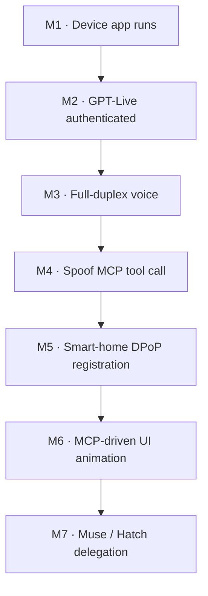
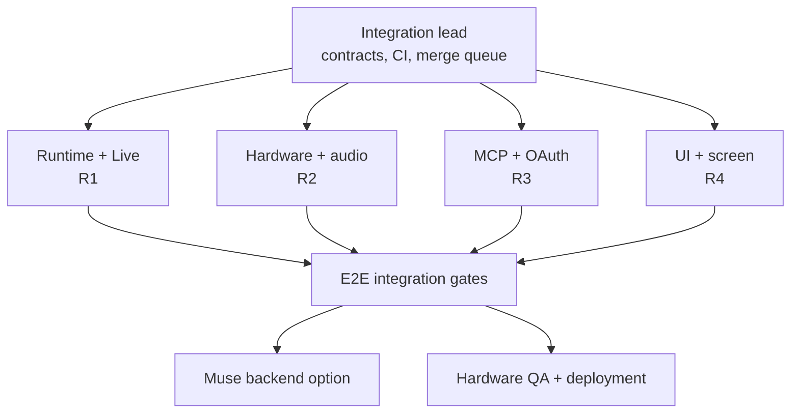
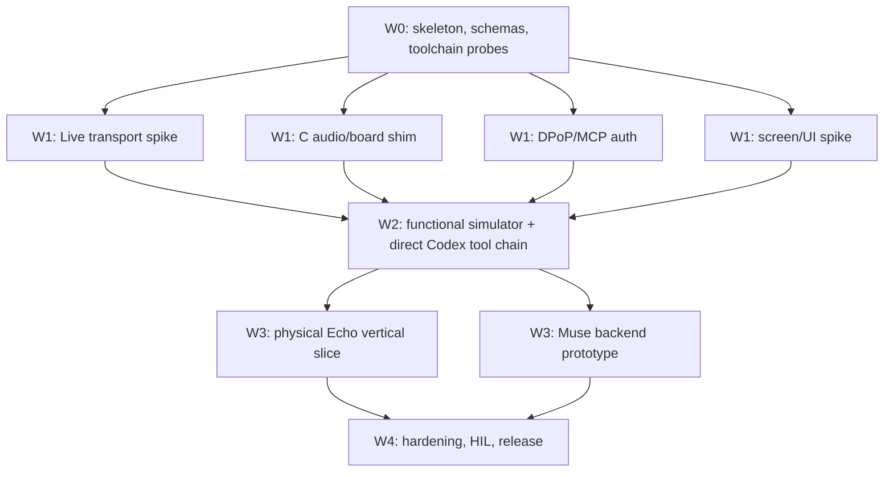
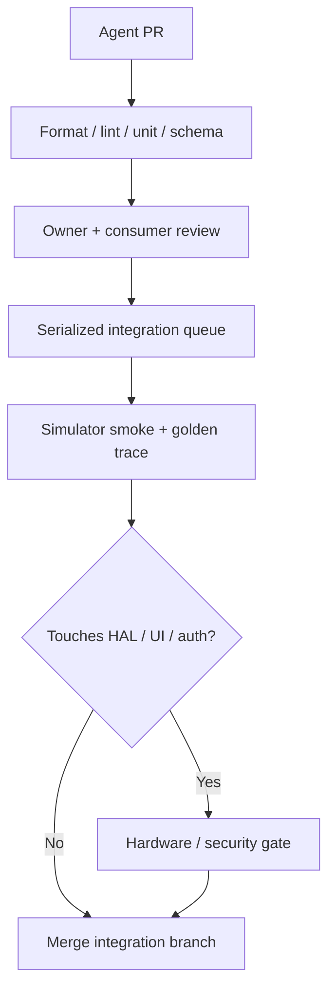

# Echo Live — parallel-agent execution plan

**Status:** Ready to turn into issues and parallel worktrees; implementation not started.  
**Parent design:** `ECHO_LIVE_IMPLEMENTATION_RFC.md` (2026-11-05).  
**Target:** Echo Show 8 Gen 2 (`athena`) with GPT-Live, client delegation, a fixed OAuth/DPoP remote MCP server,
optional Muse agent, and C native UI/hardware integration.
**Source baselines:** `echo-dot-assist` `f8b875c59dea23746e3f76628fc7ecd4aead9ec7`; Codex
`56032e9732aa9776b7f54075ed9333921596cde9`. Pins are evidence baselines, not necessarily latest upstream.

## 0. Device-verifiable happy-path milestones

These are the **primary delivery checkpoints**. Each milestone is a **working demonstration on the actual Echo Show 8
Gen 2**, not a crate merging, a green emulator test, or an unverified claim. A simulated test is a prerequisite;
physical-device proof is the completion condition. Milestones accumulate: the same installed image should still
demonstrate all earlier successes. Include automated negative/safety assertions without letting hardening obscure the
simple happy path.



| Milestone | Demonstration / user-visible definition of done | Machine-checkable evidence | Lead lanes |
| --- | --- | --- | --- |
| **M1 — App runs on device** | Reboot Show; Echo Live daemon starts automatically, screen shows `Echo Live ready`, buttons work, hardware mute is correctly reflected; app can be restarted without reboot | `adb shell` process/service alive; APK/ELF architecture and firmware hash recorded; UI snapshot; 10 restart cycles; basic memory/RSS; no unexpected Alexa/HA/Wyoming dependency | R2 + R4 + R8; I0 integrates |
| **M2 — GPT-Live auth works on device** | From the Echo, start authorized GPT-Live connection using the selected supported credential flow; screen shows `Connected` and session ID suffix; close/reopen session without manual token copying | Provider API session-created and session-closed events correlated with device trace; credentials stored per chosen design, never printed; reconnect after reboot; invalid/expired credential shows relink/error rather than pretending connected | R1 + R5 + R8, security review R3 |
| **M3 — GPT-Live voice through Echo** | Say wake word, ask “What time is it?”, hear reply through Echo speaker; while it speaks, interrupt and ask another question; real microphone remains active while playback runs | Real WebRTC media frames in/out, measured input/output audio, wake + barge-in timestamps, 20 successful turns, physical mute stops outbound mic data; external speaker/mic test optional for human demo but required for latency measurements | R1 + R2 + R8 |
| **M4 — GPT-Live + spoof MCP invocation** | Say “Call the test tool and tell me its result”; Live delegates to app-server, which calls a **local/mock remote MCP endpoint**, obtains deterministic `test.echo` response, and Live speaks the result | Exactly one correlated `delegation.created → tools/call → tool result → delegation.context.append`; mock endpoint logs tool name and arguments; test can run offline except real Live; error case gives honest voice fallback | R1 + R3 + R5 + R6 |
| **M5 — Smart-home DPoP client registration and login** | From the Show, link the **real smart-home remote MCP server**: discover authorization metadata, register/select the OAuth client through CIMD/DCR or configured client credentials, start CBL device authorization, display verification URL/code, finish login on phone, then say “What is the test light's state?” and receive a real authorized MCP result | Recorded client registration method and client ID (never secret), unique on-device DPoP public-key thumbprint, device grant approval, DPoP-bound access token, protected resource `tools/list` + one `tools/call`, correct DPoP proof per HTTP request, nonce challenge, expiry and refresh-token rotation; kill/restart retains valid grant; revoke requires relink | R3 + R4 + R5 + R8 |
| **M6 — MCP drives visual GIF/emotion state** | Say “Show me a happy face” or “Show me a sad face”; GPT-Live delegates to `ui.show_emotion` on spoof MCP; Show presents a corresponding **animated** happy/sad face (GIF or decoded frame sequence), then resets; audio conversation remains usable | MCP log records action, task and UI event IDs match, screen recording confirms correct animation frames (not merely first GIF frame); animation timeout and `clear` action; UI crash/restart doesn't duplicate action; physical mute indicator remains visible | R4 + R3 + R5 + R8 |
| **M7 — GPT-Live dispatches to Muse/Hatch** | Say “Ask Muse to run the test job”; GPT-Live delegates, on-device controller sends task via the **Hatch/Muse bridge**, Muse performs a harmless test operation, result returns to GPT-Live and is spoken; Show displays working/completed state | Correlated `delegation_id → task_id → Muse session_id → result`; bridge records Muse SDK request/response, demonstrably real paired Muse account and work performed, bounded timeout, no duplicate execution; failure produces a safe voice response | R7 + R1 + R5 + R4 + R8 |

### 0.1 What “on-device” means for these demos

- **M1 and M3 hardware path must physically run on the Echo.** The Echo owns capture, wake, output, screen, buttons and
  hardware privacy.
- **M2 and M4–M7 have a placement flag** recorded in evidence: `agent_placement=on_echo` or
  `agent_placement=lan_gateway`. For the *on-device app-server* hypothesis, **M2/M4/M5 are not fully accepted until
  Codex session control and the OAuth/MCP host actually run on the Echo**. A LAN-gateway demonstration can be marked
  `fallback-green`, not misreported as `on-device-green`.
- **M2 is provider authentication, not MCP OAuth.** Use a documented OpenAI Live API project credential on a trusted
  execution environment for initial smoke, or a verified supported Codex app-server login flow if actually proven.
  ChatGPT account tokens must not be assumed to authorize arbitrary `gpt-live-1` API usage. Record `provider_auth_mode`
  in the trace without storing the secret. Device login to MCP using CBL/DPoP is a separate **M4-auth extension** once
  the spoof bearer-free MCP test is green.
- **M4 spoof endpoint is intentionally authentication-free**, bound to localhost or the isolated lab network, with a
  hardcoded `test.echo` tool. **M5** is the separate production-shaped fixed remote MCP + smart-home CBL/DPoP
  verification. Never ship with the spoof server enabled outside test mode.
- **M5 registration is not the same as DPoP.** CIMD (client metadata document), DCR (dynamic client registration), or a
  preregistered client ID/secret establishes the OAuth **client identity** according to the server's supported metadata.
  CBL establishes **user authorization**, while DPoP signs each token/resource request with a device-held private key to
  bind tokens to the client. A device-code grant is not proof that the server supports CIMD or DCR: discover first,
  register by a supported path, and fail clearly if incompatible. Treat a confidential client secret on a rooted Echo as
  extractable and prefer a public-client profile when authorized by the AS.
- **M5 smart-home safety:** Start with an innocuous state query or test/simulator light. Any real state-changing command
  uses explicitly authorized scope and separate human confirmation as configured. Reuse no production home account in
  automated CI. Verify DPoP proofs at the resource server and the authorization server (including `ath` where required),
  and test refresh after process restart and revoked authorization.
- **M6 GIF requirement:** Existing C renderer's Android `BitmapFactory` JPEG/static image path does not establish
  animated GIF playback. Implement a bounded animation player (decoded frames and timing) or a known-working WebView
  component; do not count a static image as a passing animated demo. Prefer a bundled, original/redistributable
  two-state asset to avoid network or copyright variables.
- **M7 “Hatch interface” must be experimentally verified.** Meta Muse Gadget SDK's documented Linux `send-user-msg`
  bridge is a message-to-agent mechanism, not proof of general remote MCP or a durable agent task API. Start with a
  verifiable harmless Muse Linux gadget action, then prove the actual requested external MCP path separately. If
  unsupported, report a `blocked-by-upstream-capability` result; do not fabricate task success.

### 0.2 Standard milestone test invocation and artifact

Every milestone gets a deterministic host precheck and a named device harness command. These are **planned CLI
interfaces**, not existing scripts:

```bash
echo-lab check --milestone M1 --target athena --simulate
echo-lab run   --milestone M1 --target athena --device adb
echo-lab run   --milestone M2 --target athena --device adb
echo-lab run   --milestone M3 --target athena --device adb --acoustic
echo-lab run   --milestone M4 --target athena --device adb --mock-mcp
echo-lab run   --milestone M5 --target athena --device adb --smart-home-test --oauth-dpop
echo-lab run   --milestone M6 --target athena --device adb --mock-mcp --camera
echo-lab run   --milestone M7 --target athena --device adb --muse-test
```

All reports use the same schema:

```json
{
  "milestone": "M6",
  "result": "pass",
  "placement": "on_echo",
  "build_commit": "<git-sha>",
  "device": {"model": "athena", "firmware_hash": "<sha256>"},
  "evidence": ["events.jsonl", "mcp_calls.jsonl", "screen_recording.mp4"],
  "checks": {"tool_called_once": true, "frames_animated": true, "privacy_preserved": true},
  "limitations": []
}
```

The harness should produce a timestamped directory `artifacts/<milestone>/<run-id>/` containing the report, redacted
traces, UI recording, and any audio metrics. For human demo steps that cannot yet be automated, the report must say
`manual_observation` and record who/what observed it. Do not auto-mark `pass` merely because a process exited zero. All
artifacts exclude raw tokens and unnecessary personal voice recordings.

### 0.3 Exact blocking dependencies

| Milestone | Minimum issues to integrate | Can proceed in parallel before device gate? | Exit condition |
| --- | --- | --- | --- |
| M1 | EL-001/002/003, EL-201, EL-401/402, EL-801 | Hardware, UI and basic Rust app launch | Daemon + UI boot proof |
| M2 | M1, EL-004, EL-101 | Provider auth/session controller | Session created/closed with explicit placement |
| M3 | M2, EL-102, EL-203, EL-802 baseline | Audio/peer and acoustic bench | Full-duplex speech with barge-in |
| M4 | M3, EL-303 mock mode, EL-501, EL-601/602 | Mock MCP tests, Codex adapter | One traced tool result spoken |
| M5 | M4, EL-301/302/303 OAuth, new EL-304 registration, EL-502 setup UI | OAuth/DPoP + server registration tests | Fixed real smart-home test MCP with client registration, CBL, DPoP, refresh |
| M6 | M4, EL-401/402/502, new EL-404 animation fixture | UI independently built with fake events | MCP-selected correct animated UI |
| M7 | M4, EL-701/702, UI progress from M6 | Muse proof independent of M6 | Real Muse task and spoken result |

**Scheduling refinement:** M7's implementation can start as soon as M4 contracts stabilize; it does **not** technically
need GIF rendering or smart-home OAuth. We list M5/M6 before M7 for a satisfying sequential demonstration, but do not
make R7 idle while the UI/auth agents finish their lanes. The integration lead signs off on each M1–M7 test artifact and
preserves passing regression checks for every later demo.

## 1. How to organize parallel work

**Recommended initial team:** one integration lead plus **four active implementation agents**; escalate to six or seven
only after stable contracts. There are **nine ownership lanes**, not nine agents editing at once. The integration lead
handles design arbitration, contract versioning, integration tests, release gates and changes to shared workspace
configuration.



**Why this fan-out:** hardware/audio, Live, MCP auth, and UI are independently testable if their contracts are frozen
first. Codex patching, on-device native builds, and the root daemon are *shared hotspots* and must be serialized behind
one owner/merge queue. Muse is lower-confidence and should not block the direct-MCP vertical slice.

### 1.1 Agent lanes and exclusive edit ownership

| Lane / ID | Scope and package ownership | Dependencies | Initial deliverable |
| --- | --- | --- | --- |
| **I0: integration lead** | `Cargo.toml`, `Cargo.lock`, `rust-toolchain.toml`, CI, `crates/echo-contracts`, `echo-agent-api`, `echo-config`, architecture ADRs | None | Compiling skeleton, v0 schemas, smoke CI |
| **R1: GPT-Live/session** | `crates/echo-live`, `echo-webrtc`; Codex Live RPC adapter (not Codex core edits yet) | I0 event models; H audio port | Mock Live→delegation→result, WebRTC local peer spike |
| **R2: native device/audio** | `native/cshim`, `echo-device`, `echo-audio`, `testdata/boards`; narrow `repo/src/hassmic` extraction | I0 board/audio interfaces | Testable C ABI + real privacy/audio probe |
| **R3: MCP security** | `echo-mcp-auth`, `echo-mcp-client`, mock OAuth AS and MCP fixture server | I0 agent/tool schemas | CBL/DPoP + refresh tests and one real sandbox tool |
| **R4: UI/presentation** | `echo-ui-contract`, `echo-ui-show`, `web/ui`, native UI adapter; UI snapshot fixtures | I0 UI event schema | Screen state, approval UI, HTML/native renderer spike |
| **R5: Codex runtime packaging** | `echo-agent-codex`, pinned Codex fork/vendor patchset only | R1 delegation; R3 MCP client; feasibility | Agent-owned single remote MCP tool call via app-server |
| **R6: simulator/functional tests** | `echo-simulator`, `apps/echo-sim`, `tests/functional`, trace harness | I0 schemas; H port skeleton | Fake-clock end-to-end lab with fault injection |
| **R7: Muse backend** | `echo-agent-muse`, `apps/echo-muse-bridge`, Muse fixtures | I0 agent API; initial direct path green | Correlated task+result against real Muse Linux SDK |
| **R8: hardware test/deploy** | `tests/hardware`, `scripts/hil`, `docs/hardware`, `docs/operations`, `devices/athena` deployment manifests | H + Live baseline | ADB bench, acoustic tests, rollback checklist |

**Collision rule:** No independent agent edits the same crate or root manifest without an explicit handoff. In
particular, **R1 does not directly modify Codex `core/` while R5 owns the Codex fork**; R4 does not modify
`src/ui/android.c` while R2 changes C shim extraction until the adapter boundary is settled. R8 only touches launch
scripts after I0 authorizes the deployment layout.

### 1.2 Worktree and branch topology

```text
origin/main (protected; source baseline)
  feature/00-contracts-ci             I0
  feature/01-live-transport            R1
  feature/02-native-device-audio       R2
  feature/03-mcp-oauth-dpop            R3
  feature/04-ui-presentation           R4
  feature/05-codex-runtime             R5, after first gate
  feature/06-simulator                 R6, after first gate
  feature/07-muse-bridge               R7, experimental
  feature/08-hardware-lab              R8
integration/live-mcp-vertical          integration lead only
```

Each agent gets a separate git worktree and a narrowly scoped package tree. Do **not** assign all agents a common
mutable working directory; that risks lost edits and invalid observations. PRs target `integration/live-mcp-vertical`
until the vertical slice meets criteria; main receives small passing batches. Branch names are examples, not evidence
that branches exist.

## 2. Dependency graph and fan-out waves



### W0 — contracts and proof-of-compile (2–4 days; lead + one feasibility agent)

- Initialize workspace and build scripts without changing source baselines.
- Freeze draft event payloads: `BoardEvent`, `AudioFrameMeta`, `LiveEvent`, `DelegationId`, `TaskEvent`,
  `ElicitationRequest`, `UserDecision`, `UiState`.
- Introduce traits `Board`, `AudioSource`, `AudioSink`, `LiveSession`, `AgentBackend`, `McpTransport`, `UiPresenter`,
  `Clock`. The traits must permit in-memory fakes.
- Establish correlation semantics: `session_id`, `delegation_id`, `task_id`, `tool_call_id`, `elicitation_id` (all
  distinct, mandatory where relevant).
- Build a trivial `armv7-linux-androideabi` Rust executable and C `libhmui` dependency probe; separately attempt Codex
  app-server for Android ARMv7 and record *all* compilation blockers. No assumption that a full Codex build succeeds.
- Publish generated JSON schema and Rust fixture constructors; all W1 agents consume exactly this version.

**Gate G0:** Host test workspace green; v0 protocol/ABI documented; native toolchain build smoke executed; owners
assigned; no uncommitted shared changes.

### W1 — four independent parallel branches (1–3 weeks; four agents)

### R1 — Live/media

1. Implement a mockable Live session controller: create, attach sideband, receive delegation, append result, close.
2. Build an interoperable WebRTC media peer using an established library; measure Opus encode/decode and buffering;
   never implement ICE/DTLS/SRTP from scratch.
3. Test simultaneous upstream capture/downstream playback and barge-in. Use synthetic PCM before real board.
4. Output a transport ADR comparing a native media peer and a WebSocket PCM fallback. GPT-Live WebRTC media **must
   remain track-based**, not data-channel audio chunks.

### R2 — hardware/audio

1. Preserve existing `hassmic` stock HAL/Pryon audio capture, playback, wake word, volume, mute latch and button
   behavior through a C ABI.
2. Export native board events and audio frames without importing agent/session crates into C.
3. Provide `MockBoard`, fake input devices, and a host build of the same C parser.
4. Capture known `athena` hardware facts in a schema-backed manifest. Never make `/dev/input/eventN` a stable identifier
   or infer SoC GPIO pin numbers.

### R3 — MCP auth

1. Build a deterministic OAuth test AS implementing CBL, refresh-token rotation, DPoP nonce/jti, and negative cases.
2. Implement exactly one fixed remote MCP URL, one OAuth issuer allowlist, strict tools/call schema validation and tool
   policy.
3. Add secure storage abstraction and a singleflight refresh coordinator; assert one refresh under concurrent tool
   requests.
4. Implement mock `tools/list`, `tools/call`, and elicitation initiation. No credential propagation into UI/model text.

### R4 — UI

1. Trace and isolate existing `screen.c → screen.dex/app_process → libhmui.so → SurfaceControl/ANativeWindow` interface.
2. Render listening/speaking/tool-working/privacy/approval states with mock UI protocol events. Provide desktop
   snapshots.
3. Prototype Android System WebView or native Android activity for HTML/CSS. Check coexistence with native surface band
   and input focus on real Show.
4. Keep native wake/mute/band status independent of WebView; proposed UI templates should not require web engine for
   critical safety state.

**Gate G1:** Each lane has a host-testable public interface, a recorded demo/trace, an ADR for nontrivial dependency
choices, lint/format passing, and no cross-lane edits.

### W2 — integration without hardware (1–2 weeks; lead + R5 + R6)

1. **R5** wires the pinned Codex app-server delegate through `echo-agent-api` and to R3's remote MCP. Disable local
   shell/file tools by explicit policy and test the absence of those capabilities.
2. **R6** brings up a simulated board + mock Live events + fake OAuth + deterministic MCP server. End-to-end flow must
   complete using one command without Internet access.
3. Integrator merges R1/R2/R3/R4 contract-compatible changes and creates a **single golden trace** from wake to spoken
   tool result.
4. Add negative flow: privacy mute mid-speech, 401 during tool execution, delayed approval, duplicate
   `delegation.created`, dropped network, stale Muse/agent result.
5. Emit a machine-checkable final report: event ordering, call count, latencies, final UI state, auth redaction.

**Gate G2 — minimum vertical slice:**
`wake → live delegation → one authenticated MCP tools/call → returned context → spoken answer` passes in simulation. One
MCP action owner, exact ID correlation, and no blind replay of nonidempotent calls.

### W3 — device proof and optional Muse fork (1–3 weeks)

- **R8** uses the rooted Echo Show 8 Gen 2 to test real microphone, speaker, wake, full duplex, barge-in, hardware mute,
  Show rendering, device-code setup and DPoP refresh. Integrator records RSS, thermal, audio underruns, network delay
  and firmware hash.
- **R7** implements Muse *after* the backend interface and direct path stabilize. It runs Meta Muse Linux SDK on a
  separate Linux host, not directly on the Echo. It wraps `send-user-msg` behind `submit/events/cancel` and proves task
  result correlation. Confirm whether Muse can actually call the intended remote MCP through a supported tool path;
  otherwise label this mode experimental.
- R5 completes the Codex on-device build attempt with binary/memory profile; if impossible or unstable, ship the same
  RPC adapter on an authenticated LAN host. Do not block all development on local app-server feasibility.

**Gate G3:** At least 20 successful observed live device turns, working DPoP grant and refresh, privacy proof,
measurable barge-in, and clear rollback. Muse is independently feature-gated and not required for G3.

### W4 — production hardening (2–4 weeks; R6/R8 plus audit)

- Golden acoustic test matrix: quiet/TV/music/babble, distances, SNR sweeps, double-talk/AEC, barge-in, ducking
  attack/release, long sessions.
- 24-hour connected soak, power cycle during token rotation, restart during nonidempotent tool, network chaos,
  invalid/expired grants, interrupted approvals, app foreground switching and screen sleep/wake.
- Security/permissions review: rooted device exposure; DPoP key storage; OAuth issuer/resource binding; approval user
  identity; WebView native IPC; process privilege separation.
- Generate SBOM and provenance; release signing; upgrade/rollback test; recovery documentation.

**Gate G4:** All safety invariants and release SLOs in parent RFC satisfied; no unresolved critical defects; install and
rollback reproducible on test device.

## 3. Stable contracts: the mechanism that unlocks fan-out

All contracts live in `echo-contracts`/`echo-agent-api` and get frozen at W0. Changes after G0 must use an **interface
change proposal** with compatibility decision and tests.

| Contract | Producer | Consumer | Freeze in W0 |
| --- | --- | --- | --- |
| `BoardEvent {time, seq, kind}` | R2 | R1/R4/R6 | Key, mute, wake, touch, thermal, network |
| `AudioFrame {stream, seq, pts, format}` | R2 | R1 | 16-bit PCM, clock domain, backpressure semantics |
| `LiveEvent {session, delegation, kind}` | R1 | R5/R6/R4 | Started/closed, transcript, speech, delegation |
| `DelegatedTask`, `TaskEvent` | R1 | R5/R7 | Task ID, deadline, cancellation, progress, result |
| `McpToolCall {tool, arguments, policy, idempotency}` | R5/R7 | R3 | Tool schema and exactly-once decisions |
| `ElicitationRequest {id, mode, schema/url, deadline}` | R3/R5 | R4 | Form/URL, verified user choice, cancel |
| `UiState`, `UiAction` | Runtime | R4/R6 | Declarative state, no secrets, explicit action IDs |
| `BoardManifest` | R2 | R6/R8 | Model/version, evdev names/codes, geometry, hardware latch |

**Event bus choice:** use bounded, typed in-process channels on the Echo; cross-process UI transport uses versioned
framed messages over a Unix-domain socket. Make this transport a thin adapter; don't permit C shims or UI to import
Codex RPC directly.

### 3.1 Contract evolution rule

1. Contract author adds a JSON fixture and generated/schema test.
2. At least one producer and one consumer agent approve the change.
3. Integration lead merges a compatibility shim or increments schema major version.
4. Only after integration CI passes do downstream lanes pick up the new contract.

Avoid “agent A assumes field X, agent B assumes field Y” by making generated types and fixtures the **single executable
truth**.

## 4. Test ownership and independent acceptance oracles

| Suite | Owner | Runs | Oracle |
| --- | --- | --- | --- |
| Unit: C evdev/audio and Rust protocol | R2/R1/R3/R4 individually | Every PR, host | Strict state/assertion/property tests |
| Contract: message and FFI ABI | I0 | Every PR, host/cross | Schema snapshots, C/Rust size/align, wire fixtures |
| OAuth/MCP functional | R3 | Every PR, network-free mock AS | Token signatures, issuer, rotation and call logs |
| Live delegated flow | R1/R5 | Nightly, mocked and cloud gated | Session/delegation ID causality and output events |
| Simulated board functional | R6 | Every PR, host | Deterministic trace event sequence and deadlines |
| UI visual snapshots | R4 | Every PR, desktop; hardware gate | Rendered image diff, touch target/contrast check |
| Native Android cross-build | R2/R5 | Every PR or nightly | Artifact plus actual device link test |
| HIL acoustic/visual | R8 | Nightly or manual gated | External mic/camera **plus** instrumented device logs |
| Security/policy abuse | I0/R3 | Every PR + release | Tool allowlist/approval/no secret leakage/no replay |
| Muse remote task | R7 | Gated real-account environment | Task correlation, correct tool outcome, timeout/cancel |

**A camera and Port OS alone are not sufficient** to assert privacy or exact tool execution. R8 must separately collect
`adb`/evdev/PCM counters and remote MCP audit logs. Port OS can be an authorized source of snapshots/streams when the
specific camera is connected and permissions exist; a controllable, clocked speaker and reference mic are separate
hardware capabilities.

### 4.1 Acceptance criteria for every agent PR

Each PR must include: (a) changed crates/files, (b) contract version used, (c) executable test invocation, (d)
machine-readable test result or trace, (e) risks/unknowns, (f) rollback or feature-gate behavior, (g) no unrelated
formatting or other lane modifications. Tests must not require a physical Echo or production credentials unless tagged
`hardware`/`cloud` and excluded from host CI.

## 5. Merge queue, code review, and CI policy

**Workflow:** one agent owns one branch and submits small PRs. Integration lead serializes root `Cargo.lock` updates,
shared traits, C ABI, and Codex fork updates. Consumers test against the pinned version or a published integration
branch commit, not against uncommitted edits in another worktree.



Required commands (adjust to actual workspace tools as initialized):

```bash
cargo fmt --all -- --check
cargo clippy --workspace --all-targets --all-features -- -D warnings
cargo nextest run --workspace
cargo deny check
clang-format --dry-run --Werror native/cshim/*.c
shellcheck scripts/hil/*.sh
```

The integration lead adds `cargo build --target armv7-linux-androideabi` and release artifact validation only after the
Android NDK/toolchain is available. Avoid an `--all-features` gate for mutually exclusive hardware backends until
feature design is finalized. Have a clear license/advisory exception policy for pinned Codex dependencies.

## 6. Agent prompts: ready-to-assign task cards

Each lane below can be issued to a coding agent **after G0**, with a separate worktree and branch. Replace placeholders
for worktree paths and contract tags with actual values. These are briefs, not authorization to manipulate physical
hardware or live external accounts.

### Card R1 — GPT-Live transport and session

> Own `echo-live` and `echo-webrtc` only. Implement mockable Live session lifecycle, a sideband event adapter,
delegation correlation, clean close, and a known WebRTC peer library integration spike. Use `echo-contracts@<commit>` as
immutable API. Test overlapping capture/playback, barge-in, stream closure, and duplicate delegation. Do not edit Codex
core, OAuth code, board drivers, or shared manifests. Submit a small PR with smoke demo, tests, package size/latency
notes, and protocol risks.

### Card R2 — Echo C shim, audio, and board

> Own `native/cshim`, `echo-device`, `echo-audio`, board fixture. Extract the minimum working
capture/playback/wake/privacy interface from pinned `echo-dot-assist`, preserving exact hardware-latch authority and
named evdev devices. Create Linux-host fake device streams, C ABI verification, `athena` manifest with provenance. Never
invent physical GPIO pad/line IDs. Do not change agent/live/MCP crates. Submit ABI header, tests, and a controlled
hardware probe procedure.

### Card R3 — remote MCP + OAuth/DPoP

> Own `echo-mcp-auth`, `echo-mcp-client`, mock OAuth/MCP servers. Support one configured resource server, CBL device
grant, client registration mode selection, DPoP-bound access and refresh, nonce, expiry, rotation, revocation, token
redaction, singleflight refresh and strict tool policy. Test negative and concurrent cases deterministically with fake
clock. Do not edit UI or Codex core. Return a mock `tools/call` and elicitation request to contract consumers; note
where Codex adapter still needs integration.

### Card R4 — Show UI/native/WebView experiment

> Own `echo-ui-contract`, `echo-ui-show`, `web/ui`, and UI-only fixtures. Build declarative states and interactions for
idle/listening/speaking/tool progress/physical mute/MCP approval; render on desktop and prove a minimal screen on Show
via the existing `screen.dex/libhmui.so` SurfaceControl bridge. Independently spike WebView composition with light band
and input focus. Do not modify C board/audio or agent/MCP implementation. Deliver visual snapshots, testable UI
protocol, memory timings and recommendation native vs WebView.

### Card R5 — Codex backend packaging

> Own `echo-agent-codex` and a narrowly scoped pinned Codex fork. Implement `AgentBackend` using app-server Live
delegation and Codex MCP calls, with single allowed remote MCP endpoint and local command/file tool policy disabled.
Work from `echo-contracts@<commit>` and R3 MCP auth integration contract. Ensure elicitation is forwarded to an Echo UI
request ID and resolved once. Measure Android ARMv7 build blockers and RSS. Do not change physical hardware or renderer
code. Produce one deterministic end-to-end fixture and a list of upstream patches.

### Card R6 — deterministic system simulator

> Own `echo-simulator`, `apps/echo-sim`, functional tests and test traces. Run all production protocols through
in-memory fakes and a clock that can be advanced without sleeping. Cover wake noise/false wake, AEC-like echo fixtures,
barge-in, ducking, delayed privacy latch, Wi-Fi failure, 401/nonce/refresh, crashed UI, tool timeout, duplicate
invocation and approval. No hardware or live OAuth dependency. Submit CLI entrypoint, golden trace and CI integration
instructions.

### Card R7 — Muse backend research and prototype

> Own `echo-agent-muse` and `apps/echo-muse-bridge` only. Validate real supported Muse Linux SDK task/message behavior;
implement a correlated adapter to `AgentBackend` with deadlines, cancellation and sanitized progress. Keep Muse on
ordinary Linux host. Prove whether remote MCP execution is actually possible through supported account/tool facilities;
if not, return a precise gap report rather than fabricating a bridge. Never let Muse responses substitute for human
elicitation or copy DPoP-bound Echo credentials.

### Card R8 — hardware validation and deployment

> Own `tests/hardware`, bench scripts, board probing and deployment docs. Configure a repeatable Echo Show 8 Gen 2 test
bench with ADB, firmware hashing, external loudspeaker/mic, optional authorized Port OS camera, trace correlation, safe
credential fixtures and rollback. Do not modify kernel, partition images, or live device state without explicit owner
approval. Produce runbooks and measured reports for audio, privacy, UI, OAuth/MCP and 24h soak. Coordinate deployment
script edits with the integration lead.

### Integration lead card

> Own shared contract crates, toolchain, workspace configuration, CI, versioned schemas, merge order, threat model and
release checklist. Freeze W0 interfaces, publish an immutable contract commit, assign exclusive paths, review every
cross-lane change, and implement one golden trace in the integration branch. Do not accept unverified hardware claims,
mutable secrets in traces, auto-replayed nonidempotent tools, or a UI path that can clear physical mute. Maintain an
issue dashboard with owner, dependency, proof, and state.

## 7. Issue structure / tracking template

Use one epic per wave and one issue per testable deliverable; avoid assigning an entire crate ecosystem as a single
giant ticket. Example:

```yaml
id: EL-103
wave: W1
lane: R3
title: Implement DPoP-bound refresh and nonce retry
depends_on: [EL-001, EL-102]
owned_paths:
  - echo-live/crates/echo-mcp-auth/**
acceptance:
  - refresh_rotation_singleflight_test passes
  - nonce_retry_regenerates_proof_test passes
  - no_tokens_in_trace_snapshot passes
artifacts:
  - tests/functional/oauth_refresh_trace.json
  - docs/protocols/mcp-auth.md
gate: G1
risk: high
hardware_required: false
```

**Issue states:** `blocked` → `ready` → `in-progress` → `review` → `integration` → `accepted`. A blocked issue must name
the specific upstream contract/decision, not a generic “waiting on another agent.”

## 8. Decision boundaries and technical stop conditions

| Question | Time-box / owner | If unsuccessful |
| --- | --- | --- |
| Can Codex app-server cross-compile and run on `athena`? | W0/W3, R5 | Run app-server on trusted LAN host using same RPC; Echo remains media/UI peer |
| Can native WebRTC connect reliably with simultaneous mic/playout? | W1, R1+R2 | Try alternate established peer stack; reconsider WebSocket transport after latency measurements |
| Can existing JNI screen coexist with WebView? | W1, R4+R8 | Native UI for v1, separate Android media app only where proven |
| Does fixed MCP endpoint support CBL, DPoP, CIMD/DCR exactly as assumed? | W1, R3 | Document actual server metadata, adjust flow; no insecure auth bypass |
| Is Muse SDK a supported general delegated agent executor with MCP? | W3, R7 | Keep Muse experimental/off; direct Codex MCP remains shipping backend |
| Is user approval possible on headless device? | W2/W3, R4 | Pair phone or deny action; never synthesize approval |

## 9. First concrete backlog (suggested order)

| Ticket | Owner | Deliverable | Predecessors |
| --- | --- | --- | --- |
| EL-001 | I0 | Rust workspace + CI skeleton | — |
| EL-002 | I0 | Shared ID and event contract v0 | EL-001 |
| EL-003 | I0 | Board/UI/agent traits + fixtures | EL-002 |
| EL-004 | R5/I0 | Android ARMv7 Codex build feasibility report | EL-001 |
| EL-101 | R1 | Mock GPT-Live session/delegation lifecycle | EL-002 |
| EL-102 | R1 | WebRTC/Opus interop proof | EL-101 |
| EL-201 | R2 | C hardware ABI host build | EL-003 |
| EL-202 | R2 | Privacy/button fake device tests | EL-201 |
| EL-203 | R2 | Live Echo audio capture/playback proof | EL-201 |
| EL-301 | R3 | Mock OAuth AS + CBL tests | EL-002 |
| EL-302 | R3 | DPoP refresh, nonce, rotation | EL-301 |
| EL-303 | R3 | Fixed remote MCP tools/list/call and policy | EL-302 |
| EL-304 | R3 | Smart-home OAuth client registration (CIMD/DCR/pre-registered), CBL + DPoP device-link and restart/refresh validation | EL-301, EL-302, EL-303 |
| EL-401 | R4 | UI states and desktop snapshots | EL-003 |
| EL-402 | R4 | Android JNI native display adapter | EL-401 |
| EL-403 | R4 | WebView/SurfaceControl interop spike | EL-402 |
| EL-404 | R4 | Animated happy/sad UI, tool-driven state mapping and hardware snapshot tests | EL-401, EL-402 |
| EL-501 | R5 | Codex app-server agent adapter | EL-101, EL-303 |
| EL-502 | R5/R4 | MCP elicitation UI/response bridge | EL-401, EL-501 |
| EL-601 | R6 | Deterministic board + fake-clock functional suite | EL-202, EL-101 |
| EL-602 | I0/R6 | Golden trace: voice→MCP→voice | EL-303, EL-501, EL-601 |
| EL-801 | R8 | Physical-device automated probe + HIL harness | EL-203, EL-402 |
| EL-802 | R8 | Acoustic/noise/barge-in/ducking bench | EL-102, EL-801 |
| EL-701 | R7 | Muse bridge supported-capability proof | EL-002 |
| EL-702 | R7 | Muse backend with real task correlation | EL-701, EL-602 |

**Practical first dispatch:** Start **EL-001/002/003** with the integration lead and **EL-004** with the feasibility
specialist. Once the contract commit is frozen, assign **EL-101, EL-201, EL-301, EL-401** simultaneously to four agents.
The first shared integration target is **EL-602**, not a complete device product.

## 10. Status and evidence discipline

- Every PR and test report labels facts as **verified source**, **measured on physical device**, **observed in
  simulator**, or **hypothesis**.
- Source paths shown here describe *proposed ownership*, not files already implemented.
- The baseline repo confirms input names, privacy state and JNI architecture. It does **not** prove every physical GPIO
  pad index, WebView interoperability, Android ARMv7 Codex packaging, or Muse remote MCP interoperability.
- Agents may read other lanes' code and fixtures but must route modifications through the owner or an explicit
  integration-lead handoff.
- Update this plan after G0 and each gate; keep ADRs and contract schemas as authoritative implementation details.
