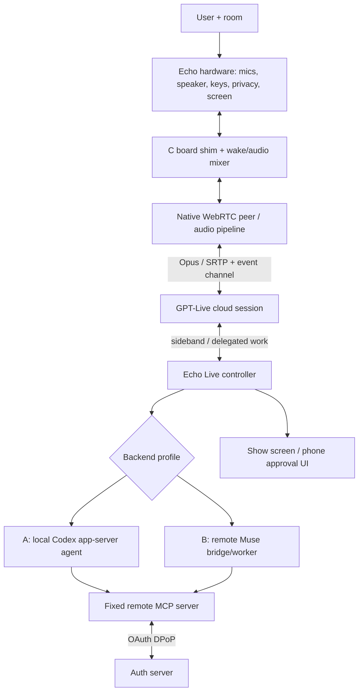
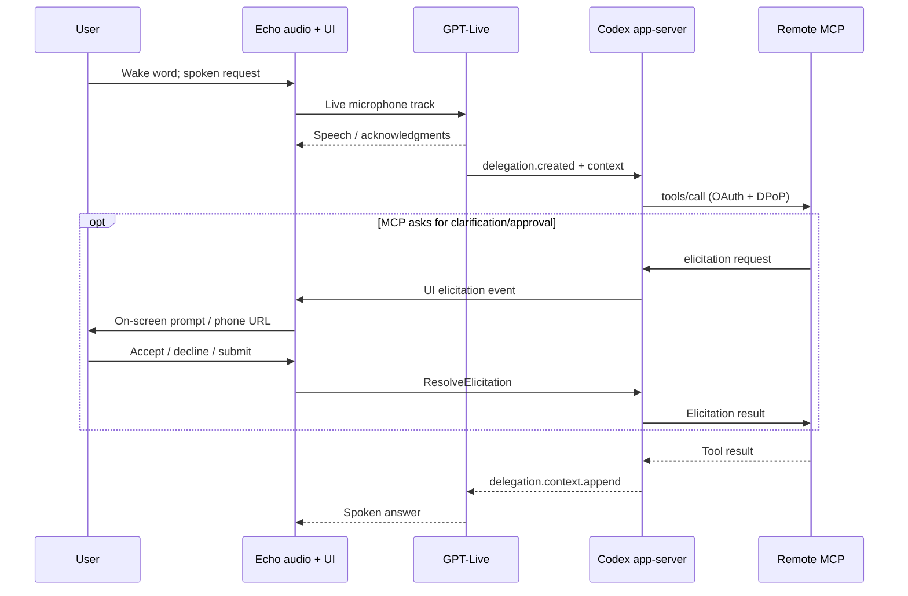
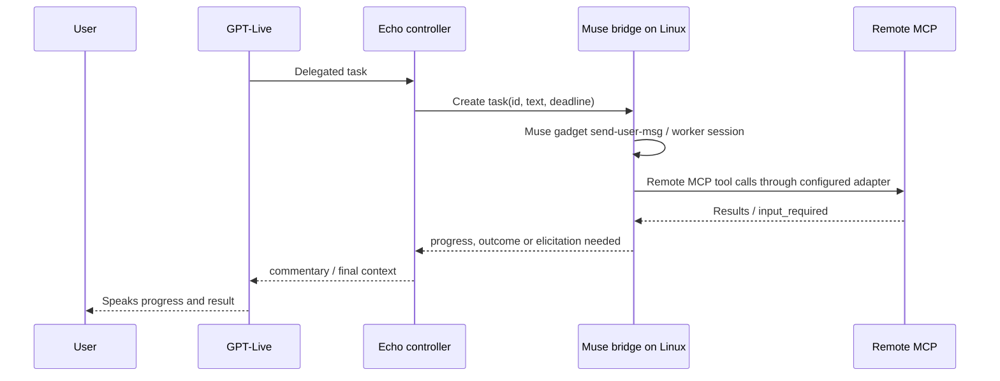
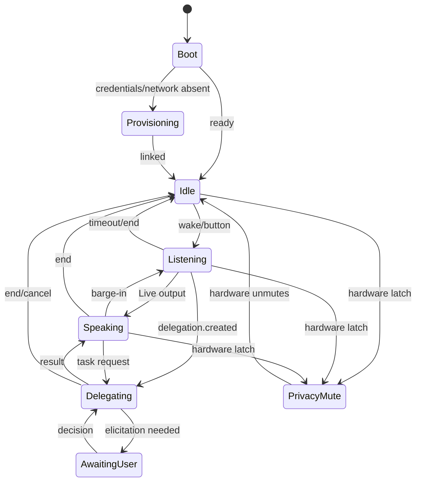
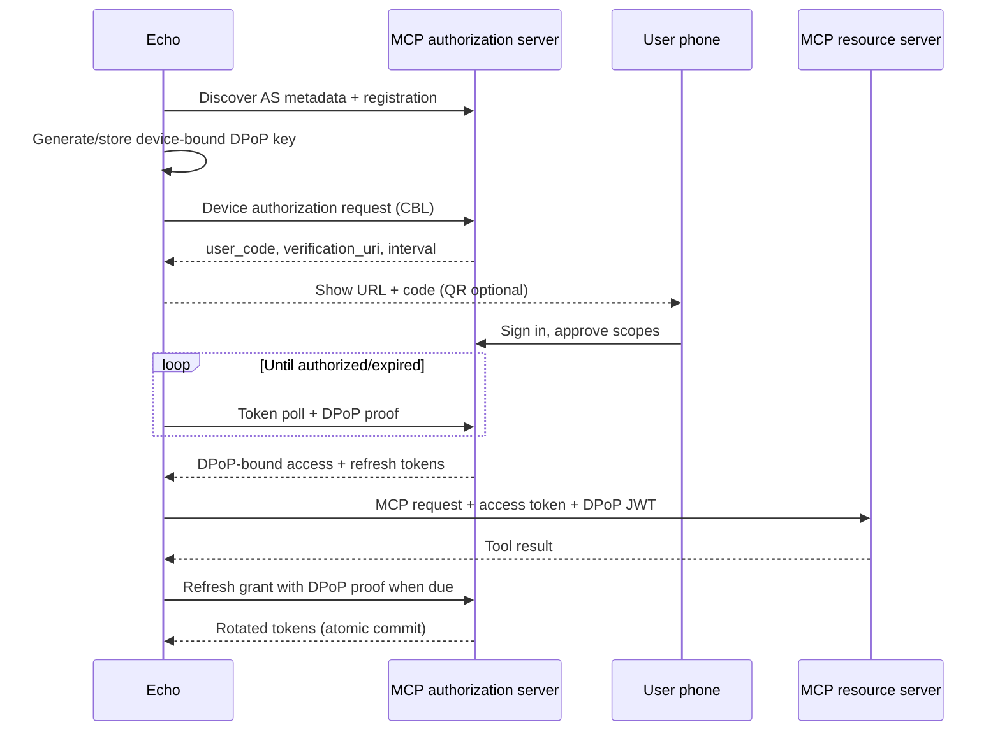

# Echo Live: GPT-Live + remote MCP implementation RFC

**Status:** Proposed design, not yet implemented  
**Baseline:** `Gamer92000/echo-dot-assist` at `f8b875c59dea23746e3f76628fc7ecd4aead9ec7`; `openai/codex` at
`56032e9732aa9776b7f54075ed9333921596cde9`
**First target:** Echo Show 8 2nd generation (`athena`, MT8183, Android 9, 32-bit userland, 2 GB RAM). **Second
target:** Echo Dot 2 as a thin audio satellite.
**Out of scope for v1:** ESPHome, Wyoming, Home Assistant, Music Assistant, local shell/code-edit tools, a generic
plugin ecosystem, new kernel drivers, custom WebRTC protocol implementation.

## 0. Executive decisions

1. **Use GPT-Live as the voice front end and a single delegated nonvoice agent as the only owner of MCP tools.**
   Implement two selectable backend profiles: **A. Codex app-server local agent** and **B. remote Muse worker**. Never
   allow both to execute the same action.
2. **Reuse Codex source as a pinned dependency/fork, not by embedding the entire CLI/UI.** The first spike must prove a
   trimmed app-server/core can compile, launch, connect, and execute a remote MCP tool on `armv7-linux-androideabi`
   (Android 9, API 28). Until that gate passes, maintain a Linux host execution mode with an on-device audio peer and
   the *same* RPC contract. Calling full on-device viability **unproven** is intentional.
3. **Keep C device hardware drivers at first.** The existing `hassmic` C code talks to stock audio HAL, Pryon wake
   detection, evdev, privacy latch, ALSA amplifier, and Android surface APIs. Wrap it in a stable ABI and progressively
   remove ESPHome/Wyoming/Music Assistant integration.
4. **Use WebRTC media on the Echo plus sideband control in the agent host.** WebRTC peer handles ICE/DTLS/SRTP/Opus, not
   just PCM-to-network. Prefer a small native media transport using `libdatachannel` C API and Opus, subject to an
   interoperability spike. The Codex side creates/attaches to the GPT-Live session and owns client delegation.
5. **MCP endpoint is fixed at build/deployment time in v1.** Its OAuth credentials belong to the Echo installation or an
   explicitly chosen secure gateway; never expose refresh tokens to the voice model, Muse prompts, JavaScript UI, or
   device logs. Implement CBL + DPoP with token rotation.
6. **The human approval channel is separate from the worker agent.** MCP elicitation is rendered on Show/tethered phone.
   Muse is a possible *task executor*, not a reliable representation of user consent.

### Evidence and key constraints

- `repo/devices/athena/board.c` is a tested board profile; `repo/devices/athena/README.md` documents the 2026-10 device
  probes, firmware pins, 32-bit Android userland, microphone path, key input and privacy latch. The repository also
  notes that the **screen UI itself had not been confirmed on the physical Show** at the pinned snapshot; therefore
  screen is a release gate.
- `repo/src/hassmic/board.h` is the board-model contract. `repo/src/hassmic/buttons.c` already resolves evdev devices by
  **name**, avoiding unstable `/dev/input/eventN`. `repo/tests/unit/buttons_test.c` and `buttons_privacy_test.c` provide
  reusable test seams.
- Codex live control is in `codex-source/codex-rs/core/src/realtime_conversation.rs`; delegation is handed into the
  agent turn in `core/src/session/turn_input.rs`; MCP calls route through `core/src/tools/handlers/mcp.rs`; app-server
  MCP elicitation reaches `app-server/src/bespoke_event_handling.rs` via `Op::ResolveElicitation`.
- OpenAI GPT-Live docs expressly distinguish voice front end and delegated backend. Media is WebRTC tracks; control
  events are on the data channel/sideband. Client delegation is supported, and backend actions/permissions remain
  developer-owned: <https://developers.openai.com/api/docs/guides/live> ;
  <https://developers.openai.com/api/docs/guides/voice-webrtc> .

## 1. System architecture



**Placement distinction:** In A, Codex agent, OAuth/MCP client, and controller *can* run on Show if the build/memory/TLS
spike passes; otherwise these components live on a small trusted LAN host. In B, keep Muse SDK on an ordinary Linux host
(its documented client expects BlueZ/D-Bus/systemd), while the Echo still runs capture, wake, WebRTC peer, and UI. Do
**not** place a Muse/Linux gadget SDK directly on Fire OS by assumption.

### 1.1 Communication/data ownership

| Channel | Wire format | Owner | Contains secrets? | Retry rule |
| --- | --- | --- | --- | --- |
| Echo C shim ↔ Rust supervisor | Versioned local UDS framed message; bounded payload | `echo-device` | No | Reconnect; events with monotonic sequence |
| Audio shim ↔ WebRTC transport | PCM16 frames with sample clock, direction, and stream id | `echo-audio` | Raw voice (sensitive) | Drop oldest frame on backpressure; never queue indefinitely |
| Echo peer ↔ GPT-Live | SDP + WebRTC SRTP/Opus/data channel | `echo-live` | Voice | ICE restart/reconnect; start new Live session if required |
| Controller ↔ app-server | App-server JSON-RPC (pinned schema) | `echo-agent-codex` | Potential context | Correlation IDs; bounded queue; no blind mutation replay |
| App-server/MCP host ↔ remote MCP | Streamable HTTP/JSON-RPC over TLS | `echo-mcp` | DPoP access proof and token | Safe retry policy only for idempotent calls |
| Echo ↔ Muse worker | Authenticated TLS MCP/bridge API | `echo-agent-muse` | Delegated task text | Idempotency key + status lookup; long-running jobs |
| Controller ↔ UI | Local read-only state feed plus explicit decision commands | `echo-ui-contract` | No OAuth tokens | Approval consumes single-use request ID |

### 1.2 Agent runtime A: direct Codex host



**Important:** GPT-Live does *not* directly run MCP calls. The delegated backend does so. The app-server existing MCP
infrastructure is advantageous, but the current Codex MCP bearer-token path must be extended/verified for *DPoP proof on
every request and token refresh*, and local Codex tools must be disabled in policy. Codex's own ChatGPT login and MCP
server OAuth are separate credentials.

### 1.3 Agent runtime B: Muse as subsidiary logic agent



**Bridge qualification:** The open-source Meta Muse Gadget SDK documents
`musegadget send-user-msg --session-id ... --wait ...`, which sends a user-role message into Muse and waits for a reply.
That is **not** a documented durable agent-job API or an MCP client. We must implement task correlation, explicit
results, timeout/cancel, and likely a tool/connector adapter ourselves; verify that the actual Muse account/worker can
invoke the chosen remote MCP endpoint before committing to B. Elicitation and sensitive approvals must still be resolved
by our client/UI. See <https://github.com/facebookincubator/muse-gadget-sdk/blob/main/linux/README.md> .

### 1.4 Voice state machine



**Invariants:** Physical mute gates *actual microphone delivery* independently of screen state. Playback can continue
when microphone muted unless user policy explicitly stops it. Barge-in stops/ducks local playback immediately and
cancels stale speech, **not automatically destructive backend work**. Long-running backend tasks have explicit
cancellation policy. Never infer hardware unmute from software state.

## 2. Package / crate decomposition

Create a new workspace `echo-live/` alongside the preserved `repo/` C port. Avoid a deep fork of upstream Codex unless
ARM builds force it.

```text
echo-live/
  Cargo.toml                     # workspace, pinned locks, feature sets
  rust-toolchain.toml
  deny.toml; clippy.toml; rustfmt.toml
  crates/
    echo-contracts/              # typed events, JSON/CBOR schema, IDs, versions
    echo-config/                 # model/runtime profiles, policy, encrypted config
    echo-device/                 # C FFI shim, board IO abstraction, lifecycle
    echo-audio/                  # PCM ring buffers, sample clocks, AEC metrics, ducking
    echo-webrtc/                 # peer, SDP, Opus, packet jitter, transport telemetry
    echo-live/                   # GPT-Live session, sideband, delegation state machine
    echo-agent-api/              # backend-neutral Task/Result/Elicitation traits
    echo-agent-codex/            # app-server RPC adapter, tool allowlist
    echo-agent-muse/             # Muse bridge client, task correlation
    echo-mcp-auth/               # metadata, CIMD/DCR, CBL, PKCE fallback, DPoP, refresh
    echo-mcp-client/             # exactly one remote MCP endpoint, tool policy
    echo-ui-contract/            # serializable view state, actions, prompts
    echo-ui-show/                # Android Surface/JNI UI adapter or embedded WebView
    echo-runtime/                # supervisor, clock, watchdog, graceful shutdown
    echo-simulator/              # deterministic simulated board and audio environment
  apps/
    echo-daemon/                 # on-device executable (C FFI + Rust)
    echo-gateway/                # optional trusted LAN host runtime
    echo-muse-bridge/            # Linux-only Muse SDK sidecar/HTTP service
    echo-sim/                    # development emulator CLI/UI
  native/
    echo_hw_abi.h                # stable C ABI
    cshim/                       # extracted board/audio/wake/privacy modules
  web/
    ui/                          # shared HTML/CSS design system and static assets
  testdata/
    audio/                       # licensed synthetic/consented fixtures
    traces/                      # redacted event traces
    boards/                      # probe-derived, schema-validated manifests
  tests/
    contract/ functional/ e2e/ hardware/ chaos/
  docs/
    adr/ protocols/ hardware/ testing/ operations/ security/
```

### 2.1 Core interfaces (illustrative, compile-time contracts)

```rust
pub trait Board: Send + Sync {
    fn capabilities(&self) -> BoardCapabilities;
    fn subscribe_inputs(&self) -> EventStream<BoardEvent>;
    fn mic(&self) -> Box<dyn Capture>;        // hardware-mute enforced below this layer
    fn speaker(&self) -> Box<dyn Playback>;
    fn set_led(&self, state: LedState) -> Result<(), DeviceError>;
    fn set_gain(&self, gain: Gain) -> Result<(), DeviceError>;
}

pub trait AgentBackend: Send + Sync {
    async fn submit(&self, task: DelegatedTask) -> Result<TaskHandle, AgentError>;
    async fn events(&self, task: TaskId) -> Result<TaskEventStream, AgentError>;
    async fn cancel(&self, task: TaskId) -> Result<(), AgentError>;
    async fn respond_to_elicitation(
        &self, id: ElicitationId, response: UserDecision
    ) -> Result<(), AgentError>;
}

pub struct DelegatedTask {
    pub task_id: TaskId,
    pub session_id: SessionId,
    pub user_id: UserId,
    pub input: String,
    pub deadline: MonotonicDeadline,
    pub idempotency_key: String,
    pub policy: ToolPolicy,
}

pub enum TaskEvent {
    Progress { safe_summary: String },
    NeedsUser(ElicitationRequest),
    Completed { safe_result: String },
    Failed { retryable: bool, public_message: String },
}

pub struct BoardCapabilities {
    pub display: Option<DisplayGeometry>,
    pub privacy_latch: bool,
    pub wake_engines: Vec<WakeEngineId>,
    pub led_kind: LedKind,
    pub audio: AudioCapabilities,
}
```

Crate boundaries are enforced by **dependency direction**: `contracts/config` have no hardware/network dependencies;
`device/audio/webrtc` never depend on agent/MCP implementation; `agent-*` implement `agent-api`; the root runtime
composes them. Keep OAuth logic out of both UI and model prompts. A single process is permitted; crate separation does
not imply a process per crate.

### 2.2 Rust/native dependency shortlist (pin versions after spike)

| Purpose | Candidate | Notes / selection gate |
| --- | --- | --- |
| Async + cancellation | `tokio`, `tokio-util` | bounded `mpsc`, cancellation tokens; Android build required |
| Serialization | `serde`, `serde_json`, `schemars` | generate and validate interprocess/config schemas |
| HTTP/TLS | `reqwest`, `rustls` | prove Android cert roots, TLS, time/clock behavior |
| OAuth/OIDC | `oauth2`, `url`, `josekit`/`jsonwebtoken` plus signing crate | DPoP is a protocol component we own/test; avoid assuming OAuth crate includes CBL/DPoP end to end |
| Secret handling | `secrecy`, `zeroize` | redaction and in-memory cleanup; encrypted at-rest key protection is board-specific |
| MCP | Codex `rmcp-client` integration first, upstream `rmcp` if extraction useful | match server protocol version; DPoP per-request patch/adapter |
| WebRTC | `libdatachannel` C API via `bindgen`/manual FFI, or `datachannel` Rust wrapper | media track + Opus + RTCP interoperability is a **spike**, not an assumed feature |
| Opus | platform `libopus` / `audiopus` | codec license and ABI check, 16k↔48k resampling as needed |
| Metrics | `tracing`, `tracing-subscriber`, `metrics` | no raw sensitive audio/text logging |
| Config | `toml`, `figment` or lean `serde` config | schema migration, no secret literal in file |
| UI markup | `maud` or `askama` | server-side HTML *generation*, not screen rendering |
| Embedded WebView | Android System WebView via tiny JNI shell; evaluate `wry` | WebView is renderer; not a Rust HTML crate; measure memory on Show |
| Native display fallback | existing `src/ui/*.c` SurfaceControl/Canvas bridge | avoids shipping browser engine if memory/compatibility poor |

**HTML distinction:** `maud`/`askama` renders a Rust template **to an HTML string**, not pixels. To display HTML/CSS on
the Echo Show, use the already-installed Android System WebView via JNI or evaluate `wry` with Android setup. Reuse your
existing UI package's CSS tokens, fonts, icons, and built assets by bundling versioned static files and using a custom
local origin. Do **not** load untrusted remote HTML into a privileged WebView or expose native bridge functions to
arbitrary pages. Existing C `src/ui/gfx.c`, `scene.c`, `android.c` is an alternative native-rendering path; ensure one
UI owner at a time.

### 2.3 Concrete existing-source change map

| Existing file(s) | Change |
| --- | --- |
| `repo/src/hassmic/main.c`, `core.h` | Extract wake/session events; remove HA/Wyoming state; no capture stop during TTS; bind new runtime callbacks |
| `repo/src/hassmic/audio.h` and capture/playback implementations | Wrap `cap_open/read/close` and `play_open/write/close` behind `echo_hw_abi.h`; timestamp frames, support simultaneous capture/playback |
| `repo/src/hassmic/buttons.c`, `board.h` | Preserve privacy latch state machine and name-based input discovery; expose structured events; no hardcoded event indexes |
| `repo/devices/athena/board.c` | Convert existing facts into `testdata/boards/athena.json` generated/validated from C board facts; avoid duplicating constants manually |
| `repo/src/hassmic/ring.c`, `ring_band.c` | Map session state to existing light patterns/band; special privacy semantics |
| `repo/src/hassmic/screen.c`, `repo/src/ui/*.c` | Replace HA/MA screens with status, login, prompts, task progress; choose native or WebView implementation after benchmark |
| `repo/src/hassmic/mass.c`, `sendspin.c` | Remove from base build; optional future media plugin |
| `repo/scripts/device/wifi.sh`, `wifictl.dex` | Retain Android Wi-Fi provisioning bridge; surface in setup UI |
| `repo/devices/athena/hassmic.rc`, `device.conf` | New echo-daemon service and restricted file paths; rollback-safe launch and watchdog |
| `codex-source/codex-rs/core/src/realtime_conversation.rs` | Prefer *composition*; minimally patch for auth/startup and test seams if needed |
| `codex-source/codex-rs/core/src/session/turn_input.rs` | Keep existing Live delegation handling; map backend task IDs |
| `codex-source/codex-rs/core/src/tools/handlers/mcp.rs` | Allowlist single MCP server, disable local tools, enforce idempotency/approval |
| `codex-source/codex-rs/rmcp-client/` | Add protocol-correct DPoP proof and refresh integration; upstream change if possible |
| `codex-source/codex-rs/app-server/src/bespoke_event_handling.rs` | Adapt elicitation request to Echo UI contract; resolve exactly once |

These are **planned changes**, not claims that the new code has been written. Preserve original repo licensing and
upstream attribution. First implementation should live on a fork/branch, not modify the checked-out evidence clone.

## 3. Authentication, linking, context, and skills

### 3.1 Two independently owned authentications

1. **GPT-Live / OpenAI:** Device-side session owner creates/attaches to the Live session. Decide product authentication
   separately: OpenAI API project key on a trusted gateway is supported/documented; reusing Codex/ChatGPT app-server
   internal login is technically available in source but is **not an established public third-party device entitlement
   or stable API**. Validate policy/product eligibility before shipping. Do not copy a user's ChatGPT auth cache into a
   production Echo appliance as a design assumption.
2. **Remote MCP:** The single MCP client authenticates to its server via metadata discovery and CBL device authorization
   where supported, with DPoP-bound access/refresh tokens and server-specific OAuth details. DCR/CIMD/client-secret
   registration is an alternative *client registration* mechanism, not a substitute for a supported device authorization
   grant. For provisioning, Show displays the verification URL/code (or QR) and a companion phone finishes login.

### 3.2 MCP OAuth workflow



Implement **issuer/audience-bound validation**, `WWW-Authenticate` resource discovery, server nonces,
`htu`/`htm`/`iat`/`jti`, and `ath` where applicable; one proof per HTTP attempt with nonce retry bounded to once; atomic
refresh-token rotation; file-permissions checks; revocation/logout; clock drift handling. Request only exact tool scopes
and do not forward MCP OAuth tokens to Muse. If Muse actually performs MCP calls, then *the bridge* holds its own
delegated user credential or user-authorized token exchange; an Echo-owned DPoP token cannot be trivially copied to the
bridge because the key is bound to the original client.

**Elicitation:** Support form and URL modes based on the negotiated MCP protocol version. The host advertises only modes
it can actually display and resolve. On a headless Dot, route prompts to a paired phone. Require an authenticated human
interaction and a single-use request ID; never treat voice-generated guesses or Muse chat output as approvals. The MCP
specification's URL mode is *not* a replacement for MCP client authorization:
<https://github.com/modelcontextprotocol/modelcontextprotocol/blob/main/docs/specification/2026-07-28/client/elicitation.mdx>
.

### 3.3 Context/skills profile

```toml
[voice]
model = "gpt-live-1"
wake_word = "alexa"
barge_in = true
session_idle_seconds = 90

[agent]
backend = "codex"  # "codex" | "muse"
prompt_file = "prompts/agent.md"
allowed_mcp_servers = ["primary"]
local_shell_tools = false
require_confirmation_for = ["financial", "irreversible", "security"]

[mcp.primary]
url = "https://mcp.example.invalid/mcp"
auth = "cbl_dpop"
client_registration = "cimd"  # or dcr/pre-registered
tool_timeout_seconds = 30

[ui]
mode = "native"  # "native" | "webview"
approval_target = "show_or_paired_phone"
```

Separate **voice prompt** (brief, conversational, when to delegate), **backend instructions** (business rules, tool
policies), **user profile/context** (explicitly consented, versioned), and **skills** (declarative per-tool
prompts/workflows, loaded by policy). Never dynamically load arbitrary remote skill instructions as trusted code. Keep
an audit trail of configuration digest per session.

## 4. Emulator architecture: functional equivalence, not pretend hardware

Split the simulator into three layers:

1. **Deterministic board simulator:** `SimBoard` implements `Board` with a `FakeClock`, input-event queue, fake
   GPIO/privacy latch, audio capture/playback endpoints, displays, thermals, Wi-Fi manager and injected faults. The
   exact Linux evdev `type`, `code`, `value`, timestamp structures and input semantics should be preserved at the C
   boundary. Mock sysfs contents in a temp fixture, not the host `/sys`.
2. **Device-contract VM:** Run unmodified C shims (compiled for host x86_64/Linux) against fake `/dev/input` and
   `HASSMIC_INPUT_DIR` plus fake audio. This tests C ABI, key combinations, latency thresholds, privacy gating and
   reopening unplugged event nodes. Use qemu-user for Linux ARM cross-build smoke where practical; **qemu-user is not a
   replacement for Android/Bionic/HAL integration**.
3. **System/network lab:** Launch real Rust binaries and optional app-server against mock GPT-Live sideband, mock remote
   MCP (HTTP+SSE/streamable semantics), mock OAuth AS with DPoP verification, mock Muse bridge. Run WebRTC peer against
   local compliant peer (e.g. browser/real WebRTC test endpoint) and inject controlled audio/network jitter. Capture
   trace fixtures. For full Android system/UI behavior, prefer a hardware-in-loop Echo or an Android virtual device with
   a stub JNI HAL; the AVD will not emulate `libasp`, Pryon, Amazon's HIDL mixer, TAS5805m, and privacy driver
   accurately.

### 4.1 Board manifest and field/index mapping

**Do not assign static GPIO chip numbers or `/dev/input/eventN` indexes without fresh probes.** The source explicitly
says the event number is enumeration-dependent (`gpio-keys` was `event4` on one Show 8, 2026-10-14). Model stable
*semantic device names* and Linux input codes instead.

| Signal | Show 8 Gen2 (`athena`) known source | Stable representation | Emulator behavior |
| --- | --- | --- | --- |
| Volume keys | `name:gpio-keys` | `EV_KEY` + `KEY_VOLUMEUP` / `KEY_VOLUMEDOWN` | Tap/hold/repeat; pair chord behavior |
| Action substitute | `board.action_combo=1` | Both volume keys short together | Emits action once, suppresses volume change |
| Pairing gesture | Same volume chord, long hold | `BUTTON_PAIR` via existing handler | Hold clock threshold; suppress double fire |
| Physical mic privacy | `/sys/devices/platform/gpio-privacy/state` | ASCII `1` means muted | Hardware gate overrides all virtual input; delayed latch |
| Privacy latch events | `name:gpio-privacy-state` | `EV_SW` `SW_MUTE_DEVICE` | Report latch transition, reorder/delay events |
| Privacy early button | `name:gpio-privacy-button` | `EV_KEY` `KEY_POWER` | Red feedback immediately; latch follows |
| Privacy settle time | `board.privacy_settle_ms=2000` | Milliseconds | Delayed confirm/rollback; never prematurely unmute |
| Display | Android 9 SurfaceControl | 1280×800 landscape, touch mapping | Synthetic screen and touch coordinates |
| Touch panel | discovered evdev device, ranges from `EVIOCGABS` | `ABS_MT_POSITION_X/Y` and multitouch slots | Rotation, calibration, edge/corner touches |
| Speaker gain | ALSA card 0 `Master TAS5805m Playback Volume` | mixer control name (not numid) | limit 118; clamp and test distortion thresholds |
| Light sensor | `tcs3400:/sys/devices/virtual/input` | discovered `input*` + RGBC channels | dark/bright/saturated/flicker fixtures |
| Wake model | `libpryon` manifest for `alexa` | semantic wake event + confidence | false positive/negative scenarios |
| Audio | stock Amazon HAL / `libasp` | timestamped PCM frames | far-end echo reference, dropout and clipping |
| Wi-Fi | Android `IWifiManager`, `wifictl.dex` | network state transitions | scan/join/failure/reconnect/timeouts |

`BoardManifest` should include: `model_id`, `firmware_hash`, `kernel_version`, `android_api`, `abi`,
`input_devices[{name, event_types, codes, abs_ranges}]`, `privacy{sysfs, asserted_value, settle_ms}`,
`audio{input_rate, channels, frame_ms, output_rate, aec_reference}`, `display{width,height,rotation,touch_ranges}`,
`mixer{card,control,min,max,safe_limit}`, `wake{engine,model_path}`, `led{kind}`, `wifi{backend}`. Include
`probe_timestamp`, `source` and `confidence` for every discovered numeric mapping. On startup discover actual event
nodes by name; record enumeration for diagnostics only. Require fresh `getevent -il`, `getevent -lp`,
`cat /proc/bus/input/devices`, `/sys/class/gpio` or GPIO character-device probe, `tinymix`, `dumpsys input`, and
active-device validation before publishing a pin/register map. **The referenced repo does not establish physical SoC
pad/pinmux indexes for every signal**, so claim no physical pin map yet.

### 4.2 Fault injection hooks

- Fake clock fast-forwards wake timeout, token expiry, 2s latch settling, and OAuth poll backoff without sleeping.
- Media injector controls noise/SNR, echo delay, reverberation/RT60, clipping, double-talk, packet loss, jitter, sample
  drift and zero-length frame.
- Network injector controls DNS failure, 401/DPoP nonce, 429, connection resets, SSE fragmentation, token endpoint
  `slow_down`, access-token expiration, refresh rotation and revoked grant.
- Power injector simulates restart during token rotation, agent tool call, UI approval or partially completed
  provisioning.
- Model simulator emits GPT-Live `delegation.created`, overlapping speech and result events; strict event-order assertor
  detects invalid duplicate/resumed delegation.

## 5. Testing pyramid and measurable quality gates

### 5.1 Unit tests (host, every PR)

**Audio:** ring buffer overrun, mono channel conversion, 16→48k resampling, sample clocks, RMS/peak, AGC gain cap,
ducking attack/release, zero output on privacy latch, jitter buffer and echo reference alignment. Property tests
(`proptest`) for sample-frame arithmetic, state machines, codec frame sizes.

**UI/input:** Linux `input_event` parsing, volume key tap/hold/chord arbitration, button repeat, touch coordinate
transform, mute latch delay, duplicate/late events, invalid display dimensions. Reuse existing C
`tests/unit/buttons_test.c`, `buttons_privacy_test.c`, `touch_test.c`, `ui_test.c` as regressions.

**Security:** DPoP JWT header/payload signature, `htu` canonicalization, nonce challenge, `jti` uniqueness, refresh
race, unauthorized server URL, no token in telemetry, encrypted persistence under crash, elicitation response one-time
consume, scope allowlist. Test token refresh while a tool is in flight.

**Agent/session:** task IDs unique; only one backend selected; delegation result arrives to exact Live session;
invalid/stale event rejected; retry of nonidempotent tool requires status check or human decision; no tool arguments
passed when confirmation pending; failed delegate produces understandable voice fallback.

**Config/schema:** reject unsupported hardware manifest fields, invalid auth scheme, policy that enables local shell,
missing prompt file, mismatched protocol version, unknown model identifier; snapshot generated JSON schema; migrations.

### 5.2 Functional tests (simulated hardware/GPIO; every PR or nightly)

| Scenario | Inject | Expected observable outcome |
| --- | --- | --- |
| First boot, CBL + DPoP | No token; fake AS device grant | Show QR/code, polls within interval, stores keys and token, tools list succeeds |
| Refresh race | 5 concurrent MCP tools, token expiry | Exactly one refresh transaction; all requests use valid rotated token/proofs |
| Wake in noise | Synthetic 0–20 dB SNR, music/TV babble | Measured wake recall and false-positive rate; thresholds set after baseline |
| Self-voice/echo | Loud local playback while microphones live | No phantom wake, controlled AEC residual; full duplex capture continues |
| Barge-in | User speaks over GPT voice | Playback ducks/stops within target budget; new utterance accepted; no duplicate tools |
| Ducking | Concurrent Bluetooth/music (if enabled) | Voice mix prioritized; 12–18 dB initial duck target, smooth attack/release |
| Physical mute | Privacy press while Live active | No frames sent after confirmed hardware mute; screen/LED truthful; restore only on latch |
| Latch lag | Early button, 1.3s delayed latch | Transitional UI then confirmed; 2s timeout fallback preserves privacy |
| User approval | MCP `elicitation/create` form/URL | No execution until one authenticated user response; cancel/timeout propagated |
| User unavailable | Headless Dot, no paired phone | Safe voice explanation; tool fails closed with actionable link/pairing instruction |
| Tool slow/fails | MCP timeout, 429, 5xx, partial result | GPT-Live can speak progress; bounded retry, honest uncertain outcome |
| Offline | Wi-Fi disconnect mid-speech | Quiet fallback, reconnect with backoff, no falsely completed action |
| OAuth revoked | Refresh `invalid_grant` | Purge unusable credentials; enter relink state; no unauthenticated retry storm |
| Muse worker unavailable | Muse bridge timeout/unsolicited reply | Correlate sessions, reject unrelated output, return recoverable error |
| Crash/restart | Kill agent during tool/refresh | Resume only safe tasks; never repeat irreversible operation blindly |
| Rendering | Resize/rotate/touch/large text | UI state snapshot matches design; no clipped approval buttons |

### 5.3 Hardware integration tests (physical `athena` required)

Use an isolated, consented test account and sandbox MCP tools (`test.echo`, `test.wait`, `test.requires_approval`,
`test.irreversible_dry_run`, `test.oauth_refresh`). Each run captures: test ID, firmware hash, board manifest,
timestamps, session/delegation/task IDs, input/output audio metering, final tool outcome, optional on-device debug
trace. No microphone audio retention by default.

1. **Device install/rollback:** Fresh rooted Show on known firmware; startup service; watchdog; kill/restart; update
   rollback; preserve Wi-Fi and privacy controls.
2. **Real audio baseline:** Measured room SPL/SNR, far/near talker, loud TV, speech at varied angles and distances,
   0.5–4 m, quiet/bright display, Bluetooth music, 30-min session heat/memory.
3. **Wake and false-wake:** Repeated known wake phrase + negative phrases; multilingual accent sets and noise
   backgrounds; report false accepts per hour and missed wakes, not just anecdotes.
4. **Full duplex & barge-in:** Reference assistant playback recorded externally, user interruption timing, AEC residual,
   end-to-end voice latency percentiles; explicit audible/artifact scoring.
5. **Hardware mute safety:** Assert physical latch/sysfs and no transmitted mic frame after latch. Independently check
   with PCAP/sideband counters and microphone LED. Test during reboot and Wi-Fi loss.
6. **Physical controls:** Volume keys, both-key action, pairing hold, mic privacy button, touchscreen coordinates,
   screen power/wake, light band patterns, Wi-Fi reconnect.
7. **Login/refresh:** Device grant to real test MCP AS, rotate both access and refresh, power cycle mid-refresh, revoke,
   relink, expired JWT/nonce challenges.
8. **Remote MCP end-to-end:** Simulated and real read tool; user-approved write tool; abort/timeout; duplicate delivery;
   session close while a tool runs.
9. **Muse mode:** Muse available/unavailable; response tied to task ID; long job progress; tool result correctness;
   verify that approval is always user-sourced.
10. **Longevity:** 4h connected, 24h intermittent idle/wake, network flaps, thermal throttling, low storage, repeated
    session creation/destruction, log size and memory leak slope.

**Initial performance budgets (provisional, calibrate on device):** wake-feedback p95 ≤300 ms after on-device detection;
first audible model reply p95 ≤1.5s after utterance endpoint on healthy Wi-Fi; barge-in local duck p95 ≤150ms; audio
underflow <0.1% frames in quiet LAN; zero transmitted frames during confirmed mute; zero duplicate irreversible tool
actions; token refresh success ≥99.9% in controlled test; baseline RSS and temperature measured before imposing a hard
limit. These are **engineering objectives**, not measured claims of current hardware.

### 5.4 Audio-specific measurement method

- Use controlled audio fixture generation (speech + pink noise + multi-talker babble + music) and record dBA/SPL with a
  calibrated device or consistent meter; label datasets by SNR, RT60, room geometry and distance.
- For AEC, send known far-end test audio, record raw/processed microphone when available, and estimate echo return loss
  enhancement (ERLE) and double-talk intelligibility; Amazon HAL may hide raw taps—flag metrics that cannot be captured.
- For ducking, play a constant-level music bed then inject voice output and barge-in; measure time to attenuation,
  depth, release and pumping. Differentiate *music* ducking from *GPT speech* cancellation.
- Report capture-to-cloud, cloud-to-speaker and UI display latency independently. Network p50/p95/p99 matters; do not
  conflate model processing with device buffering.

## 6. Can cameras / Port OS close the loop?

**Partly, but not alone.** A camera observing the Show, a separate controllable loudspeaker supplying wake/test audio,
and an external microphone capturing output are excellent **black-box acceptance sensors**. They can test on-screen
dialogs, visible button indicators, audible answers and coarse timing. Camera observation cannot reliably prove physical
GPIO state, Android audio HAL correctness, DPoP rotation, microphone privacy, or whether a real MCP tool executed once.
Those require ADB/serial/evdev/metrics/MCP server logs and network-level counters.

Port OS's connected-camera capability can furnish authorized snapshots and potentially streams *if* the selected camera
actually exposes those operations; its guide requires camera-specific authorization and freshness checks. There is no
basis to assume the Port OS MCP grants an arbitrary speaker with waveform playback, calibrated recording, or
synchronized GPIO manipulation. A normal media `play` command is insufficient for sample-accurate latency and noise
tests. The correct bench comprises:

| Bench component | Required role | Interface |
| --- | --- | --- |
| Rooted Echo Show 8 | System under test | ADB over USB/TCP, on-device metrics/logs |
| PC/test controller | Orchestrate tests and collect clocked traces | `pytest`/Rust harness, NTP/monotonic alignment |
| External loudspeaker | Play repeatable wake/noise/double-talk fixtures | USB soundcard/API or a known media player with start timestamp |
| External reference microphone | Record actual speech output + sound levels | USB audio capture, calibrated if acoustic metrics matter |
| Camera | Verify UI and physical feedback | Port OS authorized snapshot/stream **or** USB camera |
| Fake/real MCP server | Assert tool semantics | request logs, deterministic tool responses |
| Wi-Fi router/network shim | Control loss/latency and link state | `tc netem`, controllable AP; keep changes test-scoped |
| Optional hardware probe | Privacy latch confirmation | GPIO/logic analyzer or board sysfs/evdev readout |

**A remote AI agent can run this loop only when explicitly given authorized, actually connected interfaces**. Access to
Port OS MCP camera alone does not give direct access to the Echo's root shell or audio signals, and it must not be
represented as sufficient. Automated diagnosis should use trace correlation first; vision/audio are independent
corroboration.

## 7. Structural quality gates and tooling

| Layer | Formatter / linter | CI command/criterion |
| --- | --- | --- |
| Rust | `cargo fmt`, `clippy -D warnings`, `rust-analyzer` | `cargo fmt --all --check`; workspace clippy all targets/features |
| Unsafe Rust/FFI | `cargo geiger`, documented `unsafe` blocks, Miri for pure-Rust units | audit unsafe count and invariants; no UB findings |
| Crate graph | `cargo-deny`, `cargo udeps`, `cargo hakari` if needed | license/advisory/duplicate dependency policy |
| C | `clang-format`, `clang-tidy`, `cppcheck` | build `-Wall -Wextra -Werror` except reviewed exceptions |
| C/Rust ABI | `cbindgen`, `bindgen` only where controlled; ABI smoke | sizeof/alignment/version tests both architectures |
| Web UI | `prettier`, `eslint`, `stylelint`, `tsc` | no untyped IPC payload or unsafe HTML interpolation |
| Config/schema | JSON Schema + `taplo` (TOML), `yamllint` (YAML) | validate examples and manifests, generated schema snapshots |
| Shell/deployment | `shellcheck`, `shfmt` | scripts lint; dry-run rollback CI |
| Docs | `markdownlint`, `lychee` link checker, Mermaid compile | all docs in sync with generated diagrams/schema |
| Security | `cargo audit` and `cargo-deny`, `gitleaks`, dependency SBOM | no secrets/license block/high-impact untriaged CVEs |
| API contracts | `schemars` snapshot + compatibility tests | schema changes require ADR and fixture updates |

Use `cargo nextest` for Rust test parallelism, `cargo llvm-cov` for coverage, `proptest` for parser/state-machine tests,
`loom` for critical concurrency, `cargo-fuzz`/libFuzzer for WebRTC framing, evdev and MCP parser edges; use ASan/UBSan
for C host builds. CI matrix: host Linux x86_64 quick; ARM Linux cross; Android ARMv7 build; device-in-loop nightly.
Ensure no network-required tests in quick unit suite.

### 7.1 Failure prevention by design

- **Single-writer invariant:** Exactly one component executes MCP functions; other paths only observe/report. Apply task
  ID + dedup ledger for retries.
- **Bounded queues:** Every audio, UI, tool, and telemetry queue has a cap, backpressure policy, and watchdog.
- **Fail closed:** Unknown privacy status means microphone closed; missing OAuth means no MCP calls; unrenderable
  approval means reject/timeout.
- **Structured reasons:** Error categories `Network`, `AuthNeedsUser`, `AuthExpired`, `ToolDenied`, `ToolUncertain`,
  `Codec`, `HardwareMuted`, `BackendUnavailable`; only sanitized messages reach voice UI.
- **Typed state machines:** Tests assert valid transitions. Sideband handler uses correlation ID and rejects stale
  session/task pairs.
- **Versioned board configs:** Do not run a hardware adapter against an unprobed firmware hash without explicit operator
  opt-in.
- **Timeouts and budgets:** Separate wake, Live connect, ICE, tool execution, elicitation, OAuth poll, and shutdown
  deadlines.
- **Observability:** OpenTelemetry-like spans `wake→session→delegation→tool→reply`; never attach credentials or raw
  audio to ordinary spans.
- **Safe rollout:** Feature-flag backend A/B per install; preserve rollback slot/recovery script; never change firmware
  partition unexpectedly.

## 8. Implementation plan, spikes, and exit criteria

| Phase | Deliverable | Primary gate | Rough effort (one experienced engineer) |
| --- | --- | --- | --- |
| 0. Feasibility | Build `app-server` ARMv7 Android target; inspect RSS; test WebRTC peer and real hardware full duplex | Actual device session and audio stability | 1–2 weeks; may expose hard blocker |
| 1. Contracts/sim | `echo-contracts`, `device`, `audio`, `simulator`, board manifest, test harness | Unit/functional green, deterministic clocks | 2–3 weeks |
| 2. Live baseline | Native media peer, GPT-Live session, agent delegation mock, wake/barge-in/ducking | Real device 20-turn conversation, no capture drop during playback | 2–4 weeks |
| 3. MCP auth/tool | Fixed server, CBL/DPoP refresh, policy, Codex adapter, elicitation | Real sandbox tool, revoke/relink, no duplicate mutation | 2–4 weeks |
| 4. UI/provisioning | Wi-Fi, QR pairing, prompts, task status, show styles | Real touchscreen/volume/privacy tests | 2–3 weeks |
| 5. Muse profile | Linux bridge and Muse SDK worker, task lifecycle | Correlated task execution through real service | 1–3 weeks, **SDK feasibility contingent** |
| 6. Hardening | 24h soak, adverse audio, CI/HIL, deployment/rollback | Meets SLO gates and security review | 2–4 weeks |

**Planning range:** Approximately **11–23 engineer-weeks** total if full on-device Codex builds and available APIs
behave; phase overlaps can shorten calendar time. Cross-compiling Codex's dependency tree for Android ARMv7,
`libdatachannel`/Opus media interoperability, device AEC behavior, and Muse's actual remote-task affordances are
critical unknowns and may substantially change scope. Favor a **one-week proof-of-life** before committing to the
on-device-only deployment constraint.

### 8.1 Decision matrix

| Criterion | A. Codex app-server on Show | A fallback. Codex on LAN | B. Muse remote worker |
| --- | --- | --- | --- |
| Agent/tool code reuse | High | High | Low/conditional SDK capabilities |
| ARMv7/Android compile risk | **High** | Low | Low on Echo; Linux bridge required |
| RAM/thermal risk | Medium-high | Low on Echo | Low on Echo |
| MCP DPoP implementation | Need extend Codex MCP adapter | Same | Needs bridge MCP credentials or dedicated proxy |
| User elicitation | App-server bridge → Show UI | Same over authenticated LAN | We own bridge/UI integration |
| Multi-turn task correlation | Existing Codex delegation | Existing Codex delegation | Must build and verify |
| Offline voice | None: model cloud | None | None |
| Recommended v1 | Only after feasibility gate | **Default delivery fallback** | Optional experimental feature |

## 9. Documentation inventory (docs-as-code)

Every architecture diagram is maintained in source as Mermaid and checked in CI; every board manifest is
generated/verified from probe output; every ADR records a rejected alternative.

| Document | Contents / owner |
| --- | --- |
| `docs/ARCHITECTURE.md` | System context, deployed topology, trust boundaries, backend A/B (architecture lead) |
| `docs/protocols/voice-lifecycle.md` | Sequence, timing, message contracts, delegation and cancellation (runtime) |
| `docs/protocols/mcp-auth.md` | DCR/CIMD, CBL+DPoP, refresh state, credential storage, recovery (security) |
| `docs/protocols/elicitation.md` | Form/URL mode, approval policy, Show/phone routing, timeouts (runtime/UI) |
| `docs/hardware/athena.md` | Board capabilities, named input endpoints, audio path, stock HAL, screen, speaker amplifier (device) |
| `docs/hardware/athena-pinmap.md` | **Probe-derived** physical pad/pinmux/GPIO chip+line mapping where confirmed, evidence and confidence; don't infer from `eventN` |
| `docs/hardware/board-schema.json` | Validated board manifest schema (device) |
| `docs/hardware/probing.md` | Commands and repeatable capture of GPIO/input/HAL/firmware on each revision (device) |
| `docs/testing/strategy.md` | Pyramid, suites, quality gates, noise/AEC/ducking methodology (QA) |
| `docs/testing/lab-setup.md` | Camera/mic/speaker placement, calibration, Port OS permissions, HIL scripts (QA) |
| `docs/testing/scenario-matrix.md` | Each scenario's setup, oracle, metrics, failure diagnostics, evidence (QA) |
| `docs/operations/install.md` | Rooted-device prerequisites, upgrade, rollback, log collection (operations) |
| `docs/security/threat-model.md` | On-device rooting exposure, credentials, DPoP, WebView, untrusted tools, approvals (security) |
| `docs/adr/0001-*.md` onward | C vs Rust boundary; Codex embedding vs host; WebRTC library; UI renderer; Muse bridge (architecture) |

## 10. Immediate executable checklist

- [ ] Record exact `athena` firmware version and generate device manifest using fresh probe; do not extrapolate GPIO
  pads from one board.
- [ ] Build a tiny Rust ARMv7 Android hello-world + JNI calling `cap_open/read`, speaker output and a real privacy-latch
  read.
- [ ] Build `codex-rs/app-server` for Android ARMv7 with a minimal tool policy; capture all build errors, binary size
  and RSS. If unsuccessful within time box, use host mode.
- [ ] Implement WebRTC peer proof-of-life: native capture→Opus→GPT-Live→speaker while capture stays active, with real
  barge-in.
- [ ] Create fixed remote test MCP + OAuth AS supporting CBL, DPoP proofs, nonce challenges and rotation; run unit and
  network functional suite.
- [ ] Wire one mocked `delegation.created` to a single `tools/call` and `delegation.context.append`; then repeat against
  Live cloud API.
- [ ] Prototype elicitation on the actual Show screen and a phone fallback, including `Decline` and timeout.
- [ ] For Muse mode, prove `send-user-msg --wait` task/results with a real paired Linux gadget *and* a real tool
  invocation through the intended remote MCP; otherwise flag as unsupported, not a green test.
- [ ] Install camera + external audio reference, authorize Port OS camera if available, correlate camera frames, audio
  samples and device traces in one test report.

### Sources and repository anchors

- Echo project: <https://github.com/Gamer92000/echo-dot-assist> ; `devices/athena/board.c`, `devices/athena/README.md`,
  `src/hassmic/board.h`, `buttons.c`, `src/ui/android.c`, `tests/unit/`.
- Codex: <https://github.com/openai/codex> ; `codex-rs/core/src/realtime_conversation.rs`,
  `core/src/session/turn_input.rs`, `core/src/tools/handlers/mcp.rs`, `app-server/src/bespoke_event_handling.rs`.
- GPT-Live setup: <https://developers.openai.com/api/docs/guides/live> ; GPT-Live WebRTC:
  <https://developers.openai.com/api/docs/guides/voice-webrtc> ; server-side sideband:
  <https://developers.openai.com/api/docs/guides/voice-server-controls> .
- Model profile: <https://developers.openai.com/api/docs/models/gpt-live-1> .
- MCP elicitation:
  <https://github.com/modelcontextprotocol/modelcontextprotocol/blob/main/docs/specification/2026-07-28/client/elicitation.mdx>
  ; MCP extension: <https://github.com/openai/mcp-extensions/blob/main/docs/spec.md> .
- Meta Muse SDK: <https://github.com/facebookincubator/muse-gadget-sdk/blob/main/linux/README.md> .
- WebRTC implementation alternatives: <https://libdatachannel.org/> ; <https://github.com/webrtc-rs/webrtc> .
- Android WebView via Rust: <https://docs.rs/wry/latest/wry/> .
