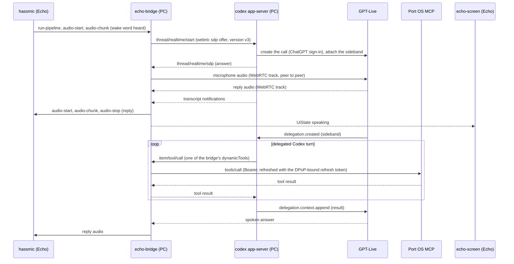

# Port OS Echo: program plan

This is the plan the coordinator works from. It starts from the two drafts in `docs/design/` (the RFC and the
multi-agent execution plan) and corrects them where a review against the real services, the real device and the
real bench found them wrong. Where this plan and a draft disagree, this plan wins.

How the work is run (the coordinator and the you-agent-factory) is in `docs/program/coordinator.md`. The standing
rules are in `docs/program/rules.md`. Measured facts are in `docs/program/baselines.md`. Decisions and open
questions are in `docs/program/decisions.md`.

## 1. What we are building

A rooted Echo Show 8 (2nd gen, `athena`) becomes a voice front end for GPT-Live that can act on the home through
Port OS:

1. On the Echo, echo-dot-assist's `hassmic` hears the wake word with the firmware's Pryon engine (section 5),
   captures the room through Amazon's echo canceller and plays replies. It runs in Wyoming mode with `-D`, which
   keeps the microphone open while a reply plays: the duplex mode echo-dot-assist added for realtime clients
   (#173).
2. On the operator's PC, `echo-bridge` connects to hassmic over Wyoming and carries the audio to and from a
   GPT-Live call through its own WebRTC media peer. OpenAI's Codex app server, a pinned release running beside the
   bridge, owns the call: sign-in, call creation, the control channel and the delegated agent turns (owner decision
   2026-11-16, section 3.3). The bridge executes every tool call those turns make: against Port OS MCP for the home, a
   spoof MCP for tests, and later other MCP servers.
3. A small screen client on the Echo shows what the bridge is doing: status, the Port OS link code, approval
   prompts and the M6 animation.

Owner decision (2026-11-15): this is the hassmic `-D` route. It replaces the drafts' on-device stack (a C hardware
shim, a Rust daemon on the Echo, an on-device WebRTC peer and an on-device MCP client). What the drafts got right
stands: one delegated agent owns MCP, the credentials stay on the owner's side, and milestones are proven on the
device.

Premises the review found wrong, and what this plan does instead:

1. **A server-side peer is required in every topology.** GPT-Live creates a session from your server with your
   credential (a Platform API key, or the ChatGPT sign-in OpenClaw uses, section 4). With the `-D` route the bridge
   is that server and the WebRTC peer itself: audio flows Echo ↔ bridge over Wyoming, and bridge ↔ OpenAI over
   WebRTC. Owner decision (2026-11-16): credentials may live on the device, so the bridge's role moves onto the Echo
   after M1 (W4, section 12).
2. **The drafts' GPT-Live event names are wrong, and so were this plan's.** The app server at the pin speaks the V3
   protocol (`FramelessBidi`): delegation arrives as `delegation.created` and results go back with
   `delegation.context.append`; the subscription model is `gpt-live-1.1-codex` (section 3.3). The app server
   parses and writes those events itself, so the bridge sees only the app server's JSON-RPC. Contracts are generated
   from captured traces, never from the RFC.
3. **Port OS MCP does not yet accept device-code tokens.** `/mcp` accepts Bearer tokens from authorization code +
   PKCE today. Making it accept any valid Port OS access token for the MCP resource, whatever grant minted it, is
   portos-backend work (section 9).
4. **Muse is reached through a wrapper around the Muse gadget SDK,** with an explicit callback command for
   correlation. Muse never receives the bridge's credentials (section 7).
5. **The bench is a Ring camera driven by the Port OS CLI.** One held Ring session plays utterances into the room,
   records the reply and watches the screen. It works today on a stock Echo (`docs/program/baselines.md`).
6. **The hardware work is already done upstream.** hassmic drives athena's audio HAL, Pryon, the mute latch, the
   keys and the screen, and echo-dot-assist tests it on the host against `hassmic-host`. We consume it at a pinned
   commit and send any change we need upstream as a pull request.

## 2. Architecture

```text
Echo Show (stock firmware + hassmic)            echo-bridge (Rust, operator's PC)        Services
  hassmic: Pryon "Alexa", AEC, mic,   <-Wyoming->  Wyoming client, audio framing
  speaker, mute latch, keys (-D)                   media peer (WebRTC, Opus) <==========> GPT-Live (OpenAI)
                                                   codex app-server (stdio JSON-RPC):
                                                     sign-in, call creation, sideband <==> GPT-Live control
                                                     delegated Codex turns ----------->  Codex models
  echo-screen: WebView of the bridge  <--HTTP-->   screen server (UiState, UiAction)
  page (status, prompts, M6)                       tool host + MCP clients ---------->  Port OS MCP, spoof MCP
                                                   Port OS OAuth (device code, DPoP)
```

| Component | Runs on | Holds | Does |
| --- | --- | --- | --- |
| `hassmic` (our fork of echo-dot-assist, `portpowered/echo-dot-assist`, pinned) | The Echo | Nothing of ours | Wake word, echo canceller, capture and playback, mute latch, keys, light band. `PROTO=wyoming`, `ARGS` with `-D`. Installed by echo-dot-assist's `scripts/install-system.sh` |
| `echo-screen` | The Echo, as hassmic's home app | A pairing token for the bridge's screen page | Shows the bridge's screen page full screen; the bridge renders layouts and characters from downloadable screen-pack data; touches go back as `UiAction`s |
| `echo-bridge` and its crates | The operator's PC first (section 6) | The Port OS grant (DPoP key, refresh token, access token); the app server's `CODEX_HOME` | Wyoming client; the media peer; the app server's client and supervisor; the tool host behind the delegated turns' `dynamicTools`; every MCP call; provider-backed read-only search via the app server (`codex.web_search`: live default, cached or disabled); the screen server; caps, audit log, kill switch |
| `codex app-server` (OpenAI Codex, pinned release, Apache-2.0) | Beside the bridge, its child process over `stdio://` | The ChatGPT sign-in (`$CODEX_HOME/auth.json`) | Sign-in and refresh, Live call creation, the sideband control channel, delegated Codex turns with only the bridge's tools (section 3.3) |
| `echo-lab` | The operator's workstation and CI | Bench session leases (never committed) | Runs scenario files with the `sim`, `cloud` or `device` driver and writes reports |
| `echo-spoof-mcp` | CI and the bench | Nothing secret | Deterministic MCP server: `test.echo`, `test.wait`, `test.requires_approval`, `ui.show_emotion` |
| `echo-muse-bridge` | A Linux host beside the Muse gadget service | Its own Muse SDK token | Submits tasks to Muse and receives results through one gadget command (section 7) |

**Trust boundary.** Wyoming is plaintext and unauthenticated. hassmic's firewall admits inbound TCP 16384–32767
from the LAN, which includes Wyoming's 16700, so anyone on the LAN who connects gets the microphone stream of a
run. Our fork's `LISTEN_FROM` setting in `hassmic.conf` admits the protocol port from the bridge's address only.
A T5 check proved that a second host is refused, including after a reboot (`docs/program/decisions.md`).

## 3. The bridge runs the conversation and the tools

Owner decision (2026-11-15): MCP runs on the bridge, on the owner's side and never at OpenAI. Delegation is
`client` only, never `responses`.



| `echo-bridge` | hassmic on the Echo |
| --- | --- |
| Supervises the app server; asks it to open and close Live calls with the session config (voice, instructions, `client` delegation) | Wake word, the echo canceller, the mute latch: hardware authority stays here |
| The WebRTC media peer (Opus, adapted from Codex's `voice-host`); the kill switch is `thread/realtime/stop` | Streams the microphone of a run over Wyoming; with `-D` it keeps streaming while the reply plays |
| Tool host: MCP `tools/list` → `dynamicTools` on `thread/start` → each `item/tool/call` executed as MCP `tools/call` → result returned; waiting on the active turn is bounded by the run ceiling | Plays the reply audio the bridge sends; reports `played` |
| Port OS credential, tool allowlist, confirmation policy, idempotency ledger; single writer of MCP calls | Nothing of the program's state |

Consequences:

- **No credential reaches the Echo, until W4.** Today the GPT-Live credential and the Port OS grant stay on the
  bridge host, and a stolen Echo yields a Wyoming endpoint and a screen pairing token, both revocable from the
  bridge. The owner decided on 2026-11-16 that credentials may live on the device. In W4 the bridge runs on the Echo
  and holds them the way OpenClaw's gateway does: only the bridge's own process can read them, and the screen app
  gets one-time tokens (`docs/program/decisions.md`).
- **The Codex app server runs in the product** (owner decision 2026-11-16, superseding "No Codex runs in the
  product"). The drafts' app-server backend and its ARMv7 build are back, as section 3.3 and phase W2d (section 12)
  describe. `echo-agent-loop`, our own Live call path in `echo-live` and the sign-in in `echo-chatgpt-auth` retire
  once the cutover passes M2 and M4 with `--driver sim`.
- **No code of ours runs as root on the Echo.** The screen client is an ordinary app; hassmic is upstream's.
- **One persistent session per wake word.** With `-D` the run and its capture stay open after each reply is Played,
  listening for `voice.session_listen_seconds` (default 15 s); speech in that window continues the same run. The run
  ends at idle expiry, at once when the agent calls `end_session` (the applied end cuts the reply and interrupts a
  running delegated turn), or at the `voice.session_max_seconds` ceiling for delegated waiting and listening granted
  by `extend_session`. Only the automatic ends wait for a running delegated turn.
  Active speech and playback retain their own completion rules (`docs/program/decisions.md`).
  The Live call stays open for `session_idle_seconds`, so the next wake word continues the same conversation,
  unless a prompt changed during the run: then the call ends with the run and the next wake admits a new call
  with the new prompts (`docs/program/decisions.md`, 2026-11-21).

### 3.1 Spikes (W1)

| Spike | Question | Decides |
| --- | --- | --- |
| S1 Live transport (answered, then superseded on 2026-11-16: the media peer is `webrtc-rs` 0.20.3 as in Codex's `voice-host`, and the control events travel on the app server's sideband) | Which Rust WebRTC stack carries GPT-Live's audio track and `oai-events` data channel from the PC (`str0m`, `webrtc-rs`, or `libdatachannel` through FFI)? Do `session.delegation.created` and `session.commentary.append` flow on the data channel, or only on the sideband WebSocket? | `echo-live`'s dependency (ADR); whether the bridge attaches the sideband for delegation |
| S2 Wyoming barge-in | With `-D`, how does the bridge cut a reply hassmic is already playing when GPT-Live cancels its response: an early `audio-stop`, `pause-satellite`, or nothing yet? What does hassmic send when the wake word is heard while it speaks? Measured against `hassmic-host` | Whether we need an upstream hassmic change; the barge-in budget |
| S3 Screen client | A minimal WebView app as hassmic's home app showing the bridge's page: memory with hassmic running, coexistence with the light band and hassmic's face and words layers, touch focus, start on boot | `echo-screen`'s shape (ADR); the fallback is Kiosk Satellite pointed at the page |
| S4 Live tools | `gpt-live-1` lists function calling. Tools declared directly on the Live session could skip the delegated model for one-step requests | Measured only; nothing depends on it |

### 3.2 Muse tool

The Codex voice path owns tool admission for M4–M7. A usable `[muse]` connection adds the bridge-owned
`ask_muse` tool alongside the existing catalog. A matching live handoff and turn authorize one attempt per
native tool request. The tool sends only its request and the handoff's correlation ID to the HTTPS service
(section 7). Muse shares the remaining Wyoming run time described in section 3. The bridge joins cancellation
before releasing the owning run. Remove `agent.backend` from older configurations.

### 3.3 The Codex app server

Research brief: [`docs/spikes/codex-app-server.md`](../spikes/codex-app-server.md) (read from Codex `main` at
`5b3d2c7fce`; line numbers there refer to that commit). Owner decision (2026-11-16): reuse OpenAI's Codex app
server instead of our own GPT-Live client, and build it for armv7 too. Reuse is the point: Codex's crates already
encode the undocumented parts (endpoints, headers, the V3 events, the sideband's reconnects). Expose only what we
need, since the Echo's disk is small.

- **Release.** No release is pinned (owner, 2026-11-21). A build takes the newest stable `rust-v*` release of
  `openai/codex`, never older than the floor in `codex.release`; `CODEX_RELEASE` names another one. Codex is
  Apache-2.0 with a NOTICE that any redistributed build or adapted file keeps. The Linux host uses the published
  `x86_64-unknown-linux-musl` binary, checked against the SHA-256 digest GitHub publishes for it by
  `scripts/codex-app-server.sh`; the Echo uses our own armv7 build of the same release's tag commit. Below, "the
  pin" means the app server release in use.
- **Process.** `codex app-server --listen stdio://`, a child of the bridge with its own `CODEX_HOME` outside the
  repository. Messages are newline-delimited JSON-RPC without a `"jsonrpc"` field. The bridge sends `initialize`
  with `capabilities.experimentalApi: true` (every realtime method is experimental and is refused without it),
  then `initialized`.
- **Sign-in.** `account/read`; if signed out, `account/login/start {type: "chatgptDeviceCode"}` returns the URL and
  code the screen shows, and `account/login/completed` reports the result. The app server stores and refreshes the
  credential in `$CODEX_HOME/auth.json` (5 minutes before expiry or after 8 days). For `api-key` mode,
  `account/login/start {type: "apiKey"}`.
- **A call.** `thread/start` (ephemeral, the settings below), then `thread/realtime/start {threadId,
  outputModality, transport: {type: "webrtc", sdp: <offer>}, version: "v3"}`. The version must be explicit: webrtc
  defaults to V1. The app server POSTs `{chatgpt base}/realtime/calls?intent=quicksilver&architecture=avas`,
  returns the answer as `thread/realtime/sdp`, and attaches the sideband (`/v1/live/{call_id}`, retried on 404).
  Media flows peer to peer between the bridge's media peer and OpenAI. `thread/realtime/stop` ends it and
  `thread/realtime/closed` confirms. Under a ChatGPT sign-in the all-JSON audio path (`appendAudio`,
  `outputAudio/delta` over the websocket transport) is refused, so the media peer is required.
- **Events the bridge uses.** `thread/realtime/started`, `itemAdded` (speech started, response cancelled),
  `transcript/delta` and `transcript/done` (role `user` or `assistant`; a reply's end is `transcript/done` with role
  `assistant`, since `response.done` is not forwarded), `error` and `closed`.
- **Delegated turns.** `delegation.created` becomes a normal Codex turn on the thread. It gets only the bridge's
  tools: `dynamicTools` on `thread/start`, each call arriving as an `item/tool/call` request the bridge answers.
  Owner amendment (2026-11-19): provider-backed read-only web search is the sole exception, with
  `[codex] web_search` selecting `live` (default), `cached` or `disabled`; enabled adds exactly one hosted
  declaration for conventional models or exactly the pin's standalone `web.run` for Responses Lite models;
  disabled adds neither. Both use provider search with no local fetch, process or file authority. Exact dynamic
  catalogs and native wrappers remain required.
  Every other built-in effect stays off. Codex's local tools are off: `features.shell_tool=false`,
  `features.unified_exec=false`, `features.view_image=false`, empty `environments`, no MCP
  servers in Codex's config, `approvalPolicy: never` with a read-only sandbox. The result goes back as
  `delegation.context.append` without bridge code. The bridge stops waiting and interrupts a stalled turn when the run reaches
  its session ceiling (600 s by default). Ordinary unanswered Live runs use a separate 60 s response window.
  Every model in the app server's catalog is code-mode-only, and the app server keeps tools of its own declared
  (`functions.exec`, `functions.wait`, `clock.sleep`, and at `rust-v0.171.0` also `apply_patch` and three MCP
  resource helpers). Owner amendment (2026-11-21): such extras are allowed when T3 proves them inert under the
  bridge's thread settings; every bridge tool must still be present. The bridge's tools are
  direct declarations beside them, never `exec` callables: `exec` runs in `codex-code-mode-host`, which the
  Echo's armv7 install does not have, so a tool that is only an `exec` callable cannot be called on the Echo
  (decision 2026-11-20). Both configuration paths set
  `features.code_mode.direct_only_tool_namespaces=["web","functions"]` while search is on and `["functions"]` when
  it is disabled. gpt-6.2-* models refuse a direct `web.run`, so the default delegated model is `gpt-6.1-sol`
  (decision 2026-11-21; debt in `docs/tech-debt/README.md`). "Only the bridge's tools" means the
  effect surface: the only callable effects are the bridge's declared tools, search and, inside `exec`,
  `clock__curr_time`. T3 (`pinned_media/tools_provider.py`) fails if either list widens (decision 2026-11-17)
  and proves a direct call with no code-mode host beside the app server.
- **Audio.** The media peer's track is Opus at 48 kHz; the bridge resamples hassmic's 16 kHz to it and back with
  `rubato`, as `voice-host` does.
- **Not yet known (each answered by a W2d lane, measured, recorded in `docs/program/baselines.md`).** Whether the
  sideband base can be pointed at a local fake for T3 (the call base can: `experimental_realtime_webrtc_call_base_url`);
  how V3 signals barge-in to the app server's client; whether `apply_patch` can be disabled by config; disk and
  memory use per session; whether the armv7 build links (OpenSSL vendored, `aws-lc-sys` with the NDK,
  `portable-pty`, a CA bundle through `SSL_CERT_FILE`).

## 4. GPT-Live access: the credential and the token exchange

Since 2026-11-16 (owner) the Codex app server performs sections 4.2 and 4.3 itself: it signs in, stores and
refreshes the credential, and creates the call (section 3.3). What follows stays as the record of what that path
does on the wire, which is what our contract tests and the fake Live server check; `echo-chatgpt-auth`'s own sign-in
retires after the cutover. The model on the `chatgpt` path is `gpt-live-1.1-codex` at the pinned release, not
`gpt-live-1-codex` as OpenClaw named it.

The operator sets up GPT-Live access (owner, 2026-11-15). The bridge is the only component that ever holds the
credential. The code follows OpenClaw's implementation, which signs in with the operator's ChatGPT subscription
the way Codex does and uses that sign-in for realtime voice. References are pinned to OpenClaw
`032227a96023233f4c66aa8d172e5823a857a43a` and Codex `ee344ca9458351a6ea102795fa73110ad3ede5dc` (read
2026-11-15). OpenClaw is MIT and Codex is Apache-2.0: code ported from either keeps its notice, and Codex's NOTICE
file comes with it.

### 4.1 Two credential modes

`echo-bridge` supports two modes, chosen in its config and recorded in every trace as `provider_auth_mode`
(never the secret itself):

| Mode | Credential | Live session | Agent model calls | Status |
| --- | --- | --- | --- | --- |
| `chatgpt` (default, the OpenClaw path) | The operator's ChatGPT sign-in: OAuth access token plus the `chatgpt-account-id` | `POST https://chatgpt.com/backend-api/codex/realtime/calls?intent=quicksilver&architecture=avas`, model `gpt-live-1-codex` | `https://chatgpt.com/backend-api/codex/responses` | What OpenClaw ships; preview interface (section 4.5) |
| `api-key` | An OpenAI Platform API key | `POST /v1/live/sessions`, model `gpt-live-1` (the documented GPT-Live path) | `https://api.openai.com/v1/responses` | Documented; billed per use |

Either way the bridge is the WebRTC peer and the credential never leaves the bridge process. OpenClaw does the
same: its gateway holds the token, and a client (browser, phone, watch) gets a one-time offer token valid for 60 s.
The client POSTs its SDP offer to the gateway, and the gateway forwards it to OpenAI with the token. Media then
flows from the client to OpenAI directly (`docs/program/decisions.md`, 2026-11-16). In W4 the bridge process runs on
the Echo, so the device is the gateway.

### 4.2 Signing in (the `chatgpt` mode)

OpenClaw runs its own sign-in with Codex's public OAuth client instead of sharing Codex CLI's token file. The
bridge does the same.

- **Client and endpoints.** Client id `app_EMoamEEZ73f0CkXaXp7hrann` (Codex's), issuer `https://auth.openai.com`,
  scopes `openid profile email offline_access`, PKCE S256 with a `state` value
([OpenClaw authorization](https://github.com/openclaw/openclaw/blob/032227a96023233f4c66aa8d172e5823a857a43a/extensions/openai/openai-chatgpt-oauth-authorization.runtime.ts#L3-L48),
[Codex login server](https://github.com/openai/codex/blob/ee344ca9458351a6ea102795fa73110ad3ede5dc/codex-rs/login/src/server.rs#L597-L616)).
- **Device-code sign-in, the bridge's default.** `POST /api/accounts/deviceauth/usercode`; the operator approves
  at `https://auth.openai.com/codex/device`; the bridge polls `/api/accounts/deviceauth/token`, which returns an
  `authorization_code` and `code_verifier`; those go to `POST /oauth/token` with redirect
  `https://auth.openai.com/deviceauth/callback`
([OpenClaw device code](https://github.com/openclaw/openclaw/blob/032227a96023233f4c66aa8d172e5823a857a43a/extensions/openai/openai-chatgpt-device-code.ts#L25-L43)).
  It needs no browser on
  the bridge host.
- **Browser sign-in, as an alternative.** Authorization code with PKCE and a loopback redirect
  `http://localhost:1455/auth/callback`; the code goes to `POST https://auth.openai.com/oauth/token` as a form post
([OpenClaw token request](https://github.com/openclaw/openclaw/blob/032227a96023233f4c66aa8d172e5823a857a43a/extensions/openai/openai-chatgpt-oauth-token.runtime.ts#L22-L23)).
- **Account id.** From the access token's claim `https://api.openai.com/auth` → `chatgpt_account_id`
([OpenClaw JWT](https://github.com/openclaw/openclaw/blob/032227a96023233f4c66aa8d172e5823a857a43a/packages/ai/src/utils/oauth/openai-chatgpt-jwt.ts#L2-L31)).
- **Refresh.** Form post `grant_type=refresh_token`, `refresh_token`, `client_id` to `/oauth/token`
([OpenClaw refresh](https://github.com/openclaw/openclaw/blob/032227a96023233f4c66aa8d172e5823a857a43a/extensions/openai/openai-chatgpt-oauth-token.runtime.ts#L305-L319)).
  Codex refreshes
  when the access token is within 5 minutes of expiry or the last refresh is older than 8 days
([Codex refresh policy](https://github.com/openai/codex/blob/ee344ca9458351a6ea102795fa73110ad3ede5dc/codex-rs/login/src/auth/manager.rs#L232-L241));
  the bridge uses the same policy.
- **Importing an existing Codex sign-in** (`~/.codex/auth.json`: `tokens.access_token`, `refresh_token`,
  `account_id`, `id_token`, `last_refresh`) is allowed once, as OpenClaw does
([OpenClaw import](https://github.com/openclaw/openclaw/blob/032227a96023233f4c66aa8d172e5823a857a43a/extensions/codex/src/migration/cli-credentials.ts#L209-L235),
[Codex auth.json](https://github.com/openai/codex/blob/ee344ca9458351a6ea102795fa73110ad3ede5dc/codex-rs/login/src/auth/storage.rs#L53-L77)).
  After the import the bridge owns its own
  copy. It never refreshes Codex CLI's file in place, so two programs never rotate the same refresh token.
- **Storage.** The bridge keeps `{access, refresh, expires, account_id}` in its own file, readable only by the
  bridge's user, outside the repository, and wrapped in `Secret<T>` in memory.

### 4.3 Creating a Live call (the `chatgpt` mode)

OpenClaw's wire format for `gpt-live-1-codex`
([OpenClaw quicksilver wire](https://github.com/openclaw/openclaw/blob/032227a96023233f4c66aa8d172e5823a857a43a/extensions/openai/realtime-quicksilver-wire.ts#L405-L425),
[control channel](https://github.com/openclaw/openclaw/blob/032227a96023233f4c66aa8d172e5823a857a43a/extensions/openai/realtime-quicksilver-wire.ts#L227-L249),
[credential selection](https://github.com/openclaw/openclaw/blob/032227a96023233f4c66aa8d172e5823a857a43a/extensions/openai/realtime-auth.ts#L10-L45)):

- `POST https://chatgpt.com/backend-api/codex/realtime/calls?intent=quicksilver&architecture=avas` with a JSON body
  `{sdp, session}`.
- Headers: `Authorization: Bearer <access token>`, `chatgpt-account-id`, `OpenAI-Alpha: quicksilver=v2`,
  `session-id`, `thread-id`, `x-session-id`, an `originator` and a User-Agent naming this project
([OpenClaw headers](https://github.com/openclaw/openclaw/blob/032227a96023233f4c66aa8d172e5823a857a43a/packages/ai/src/providers/openai-chatgpt-request-headers.ts#L24-L30)).
- The response carries the SDP answer for the bridge's own WebRTC peer. The control channel is
  `wss://api.openai.com/v1/live/{callId}`.
- Codex CLI has the same route against the same backend
([Codex realtime call](https://github.com/openai/codex/blob/ee344ca9458351a6ea102795fa73110ad3ede5dc/codex-rs/codex-api/src/endpoint/realtime_call.rs#L130-L229)).

The public `gpt-live-1` model needs a Platform API key; the subscription path uses `gpt-live-1-codex`
([OpenClaw model check](https://github.com/openclaw/openclaw/blob/032227a96023233f4c66aa8d172e5823a857a43a/extensions/openai/realtime-quicksilver-wire.ts#L389-L392)).
Ephemeral client secrets
(`/v1/realtime/client_secrets`) are minted only with a Platform API key, so they are no way to hand the
subscription credential to another device either
([OpenClaw provider factory](https://github.com/openclaw/openclaw/blob/032227a96023233f4c66aa8d172e5823a857a43a/extensions/openai/realtime-voice-provider-factory.ts#L400-L430)).

### 4.4 The Codex token exchange, and why it is not the default

Codex can also trade its sign-in for a Platform API key: `POST https://auth.openai.com/oauth/token` with
`grant_type=urn:ietf:params:oauth:grant-type:token-exchange`, `client_id`, `requested_token=openai-api-key`,
`subject_token=<id_token>` and `subject_token_type=urn:ietf:params:oauth:token-type:id_token`, then reads
`access_token` as the key
([Codex obtain_api_key](https://github.com/openai/codex/blob/ee344ca9458351a6ea102795fa73110ad3ede5dc/codex-rs/login/src/server.rs#L1036-L1068)).
Codex calls it
only after browser sign-in and ignores a failure
([call site](https://github.com/openai/codex/blob/ee344ca9458351a6ea102795fa73110ad3ede5dc/codex-rs/login/src/server.rs#L446-L451));
device-code sign-in stores no key. OpenClaw does not use the exchange at all: it sends the ChatGPT access token
itself.

So the bridge's default is OpenClaw's direct path. The exchange stays a documented way to obtain a key for the
`api-key` mode, but nobody has shown that an exchanged key works for `/v1/live/sessions`. M2 tries it once and
records the result in `docs/program/baselines.md`.

### 4.5 Risks the operator accepts with the `chatgpt` mode

- **Terms.** Using Codex's OAuth client from another program rests on OpenClaw's own statement that it is
  supported outside Codex CLI. Nothing from OpenAI was found that says so.
- **Entitlement.** Which subscription tiers get `gpt-live-1-codex` is not documented.
- **Stability.** The `chatgpt.com/backend-api/codex` routes and `OpenAI-Alpha: quicksilver=v2` look like preview
  interfaces and may change without notice. Contract tests pin captured traces, so a change fails T4 loudly
  instead of drifting.

If any of these bites, the bridge switches to the `api-key` mode with no change on the Echo: the Echo never sees
either credential, only Wyoming audio.

## 5. Wake word

Owner decision (2026-11-16): the wake word is "Computer", the Pryon model set the firmware ships next to "Alexa"
(`/system/local/models/keyword/en-US/COMPUTER/`). It needs no model of our own, no training and no download:
`hassmic` loads an unmodified copy of that folder as its model set `computer-en-US`. Nothing of ours touches Pryon.

What follows from it:

- **Bench interference.** Stock Echos in the house wake on "Alexa", not on "Computer", so they no longer answer
  the bench's utterances. Still record the room in every report. The bench measured that a natural TTS voice at
  full level wakes an Echo through the Ring speaker, and that quiet or robotic voices are rejected as false wakes
  (`docs/program/baselines.md`).
- **Firmware dependency.** The Pryon library and model are the firmware's, so a firmware build nobody has probed
  may move them. The probe (section 8.5) records their hashes; 7809's `libpryon.so` differs from the pinned 7080's
  (`docs/program/baselines.md`).
- **Other keywords exist.** The firmware also carries "Alexa", "Amazon" and "Echo"; switching is a hassmic
  setting, so it costs no code (`docs/program/decisions.md`).
- **False-wake rate** is a T6 soak measurement, not a T5 pass condition.

## 6. The bridge: what it runs and where

Linux is the only supported platform for building, testing and running Echo (owner, 2026-11-18).
Coordinator device runs use Linux pe-ci with the existing T5 safeguards.

- **What it is.** A single Rust binary, `echo-bridge`, in this workspace, sharing `echo-contracts`, so the Wyoming,
  screen and GPT-Live protocols are contracts checked by the same CI gates as every other crate.
- **What it does.** It connects out to hassmic's Wyoming port on the Echo (`run-satellite`), owns the GPT-Live
  call (section 4), runs the agent loop and the MCP clients, and serves the screen page and its event stream to
  `echo-screen` on the LAN (TLS with a certificate pinned at pairing, plus the pairing token). An operator CLI on
  the same binary handles the ChatGPT sign-in, the Port OS link, pairing the screen and the kill switch. A
  loopback-only `GET /healthz` reports each link's state.
- **Audio.** hassmic announces its formats in `audio-start` (rate, width, channels); the bridge resamples between
  them and the WebRTC track's Opus at 48 kHz. Every queue is bounded and drops the oldest frame under backpressure.
  The bridge counts received microphone frames per run, which is half of the mute proof (section 8.4).
- **Where it runs first: Linux on the operator's PC on the LAN,** beside the CI-identical toolchain. The
  credentials are the operator's own, so they stay on the operator's machine; the Echo is on the same LAN, so
  Wyoming never crosses the internet; nothing is exposed to the internet. The cost is that the device only works
  while the PC is on, which is fine for development and the bench.
- **Where it moves: the Echo (W4).** The owner decided (2026-11-16) that credentials may live on the device, so the
  bridge's target host is the Echo itself: `armv7-linux-androideabi`, built with the Android NDK like the fork's
  hassmic. There it runs as its own user, started by the fork's service scripts, and reaches hassmic on loopback.
  What those scripts must do is the launch contract in `docs/architecture.md`; `examples/bridge.echo.toml` is the
  configuration that goes with it.
  Nothing changes on `/system`, partitions or firmware. The PC stays the development and bench host. A Raspberry Pi
  stays possible for the Muse bridge.
- **It talks to Port OS directly.** The bridge is the Port OS OAuth client and the only MCP client. Section 9 says
  what it can use today and what waits for portos-backend.
- **The app server beside it.** On the PC the bridge starts the pinned `codex app-server` as a child process
  (section 3.3). On the Echo (W4) it starts our armv7 build of the same commit the same way, with `CODEX_HOME` in the
  bridge user's mode-0700 directory, so the credential rule above holds for `auth.json` too. That build is a
  standalone app server, so the configuration names it with `codex.launch = "standalone"` and gives it a
  certificate bundle with `codex.ca_file`.
- **Crates** (declared in `lanes.toml`, section 10). W2d adds `echo-codex` (the app server's client and supervisor)
  and `echo-media` (the WebRTC/Opus media peer) and retires `echo-agent-loop` and `echo-live`'s call path. Today:
  `echo-contracts`, `echo-config`, `echo-wyoming`, `echo-audio`,
  `echo-live`, `echo-chatgpt-auth`, `echo-agent-api`, `echo-agent-loop`, `echo-agent-muse`, `echo-mcp-auth`,
  `echo-mcp-client`, `echo-screen-contract`, `echo-bridge`, `echo-screen-server`, `echo-delegation`, `echo-signin`,
  `echo-lab`, `echo-spoof-mcp`, `echo-muse-bridge` and `xtask`. The screen page lives in `web/screen/`; the
  `echo-screen` app's shape waits for spike S3. `echo-screen-server` (the screen page and its `UiState`/`UiAction`
  stream), `echo-delegation` (the agent turn) and `echo-signin` (the operator commands and credential modes) are
  libraries that `echo-bridge` hosts; the binary only wires them together.

### Screen packs

Owner direction (2026-11-19): "we want the hassmic side to be mostly a dumb pipe".
hassmic owns wake word, echo cancellation, capture and playback, mute latch, keys,
light band and hosting the screen app. The bridge's screen page decides and renders
everything the user sees while connected. hassmic's native procedural face remains
the disconnected fallback; screen packs require no hassmic or APK change.

Layouts and characters are downloadable data, separate from the bridge binary.
The first character format uses WebM/MP4 clips with a required rest pose, without VRM.
The bridge owns verified background installation under `<home>/screens/`, selection
through its existing settings writer, and hot rendering without a voice restart.
[Screen-pack documentation](../screen-packs.md) records the format and implementation
status; configuration support alone does not establish installation or playback.

## 7. Muse: a wrapper around the gadget SDK

Owner decision (2026-11-13). The Muse gadget SDK turns a Linux box into a gadget Muse can call. It gives two
channels, and the wrapper uses both:

- **To Muse:** `musegadget send-user-msg --session-id <s> --wait <seconds>` sends a user-role message into Muse and
  returns Muse's next reply, or exits 3 on timeout (1–600 s).
- **From Muse:** a command spec in `/etc/musegadget/commands.d/` that Muse can call. The wrapper installs exactly
  one, `echo.report.result {task_id, status, summary}`. That is the correlation channel the RFC said was missing. The
  SDK names commands as lowercase words joined by dots, so the plan's earlier `echo.report_result` became
  `echo.report.result` (`docs/program/decisions.md`).

| Operation | Implementation |
| --- | --- |
| `submit(task)` | Create `task_id` with the remaining run time for an Echo delegation. Send a message carrying the task, the `task_id`, and the instruction to finish by calling `echo.report.result` with that id. Persist the task |
| `events(task)` | `Progress` from interim replies; `Completed` or `Failed` only from an `echo.report.result` call whose `task_id` matches a live task. Reject unknown or expired ids |
| `cancel(task)` | Mark cancelled, send a cancel message, ignore later results for that id |
| Timeout | No `echo.report.result` by the deadline: `Failed {retryable: false}` with an honest voice message. Never infer success from chat text |

Rules: Muse acts on Port OS through its own connector, never with the bridge's credentials. The Muse bridge never
installs
`system.run`, `file.write` or other host commands. `echo-bridge` talks to the Muse bridge over an
authenticated LAN connection. An `echo.report.result` call never counts as user consent. The first proof (M7) is a
harmless Port OS read that Muse performs and reports, with correlated ids end to end.

## 8. Testing as structure

### 8.1 Test tiers

Every change names its tier and its oracle. Every milestone names the tiers it requires.

| Tier | Runs where | Network | Command | Oracle | Required for |
| --- | --- | --- | --- | --- | --- |
| T0 static | Every PR | None | `make lint` | Shape lint, rule lint, fmt, clippy, deny, schema snapshots | Every PR |
| T1 unit and property | Every PR | None | `make test-unit` | Assertions, proptest, loom on the refresh and queue paths | Every PR |
| T2 contract | Every PR | None | `make test-contract` | JSON fixtures, captured GPT-Live traces, captured `hassmic-host` Wyoming exchanges | Every PR touching contracts |
| T3 simulated system | Every PR | Loopback only | `echo-lab run <scenario> --driver sim` | Trace assertions on one golden event sequence, fake clock | Every milestone |
| T4 cloud integration | Nightly or on label | Real GPT-Live; Port OS pilot with simulator devices; `hassmic-host` in place of the Echo | `echo-lab run <scenario> --driver cloud` | Trace, provider events, Port OS audit; no hardware | M2, M4, M5 |
| T5 hardware in the loop | Operator-started | Real | `echo-lab run <scenario> --driver device --bench ring` | Bridge trace and hassmic's log (adb) plus bench observations (Ring audio, STT, frames) | M1, M3, M5–M7 |
| T6 soak and acoustic | Scheduled | Real | `echo-lab soak …` | Percentiles, leak slope, false-wake rate | Release |

- Test tags map to nextest profiles (`hardware`, `cloud`). A T0 rule fails any test that opens a socket to a
  non-loopback address without the `cloud` tag.
- A change's acceptance names a scenario file and a tier. "Compiles" or "unit tests pass" is never acceptance for a
  change in behavior.
- A milestone passes only on a T5 report. T3 green is the precondition, never the completion.

### 8.2 One scenario file, many drivers

Each milestone and failure case is written **once**, as data, and run in simulation, against the cloud and on the
device. The drivers differ; the oracle does not. The `sim` and `cloud` drivers run the real hassmic code:
`hassmic-host`, echo-dot-assist's host build at the pinned commit, which reads file audio, takes `SIGUSR1` as a
wake word and speaks the same Wyoming as the Echo. CI builds it once and caches it (`el-w0-hassmic-host`).

```yaml
# tests/scenarios/m4-spoof-tool.yaml
id: m4-spoof-tool
milestone: M4
tiers: [T3, T4, T5]
setup:
  mcp: spoof            # spoof | portos-pilot
  backend: client       # client | muse
steps:
  - say: "Computer, call the test tool and tell me its result"   # sim: fixture PCM + SIGUSR1; device: Ring talkback
  - expect_trace:
      - session.delegation.created
      - tools/call {name: test.echo, count: 1}
      - session.commentary.append
  - expect_speech_contains: ["test", "echo"]                  # sim: transcript; device: STT of the Ring mic
  - expect_screen: {state: speaking}                          # sim: UiState; device: screencap + Ring frame
budgets:
  first_audio_after_endpoint_ms_p95: 1500
negative:
  - inject: {mcp: http_500}
    expect_speech_contains: ["couldn't"]
    expect_trace_absent: [tools/call {count: 2}]
```

| Step | Sim driver | Cloud driver | Device driver |
| --- | --- | --- | --- |
| `say` | Fixture PCM into `hassmic-host`, `SIGUSR1` for the wake word | The same, against real GPT-Live | Play through the Ring speaker (section 8.4) |
| GPT-Live | A fake Live peer replaying captured traces | Real GPT-Live | Real GPT-Live |
| `expect_trace` | Bridge trace | Bridge trace plus sideband events | Bridge trace plus hassmic's log over `adb` |
| `expect_speech_contains` | Transcript event of the fake | GPT-Live transcript event | STT of the Ring recording, plus the transcript event |
| `expect_screen` | `UiState` snapshot from the screen server | `UiState` snapshot | `adb exec-out screencap` golden diff, plus a Ring frame for physical truth |
| `press` / `touch` | Signals and fake key events into `hassmic-host`; DOM events on the screen page | Not applicable | `adb shell input` for touch; key events into the input node found by name (section 8.6) |

The report schema of the execution plan (its section 0.2) stands, plus `tier`, `driver`, `scenario_digest`,
`hassmic_commit` and `bench_session_ids`. `placement` is always `bridge_pc` until the bridge moves.

### 8.3 Milestones

Milestones accumulate: the installed image still demonstrates every earlier one.

| Milestone | Demonstration | Tiers | Needs |
| --- | --- | --- | --- |
| **M0** repository harness | Every T0 gate runs in CI and has been seen to fail on a seeded violation. `echo-lab check --milestone M0` passes. Nothing else starts before M0 | T0 | Phase F (section 10) |
| **B0** bench on a stock Echo | The Ring plays "Alexa, what time is it?" to a stock Echo; the bench records the reply; STT finds a time; a Ring frame shows the light ring. Mouth, ear and STT are proven (`docs/program/baselines.md`); the eye is not yet | T5 (stock device) | The Port OS CLI (done, v0.1.27) |
| **M1** hassmic and the bridge | hassmic is installed on the probed firmware with `PROTO=wyoming` and `-D` (owner's go-ahead first); after a reboot the bridge connects over Wyoming; a wake word reaches the bridge as a run with microphone audio; the page renders the Ready home state (`data-ui-state="ready"`); the mute switch shows on the screen and the bridge receives zero frames while latched; 10 restarts of the bridge and of hassmic each recover without a reboot; a second LAN host is refused on 16700 | T3, T5 | W0, W1 |
| **M2** GPT-Live connects | The bridge creates and closes a Live call in the `chatgpt` mode, through the app server from W2d on; the page renders the Connected home state (`data-ui-state="connected"`); an invalid or expired credential shows a relink error instead of pretending | T3, T4, T5 | Section 4 |
| **M3** full-duplex voice | "Alexa, what time is it?" is answered through the Echo speaker; talking over the reply cuts it within the S2 budget and the new question is answered; mute stops outbound audio (hassmic's log and the bridge's counter both show zero frames) | T3, T5 | M1, M2, S1, S2 |
| **M4** spoof MCP tool call | "Call the test tool and tell me its result": exactly one correlated delegation → `item/tool/call` → `tools/call` → result (V3 `delegation.created` and `delegation.context.append` from W2d on); the answer is spoken; an MCP error gives an honest fallback | T3, T4, T5 | Agent loop, spoof MCP |
| **M5** Port OS link | The bridge starts the device-code grant; the Show displays the code; the phone approves the requested MCP scopes (all seven by default); `tools/list` and one `endpoint_query` on the "Echo test light" simulator succeed; refresh needs a proof from the same key; a replayed refresh token is rejected; a bridge restart keeps the grant; revoke forces a relink. Until portos-backend's change lands, T4 runs the same scenario with an authorization code + PKCE token | T4, T5 | Section 9 |
| **M6** MCP drives an animation | "Show me a happy face": the spoof MCP's `ui.show_emotion` makes the screen play an animated face (frames, not a still), then clear; audio stays usable. Spoof MCP only: Port OS does not grow an equivalent | T3, T5 | M4, `echo-screen` |
| **M7** Muse delegation | "Ask Muse to run the test job": correlated `delegation_id → task_id → Muse session → result`, spoken; a timeout gives a safe voice response | T4, T5 | Muse bridge (section 7) |

Device-code access tokens live 24 h by default, so an ordinary M5 run never refreshes on its own. The scenario forces
at least two refreshes (the bridge's `--refresh-now` operator command) and one replay, which must revoke the grant.

### 8.4 The bench

A Ring pan-tilt indoor camera next to the Echo, driven by the Port OS CLI (`port`, v0.1.27 or later). `echo-lab`
shells out to `port ... --json` with an explicit `--port <path>`; it never carries its own Ring peer. The forms below
are pinned to the CLI's source (`cli/internal/cli/session_commands.go`, `message_commands.go`), and echo-lab keeps
them in one table-driven module.

| Need | CLI surface |
| --- | --- |
| Hold one session that talks and listens | `port session hold <ring> --camera --listen --json` (JSON gives `holdId` and `lease`); release with `port session release <holdId> --json` |
| Mouth | `port message play-audio <ring> --lease <l> --file <wav> --json`. Text needs both `--text "..." --speech-endpoint <e> --speech-model <m>`; echo-lab has no defaults for them |
| Mouth and ear in one step | the same with `--listen <s> --output reply.wav` (JSON reports `playStartedAt`, `playEndedAt`, `recordStartedAt`, `recordEndedAt`) |
| Clock alignment | the play's own timestamps (`playStartedAt`, `playEndedAt`, `recordStartedAt`, `recordEndedAt`); no chirp is played (owner, 2026-11-15) |
| Hold ordering | after a play without `--listen`, no other command on the hold until `playEndedAt` passes: a snapshot during playback cuts the clip |
| Ear only | `port message record --lease <l> --audio-only` (to be pinned against the source before echo-lab uses it) |
| Eye | `port message snapshot <ring> --lease <l> --output <frame.jpg> --json`, from the held camera with no new session. Frames are JPEG and stay JPEG; PTZ to aim |
| Quiet hours | audio commands refuse before 09:00 local unless `--allow-quiet-hours`; `echo-lab run` passes it on to `port play-audio` only when given it (owner waiver, `decisions.md` 2026-11-17) |

Harness rules:

- **One session per batch.** Run scenarios for at most 11 minutes, close, wait 25 s, reopen. Ring closes a live
  view after about 12 minutes, refuses a new offer for about 20 s after a close, and locks out after too many
  sessions. Never one session per scenario.
- **Latency budgets are measured from the bridge and hassmic traces.** Ring audio arrives in bursts, so Ring-side
  timing is only good to about ±0.5 s. The Ring corroborates that sound happened.
- **Ear oracle:** STT on the Ring recording (a local Whisper model). Assert phrases, not exact transcripts. Record
  replies after the clip ends: the Ring microphone ducks while its own speaker plays. Keep recordings only for
  failed runs, outside git, and delete them after triage.
- **Eye oracle:** pixel-exact checks from `adb exec-out screencap -p` against goldens. The Ring frame answers only
  what screencap cannot: is the panel lit, does the light ring show the right pattern, is the mute LED red. OCR only
  for large text.
- **Privacy proof is instrumented.** The camera can see the mute LED; it cannot prove no frame left the device. That
  comes from hassmic's log of the run and the bridge's received-frame counter, both of which must show zero frames
  while the mute latch is set.

### 8.5 The firmware probe is generated

`echo-lab probe` runs the read-only probe (the six library hashes echo-dot-assist pins, `getevent -lp`,
`/proc/bus/input/devices`, `tinymix`, `dumpsys input`, the wake word models) over `adb`, without pushing a file,
and writes a manifest with `probe_timestamp` and `source`. The operator runs it once per firmware build; the
summary goes into `docs/program/baselines.md` (7809: 2026-11-15) and the raw output stays outside git, since it
holds the device serial. The `device` driver refuses an unprobed build.

### 8.6 Testing touch

hassmic owns the keys and the mute latch; Android owns touch, so the screen client sees ordinary touch events.

| Layer | Proves | How | Tier |
| --- | --- | --- | --- |
| 1. Hit testing | Page coordinates map to the right `UiAction` | The screen page at 1280 × 800 in a headless browser; synthetic pointer events at edges and corners; targets at least 48 dp; contrast checked in the snapshot test | T1/T3 |
| 2. Rendering | Every `UiState` renders without clipping | Snapshot of every state at 1280 × 800 in the headless browser | T1/T3 |
| 3. Injected touch on the device | Android → WebView → bridge → `UiAction` works on the Echo | `adb shell input tap` scaled to the panel; oracle: the bridge trace shows the `UiAction`, screencap shows the new state, a Ring frame confirms | T5 |
| 4. Glass | The digitizer that carries the glass, and its calibration | Once per firmware, a person taps five marked targets while `echo-lab calibrate` records raw `getevent`. 7809 has two touch devices (`fts_ts`, `amazon_touch`); this says which. Recorded on the Ring video | Manual, recorded |

## 9. Port OS dependencies

Owner decision (2026-11-15): the work is split by repository. portos-backend owns these changes; this repository
consumes them. The rule they follow: **`/mcp` accepts any valid Port OS access token for the MCP resource the same
way, whatever grant minted it** (authorization code + PKCE, device code, refresh). Nothing on `/mcp` is specific to
device login.

| ID | Change (portos-backend) | Status (2026-11-15) | Gates |
| --- | --- | --- | --- |
| PB-1 | `/mcp` accepts every valid access token for the MCP resource, independent of the grant that minted it | Merged (portos-monolith PR 2731); on the pilot since 2026-11-15 | M5 |
| PB-2 | The device authorization request takes `resource`, so a device-code token gets the MCP audience; discovery advertises `device_authorization_endpoint` | Merged (PR 2731); on the pilot since 2026-11-15 | M5 |
| PB-3 | Discovered dynamic registration of a public client for the device-code and refresh grants | Owner decision (2026-11-20): on explicit link, the bridge uses `registration_endpoint` to register an Echo-named client with the configured scopes and auth method `none`, unless an explicit `mcp.client_id` or reusable committed registration supplies the identity. Existing CLI grants retain their binding until the operator relinks. | M5 |
| PB-4 | DPoP proof checks (`typ`, `htu`, `htm`, `iat`, `jti` and the signature) at device authorization and at the token endpoint | Merged (portos-monolith PR 2735); on the pilot since 2026-11-15 | M5 hardening, not the first M5 run |
| PB-5 | Refresh rotation and revoke for device grants | Merged (PR 2731); on the pilot since 2026-11-15 | M5 revoke step |
| PB-6 | The "Echo test light" simulator for synthetic validation; installed-product real-light control is owner-authorized (2026-11-19), with actual lamps remaining coordinator T5 proof | Done: a LIGHT simulator on the owner's pilot account, visible through MCP. A dedicated test principal needs the owner's approval and does not exist | M5 |

Owner decision (2026-11-19): installed-product control may act on real lights. Device-code links default to
`endpoint:read endpoint:write message:send group:read group:manage subscription:read subscription:write`,
and the Port OS tool allowlist defaults to all eleven MCP tools. Explicit narrower scope/tool lists stay exact;
existing grants require explicit relink to expand permissions. Non-MCP scopes are excluded. Requesting subscription
scopes does not add an event subscription consumer. Worker tests remain synthetic loopback; real model reasoning,
lamps and acoustic replies remain coordinator-owned T5 validation.

What PR 2731 gives the bridge, once it is deployed:

- **Discovery.** `GET /.well-known/oauth-authorization-server` carries `device_authorization_endpoint`
  (`<base>/auth/device-authorization`) and `dpop_signing_alg_values_supported` (ES256, ES384, ES512, RS256, RS384,
  RS512, EdDSA). The bridge reads both from discovery and never hard-codes a path.
- **Device authorization.** `POST /auth/device-authorization` (form) with `resource` set to the `resource` of
  `/.well-known/oauth-protected-resource` (the server's `/mcp` URL). Any other value answers 400 `invalid_target`.
  Without `resource` the grant mints an old first-party token, which `/mcp` refuses with 401, so `echo-mcp-auth`
  always sends it and a T1 test asserts so. The request carries a DPoP proof: this is where the bridge's key is
  registered. Port OS accepts one device authorization per key; a second one from the same key answers 400
  `invalid_dpop_proof`. So every link signs with a new key, and the committed grant keeps its own key until an
  approval replaces the grant and the key together. A failed link records `mcp.link.failed` in the trace with
  the step, the HTTP status and the OAuth error code only.
- **Token.** The `device_code` grant at `/auth/token`, with a DPoP proof from the same key, returns the same
  resource-bound pair as the browser code
  grant: an access token (`aud` = the resource, `token_use=access`, a `grant_id`, the scopes the owner granted;
  24 h by default) and a refresh token (30 days, `cnf.jkt` = the bridge's DPoP key thumbprint).
- **`/mcp` admission** is unchanged and grant-agnostic: `token_use=access`, the issuer, the MCP audience, a subject
  and an active `grant_id`. Access tokens are plain Bearer.
- **Refresh** is `grant_type=refresh_token` with a DPoP proof from the same key. Refresh tokens rotate; a replayed
  one revokes the whole grant, so the next `/mcp` call answers 401. The bridge must persist the rotated refresh
  token before it uses the new access token, or a crash between the two forces a relink.
- **Revoke** is `POST /auth/revoke` with `token=<refresh token>` and `client_id`; it ends MCP access.

PR 2731 is on the pilot (2026-11-15; `docs/program/baselines.md` has the live check). `echo-mcp-auth` is built and
tested against a mock authorization server that implements exactly this (T1–T3), and M5's device-code run on T4
uses the pilot. PB-4 is on the pilot too (PR 2735, 2026-11-15): a proof whose `htu` names another endpoint is
refused, so the T4 run proves on the real server that the bridge signs the exact URL. The `htu` is the exact
endpoint URL on the auth or api origin; the server ignores query strings and never trusts the `Host` header.

**DPoP is sent at exactly two places** (owner, 2026-11-15): device authorization (key registration) and the token
endpoint (`device_code` redemption and every refresh). `/mcp`, endpoint enumeration and every other API take the
plain Bearer access token, a signed JWT, with no proof; no `DPoP-Nonce` and no `ath` anywhere. Each proof has
`typ` `dpop+jwt`, `htm` `POST`, `htu` equal to the exact URL posted to (the discovery URL), a fresh random `jti`
and `iat` now; a proof for another path or host is refused with `invalid_dpop_proof`. `echo-mcp-auth` sends DPoP
on `/auth/device-authorization` and `/auth/token` only, and a T1 test asserts that no other request carries a
`DPoP` header. The drafts' resource-server proof checks, nonce retry and `ath` (`docs/design/`) are dropped.
Server-sent elicitation is deferred: Port OS MCP is stateless (POST only, no session ids, `GET /mcp` answers 405),
and no Port OS tool needs approval. Elicitation is tested only against the spoof MCP. Anything else this
repository needs from Port OS is asked of the portos-backend coordinator, never worked around.

### Echo endpoint registration (W6)

The owner authorized one opt-in endpoint path in `el-w6-portos-endpoint-bridge` on 2026-11-21.
Paired Settings v2 names and enables the installation. The existing Port OS link supplies one
registered client, device-code approval and rotating DPoP-bound refresh token. Serialize refreshes
through that grant owner and mint different MCP and endpoint access tokens. REST and the gateway
share the endpoint token. Resolve the route after the install exchange and refresh both audiences
for the auth-link claim before opening the gateway. Production activation requires an available
endpoint issuer and authoritative route resolver.

The endpoint uses the existing voice and device owners. Immediate decisions and text starts have one
final reply within 1 s. Mic starts that wait for the device decide at the 2 s boundary and deliver one
final reply by 2.5 s with a healthy uplink. Explicit end-session cancels a running delegation,
stops speech and closes the mic run immediately. Every speaker command is acked by one report with its
`requestId` and the speaker state the device reports back within 3 s, or a reason-code error instead;
the camera source owns the snapshot shutter. Workers exercise this path through local fakes.

Remote microphone starts require explicit `portos_endpoint.remote_mic` capability configuration,
off by default. The Wyoming request carries a fresh `requestId` echoed by the corresponding
`run-pipeline`. Local wakes keep the same wire and cannot satisfy a remote reservation.

## 10. Phase F: the repository harness, before any crate

Process and review trust CI alone, so the gates exist first. Each item's acceptance is: **the gate runs in CI, and
the pull request shows it failing on a seeded violation**, then removes the seed. A gate nobody has seen fail is not
evidence. There is no baseline file, so every rule is strict from the first commit. Phase F runs on the factory
once its smoke test has passed (`docs/program/coordinator.md`).

| Item | Delivers | Seeded-violation proof |
| --- | --- | --- |
| `el-f1-readme-makefile` | README build section; `Makefile` with `lint`, `test-unit`, `test-contract`, `test-sim`, `build-host`, `ci`; `rust-toolchain.toml` pinned to 1.100.0; a Cargo workspace whose only member is `xtask`; `lanes.toml` listing exactly the workspace's crates, each with a `kind` (`lib`, `bin`, `ffi` or `tool`). A crate joins `lanes.toml` in the change that creates it | `make lint` exits non-zero on an unformatted file |
| `el-f2-rust-strict` | Workspace `[lints]`: `unsafe_code = "forbid"` except in crates `lanes.toml` marks `ffi`; clippy `pedantic` plus `unwrap_used`, `expect_used`, `panic`, `print_stdout`, `dbg_macro`, `todo`, `undocumented_unsafe_blocks`, `too_many_lines` (60), `cognitive_complexity` (15); `-D warnings`; rustfmt config | An `unwrap()`, an undocumented `unsafe` block and a 70-line function each fail |
| `el-f3-shape-lint` | `cargo xtask lint-shape`: the crate set equals `lanes.toml`; files at most 500 lines; at most 10 files per module directory, tests included; names carry their area prefix | An undeclared crate and a 501-line file both fail |
| `el-f4-layering` | `cargo xtask lint-deps` over `cargo metadata`: `echo-contracts`, `echo-config` and `echo-screen-contract` have no network, hardware or async-runtime deps; `echo-wyoming`, `echo-audio` and `echo-live` never depend on `agent-*` or `mcp-*`; `agent-*` reach each other only through `agent-api`; OAuth types only in `echo-mcp-auth`; plus `cargo-deny` | `echo-audio` depending on `echo-mcp-client` fails |
| `el-f6-rules-lint` | A new `Cargo.lock` package needs an ADR in `docs/adr/` that names it; gitleaks over the tree. The rules that need product types (schema snapshots, the `Secret<T>` compile-fail test, network test tags) land in W0 with `echo-contracts` and become part of `lint-rules` there | A dependency without an ADR fails; a committed fake key fails gitleaks |
| `el-f7-scripts-web-lint` | `shellcheck` and `shfmt` for `scripts/`; `prettier`, `eslint` and `tsc --noEmit` for `web/screen/` once it exists | A shellcheck warning fails |
| `el-f8-docs-lint` | markdownlint, lychee, Mermaid compile, frontmatter check, a docs index | A broken link fails |
| `el-f9-echo-lab-skeleton` | `echo-lab` with scenario and report JSON schemas, a scenario validator, the artifact layout; `echo-lab check --milestone M0` | An invalid scenario file fails validation |
| `el-f10-ci` | The required checks in section 11 as GitHub Actions jobs calling the make targets; branch protection on `main` requiring them | A red required check blocks merge; a seeded coverage drop fails `coverage` |

The drafts' `el-f5-lane-ownership` stays dropped, and so does the native lint item: no C of ours exists in this
repository. The drafts' `build-armv7` gate went with the on-device daemon. W4 brings back a narrower one,
`build-echo`, which builds the bridge for `armv7-linux-androideabi` (section 12, item 7). `echo-screen`'s build
becomes a gate in W1 once spike S3 has chosen its shape.

Order: F1 first. F2–F4 and F6–F8 are independent after it (each owns a separate config or xtask file) and run as
parallel factory lanes. F9 and F10 come last. M0 passes when F10 has merged with every seeded proof linked.

## 11. CI gates

CI is the quality bar. Every gate below is a required status check on `main` from the day `el-f10` merges.
Nobody merges this repository with `--admin`: a red required check means the pull request waits.

Every job calls a make target, and the make target is what an agent runs locally. `make ci` runs the same list in
the same order. `xtask ci-parity` fails when `.github/workflows/ci.yml` and the `ci` target name different jobs.
The four slowest gates run as parallel part jobs (nextest `--partition`, `echo-lab run --all --partition`, or one
job per prerequisite target), and the check named after the gate fails unless every part passed. Seven short
gates start after `build-host-workspace`, whatever its result, so the first wave fits the free plan's 20 jobs.

Required on every pull request:

| Check | Make target | What fails it |
| --- | --- | --- |
| `format` | `make fmt-check` | `cargo fmt --check`, `shfmt -d`, `prettier --check` |
| `lint-rust` | `make lint-rust` | clippy with the `el-f2` lint set and `-D warnings` |
| `lint-shape` | `make lint-shape` | Undeclared crate, file over 500 lines, module directory over 10 files |
| `lint-deps` | `make lint-deps` | A forbidden crate edge; `cargo-deny` licenses, advisories, duplicates, bans |
| `lint-rules` | `make lint-rules` | Schema drift, a dependency without an ADR, a secret-shaped string, `Debug` on a secret type, an untagged network test |
| `lint-scripts-web` | `make lint-scripts-web` | shellcheck, eslint, `tsc --noEmit` |
| `lint-docs` | `make lint-docs` | markdownlint, lychee, Mermaid compile, frontmatter |
| `test-unit` | `make test-unit` | Any T1 failure. nextest runs each test once with no retries: a test that passes on retry is a failure |
| `test-contract` | `make test-contract` | A T2 fixture, captured GPT-Live trace or captured Wyoming exchange that no longer round-trips |
| `test-sim-suites` | `make test-sim-suites` | Any scenario in `tests/scenarios/` failing under `--driver sim` against the cached `hassmic-host`, or the `hassmic-host` smoke test or a bridge/Wyoming T3 suite failing (T3) |
| `test-sim-host` | `make test-sim-host` | An `echo-lab` `sim_host` or binary T3 case failing. `make test-sim` runs both halves |
| `test-concurrency` | `make test-concurrency` | loom over the refresh, audio queue and ledger paths; Miri over any `ffi` crate's tests |

**Coverage is suspended** (owner, 2026-11-18, `decisions.md`): CI runs no `coverage` job and no change must meet
these floors. `make coverage` still checks them when run by hand. The floors are fixed numbers, not a ratchet file:

| Scope | Line | Branch |
| --- | --- | --- |
| Whole workspace | 80% | 70% |
| `echo-mcp-auth`, `echo-mcp-client`, `echo-agent-loop`, `echo-wyoming`, `echo-bridge` | 90% | 85% |
| `echo-contracts`, `echo-config`, `echo-screen-contract` | 95% | 90% |
| Lines a pull request changes | 85% | — |

Generated code is excluded through one list in `.config/coverage.toml`; adding to it needs an ADR.

**Time budget.** Required checks finish in under 10 minutes with a warm cache (the `hassmic-host` build is
cached by its pinned commit). Each T1 test has a 30 s timeout and each T3 scenario 120 s, on the fake clock. A
check that outgrows its budget becomes its own plan item; it is never made optional.

Nightly and on label, never on the pull request path:

| Job | Trigger | What fails it |
| --- | --- | --- |
| `test-cloud` (T4) | Nightly, or the `cloud` label | A scenario under `--driver cloud` against GPT-Live and the Port OS pilot |
| `mutants` | Nightly | `cargo-mutants` score below 70% on `echo-mcp-auth` and `echo-agent-loop` |
| `deps-fresh` | Weekly | `cargo-deny` against the latest advisory database |
| `hassmic-upstream` | Weekly | `test-sim` against echo-dot-assist's latest `main`, so an upstream change shows before we move the pin |

T5 and T6 never run in CI. The milestone report directory and `docs/program/milestones/<id>.md` are their record.

## 12. Phase order after M0

The coordinator submits each phase to the factory as one idea batch with its `DEPENDS_ON` edges and a closing
loopback (`docs/program/coordinator.md`), and fans out inside a phase only where pieces are independent.

1. **W0 contracts and the host Echo.** `echo-contracts` (ids, the Wyoming events generated from captured
   `hassmic-host` exchanges, `LiveEvent` generated from captured GPT-Live traces, `TaskEvent`), `echo-screen-contract`
   (`UiState`, `UiAction`), the agent traits and fakes; `el-w0-hassmic-host` (echo-dot-assist at a pinned commit,
   built and cached in CI); `echo-lab probe`. Done when T2 fixtures round-trip and the schema snapshot is stable.
2. **W1 parallel pieces.** `echo-wyoming` (client against `hassmic-host`), `echo-audio`, `echo-live` (spike S1
   first), `echo-mcp-client` (Bearer) and `echo-spoof-mcp`, `echo-mcp-auth` against a mock authorization server,
   the screen page and `echo-screen` (spike S3 first), `el-w1-wyoming-lockdown`, the `echo-lab` sim driver, spike
   S2. Done when `w1-wake-stream` passes with `--driver sim` and each piece passes against `hassmic-host` or its
   fake. `el-w1-wyoming-lockdown` and spike S3 need the device, so they run in W3 (`docs/program/decisions.md`).
3. **W2 integration.** The agent loop, `echo-bridge`, the golden trace. `echo-screen-server`, `echo-delegation` and
   `echo-signin` build in parallel with `echo-bridge` as standalone libraries; `el-w2b-bridge-wire` mounts them. Done
   when `m4-spoof-tool` passes with `--driver sim`, then with `--driver cloud`, and M5's scenario with an
   authorization code token.
4. **B0 bench** runs in parallel from W0: the `echo-lab` device driver over the Port OS CLI, the STT oracle,
   `echo-lab calibrate`, and the Ring frame of the light ring.
5. **W3 device.** hassmic installed on the Echo (the owner's go-ahead), then M1, M3, M5 and M6 as operator-started
   T5 runs. PR 2731 and the PB-6 simulator are on the pilot.
6. **W2d the Codex app-server cutover** (owner, 2026-11-16; section 3.3). One batch, `operator-w2d-20261116`:
   - `el-w2d-codex-client` (starts at once): `scripts/codex-app-server.sh` fetches the pinned release and checks
     its SHA-256; crate `echo-codex` supervises the process and speaks its JSON-RPC (types copied from the pinned
     `generate-json-schema --experimental` output, not the `codex-app-server-protocol` crate, whose closure is about
     750 crates). Its first story answers whether the app server can run fully against a local fake (call base and
     sideband); T3 runs the real pinned binary against the fake Live server with an `apiKey` sign-in.
   - `el-w2d-media-peer` (starts at once): crate `echo-media`, the WebRTC/Opus peer adapted from `voice-host` at the
     pin (`webrtc`/`rtc` 0.20.3, `opus`, `rubato`), with host candidates on a routable interface, never 127.0.0.1 alone.
     T3 is two peers over loopback plus the fake Live server's peer.
   - `el-w2d-codex-armv7` (starts at once, long): the pinned app server cross-built for `armv7-linux-androideabi`
     on the CI image, with Codex's code unmodified and any build changes as patch files under `third_party/codex/`.
     Records the stripped size; RSS is a coordinator T5 measurement on the Echo.
   - `el-w2d-bridge-cutover` (after the client and the peer): `echo-bridge` opens calls through `echo-codex` and
     `echo-media`, hosts the `dynamicTools`, and keeps M1, M2, M4, M5 and M6 passing with `--driver sim` (golden
     traces re-recorded deliberately, never loosened). Then `el-w2d-retire` removes the replaced code paths.
   - A loopback closes it. Done when M2 and M4 pass with `--driver sim` through the app server, and the coordinator's
     T5 run makes a real call from the Echo.
   M3's Live side (barge-in) is re-scoped onto this path once the cutover lands.
7. **Muse** (`el-w3-muse-bridge`), gating M7.
8. **W4 the bridge on the Echo** (owner, 2026-11-16: credentials may live on the device). Two parts.
   - **Device-free preparation, which starts now**, in parallel with W2 and W3: the bridge-side crates, and the
     `echo-bridge` binary once it is on main, built for `armv7-linux-androideabi` in CI on every PR
     (`el-w4-echo-cross-build`). It is a release artifact with its size recorded, T0–T2 only. The protocol-neutral
     `echo-link` (`el-w3-echo-link`) follows bridge-wire.
   - **The device move, after M1 passes on the PC and `echo-link` is on main.** First the credential store on the
     device: the bridge's own user, mode 0600, and device-code sign-in shown on the Echo's screen.
   - Then the fork starts the bridge beside hassmic, with Wyoming on loopback only. `LISTEN_FROM` becomes
     `127.0.0.1`, so nothing on the LAN reaches hassmic at all.
   - Done when M1 and M4 pass as T5 runs with no PC in the path, and the screen app has no read access to the
     credential file (shown on the device).

Contract changes after W0 are their own pull request, made by the coordinator, never a side effect of a feature.
The owner authorized `el-w6-portos-endpoint-bridge` to deliver the additive endpoint wire and Settings v2 leaves
alongside their runtime consumers and tests in one pull request.
